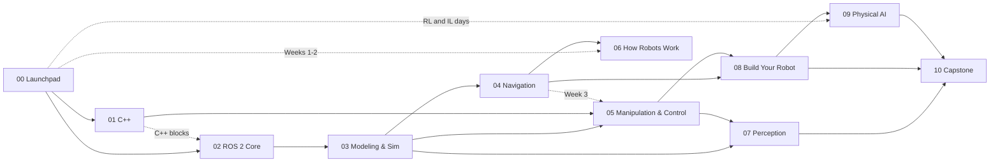

<a id="toc"></a>

# Robotics Mastery — From Zero to Building Robots That Do Wonders

> **Daily:** 2–2.5 h (Mon–Fri) · **Saturday:** 4 h build · **Sunday:** 1.5 h reading
> **Duration:** Week 0 + 26 weeks, about six months (Nov 23, 2026 → May 30, 2027 if you start tomorrow). See [Timeline: An Honest Accounting](#timeline)
> **Based on:** The Construct's Robotics Developer Masterclass (2027 syllabus), **plus everything it does not cover**: robot learning (RL, imitation learning, VLAs), NVIDIA Isaac Sim / Lab / ROS, electronics, firmware and mechanical design, and much deeper perception
> **Stack:** Ubuntu 24.04 · ROS 2 Jazzy · Gazebo Harmonic · Nav2 · MoveIt 2 · ros2_control · Isaac Lab 3.0 · Isaac Sim 6.2 · Isaac ROS 4.6 · LeRobot
> **Structure:** one folder per phase, each with its own day-by-day plan. **Start where you like** (see [Phase Map & Entry Points](#phase-map))
> **End goal:** design, build, program and teach your own robot (a mobile base with an arm) that maps, navigates, sees, manipulates, learns new skills and takes instructions in plain language

> 📍 **You are here:** not started · **Next:** `00_Launchpad`, Week 0, Day 1. Ask Cursor for **"P00·W0·D1"**
> *(Update this line whenever you finish a day.)*

---

## 📑 Table of Contents

### 🎯 Getting Started
- [North Star](#north-star)
- [What You Will Be Able to Build and Understand](#build-and-understand)
- [The Masterclass, Mapped](#masterclass-mapped)
- [State of the Robotics Stack (Snapshot: November 2026)](#state-of-the-stack)
- [Your Lab](#your-lab)

### 🗺 The Plan
- [Phase Map & Entry Points (Start Anywhere)](#phase-map)
- [What You Learn, Phase by Phase](#what-you-learn)
- [Timeline: An Honest Accounting](#timeline)
- [The 27-Week Calendar](#calendar)

### 🛠 How It Works
- [How To Use This Folder](#how-to-use)
- [How the Daily Notes Work](#daily-notes)
- [Project Philosophy: Fun + Real + Cumulative](#project-philosophy)
- [🏆 Project Catalog](#project-catalog)
- [🛒 Hardware: What and When](#hardware)
- [⚠️ Safety Rules](#safety)

### 📈 Staying on Track
- [Expertise Gates](#gates)
- [Retention: Still Knowing Month 1 in Month 6](#retention)
- [When You Fall Behind](#falling-behind)
- [How This Folder Relates to Your Other Tracks](#other-tracks)
- [⚡ The NVIDIA / Physical-AI Angle](#nvidia-angle)
- [Beyond Six Months](#beyond)

### 📦 Reference
- [Repo Layout & GitHub Setup](#repo-layout)
- [Progress Overview & Catch-up Ledger](#progress)
- [Appendix: Resources](#resources)

### 📂 Phase Folders
| # | Phase | Weeks |
|---|---|---|
| 00 | [Launchpad: Lab, Linux, Python, Git, Math](00_Launchpad/README.md) | 1 |
| 01 | [Modern C++ for Robotics](01_Cpp_for_Robotics/README.md) | 3 |
| 02 | [ROS 2 Core: First Node to Intermediate](02_ROS2_Core/README.md) | 3 |
| 03 | [Robot Modeling & Simulation: URDF, TF, Gazebo, ros2_control](03_Modeling_and_Simulation/README.md) | 2 |
| 04 | [Navigation: SLAM, Localization, Nav2](04_Navigation_Nav2/README.md) | 2 |
| 05 | [Manipulation & Control: ros2_control, MoveIt 2, Mobile Manipulation](05_Manipulation_and_Control/README.md) | 3 |
| 06 | [How Robots Really Work: Math, Kinematics, Control, Estimation, Planning](06_How_Robots_Really_Work/README.md) | 3 |
| 07 | [Perception & Vision: Cameras, 3D, Deep Learning, VSLAM, Isaac ROS](07_Perception_and_Vision/README.md) | 2 |
| 08 | [Build Your Own Robot: Electronics, Firmware, Mechanics, Shipping Software](08_Build_Your_Own_Robot/README.md) | 3 |
| 09 | [Physical AI & NVIDIA Isaac: Robots That Learn](09_Physical_AI_and_Isaac/README.md) | 3 |
| 10 | [Capstone & Portfolio](10_Capstone_and_Portfolio/README.md) | 2 |

Also: [`SETUP.md`](SETUP.md) (build the lab) · [`HARDWARE.md`](HARDWARE.md) (what to buy, when) ·
[`my_robot/`](my_robot/README.md) (your robot's growing codebase) · [`journal/`](journal/README.md) ·
[`setup/`](setup/README.md) (sync and check scripts) · [`_templates/`](_templates/DAY_TEMPLATE.md)

---

<a id="north-star"></a>

## North Star

Become the kind of robotics engineer who can take a robot from idea to working machine, through every layer:

```text
mechanics & power → electronics & firmware → drivers (ros2_control) → middleware (ROS 2, DDS/Zenoh)
→ perception & state estimation → planning & control → behaviours & tasks → learning (RL, IL, VLAs)
→ people (voice, dashboard, safety)
```

Most robotics engineers are deep in one or two of those layers and treat the rest as black boxes. This
roadmap makes you **T-shaped**: broad enough to design, wire, program and ship a whole robot yourself, and
deep enough in the software layers (ROS 2, navigation, manipulation, robot learning) that teams want to hire
you for them.

After this roadmap you should not merely "know ROS." You should be able to:

- Design a robot in CAD and URDF, wire its power and electronics safely, write its firmware, and bring it up
- Write production-quality ROS 2 code in C++ and Python, and choose executors, QoS and middleware deliberately
- Make a robot map, localize and navigate, and write the algorithms behind that yourself
- Make an arm find, pick and place objects, with MoveIt and with policies you trained from your own demonstrations
- Train robot skills with reinforcement learning in Isaac Lab and deploy them through ROS 2
- Put an AI agent in front of a robot so people can give it instructions in plain language, safely
- Ship robot software the way professional teams do: tests, Docker, CI, documentation, safety cases

The journey is deliberately hard. Robots fail physically, intermittently, and in ways simulation never
showed you. The reward is rare: very few people can hold the electronics, the math, the middleware and the
machine learning in their head at once. That intersection is where the most interesting robots get built.

---

<a id="build-and-understand"></a>

## What You Will Be Able to Build and Understand

### Build

- **Your own robot, Rover-1:** designed by you, wired by you, with your firmware. It maps your home, knows
  where it is, and drives to any room you click on a browser dashboard. Its software runs from the same
  Docker image in simulation and on hardware, and CI tests every change
- **An arm that sees and grasps:** it finds an object with a camera, works out where it is in 3D, plans a
  collision-free motion and picks it up, with MoveIt *and* with a policy you trained from your own demonstrations
- **A mobile manipulator** that drives to a shelf, picks an item and delivers it (simulated in Phase 05, real
  by the capstone)
- **Your own navigation stack** (EKF, particle filter, A*/Hybrid-A*, pure pursuit/MPC) written from scratch
  and benchmarked against Nav2
- **Your own kinematics library and controllers:** forward and inverse kinematics, Jacobians, PID, LQR, MPC
- **A quadruped walking policy** trained with reinforcement learning in Isaac Lab and deployed through ROS 2
- **A robot you command by voice** through an AI agent, with guardrails that refuse unsafe requests
- **Custom ROS 2 plugins:** a Nav2 planner, behaviour-tree nodes, a ros2_control hardware interface and
  controller, a Gazebo system plugin
- **Your own mini middleware (MiniROS)**, so ROS 2's design makes sense from the inside
- **A portfolio** of 10+ projects with demo videos and write-ups

### Understand

- **How robot software is organised:** small programs (nodes) sharing data through topics, services and
  actions, managed by lifecycles, composed into processes, carried by DDS or Zenoh, and *why* it is built
  that way, because you built a small version yourself
- **Frames and transforms, in your bones:** turning "the cup is 30 cm in front of the camera" into "move
  the gripper here relative to the arm's base" is a TF problem, and it comes up every single day
- **How robots know where they are:** Bayes filters, Kalman filters, particle filters, SLAM, and why they
  fail when they fail
- **How robots decide where to go and how to move:** graph search, sampling-based planning, trajectory
  optimisation, PID, LQR, MPC, pure pursuit
- **How robots see:** camera models, calibration, classical vision, deep-learning detectors, point clouds,
  visual SLAM, GPU-accelerated pipelines
- **How electrons become motion:** batteries, regulators, motor drivers, encoders, closed-loop firmware,
  real-time constraints
- **How robots learn:** reinforcement learning, imitation learning, vision-language-action models, and how
  simulation plus domain randomisation crosses the gap to reality
- **How professional teams ship robots:** Git, tests, Docker, CI, safety cases

---

<a id="masterclass-mapped"></a>

## The Masterclass, Mapped

This roadmap follows the structure and topics of The Construct's
[Robotics Developer Masterclass](https://www.theconstruct.ai/robotics-developer/) (240 hours, next batch
**January 4, 2027**), split into finer phase folders so you can start in the middle, then adds the areas
the masterclass explicitly does not teach.

| Masterclass (2027) | ≈ Hours | This roadmap | Path A weeks |
|---|---|---|---|
| Prerequisites: Linux, Python 3, high-school math | — | **00 Launchpad** | W0 |
| **Phase 1, Foundations:** Git, C++ → advanced modern C++, ROS 2 basics, URDF, TF, Gazebo Sim, vibe coding, City Lab project | ~60 | 00 (Git) · **01 C++** · **02** Weeks 1–2 · **03** → 🏆 CityBot Challenge | W1–8 |
| **Phase 2, ROS 2 Developer:** intermediate ROS 2 (parameters, threading, QoS, DDS, lifecycle), Nav2, advanced Nav2, MoveIt 2 + perception, ros2_control + quadruped, agentic robotics, Warehouse Lab project | ~70 | **02** Week 3 · **04** → 🏆 ButlerBot · **05** → 🏆 WarehouseBot | W6, W9–13 |
| **Phase 3, How Robots Really Work:** math, mobile and arm kinematics, dynamics and control, state estimation, path planning, Cyber World Lab project | ~50 | **06** → 🏆 NavFromScratch | W14–16 |
| **Phase 4, Build Your Own Robot:** kit assembly, web dashboard, Docker, testing and CI | ~60 (Phases 4–5) | **08** → 🏆 Rover-1 Complete (*designed* by you, not a kit) | W19–21 |
| **Phase 5, Final Project:** camera calibration, café delivery, trash-table picker, shelf return, tic-tac-toe | | **10** (all five options, on your own hardware) | W25–26 |
| **Not in the masterclass** | — | **07** deep perception · **08** electronics, firmware, CAD · **09** RL, imitation learning, VLAs, Isaac Sim/Lab/ROS · safety | W17–24 |

### If you also enroll in the January 4, 2027 batch

On Path A you will be in Week 6 (intermediate ROS 2) when it starts, comfortably ahead of their Phase 1.
Use what the masterclass uniquely offers: **remote access to real robots** (FastBot in the City Lab, an RB-1
base with a UR3e arm in the Warehouse Lab, a ROSbot XL in the Cyber World Lab) to run your phase projects on
industrial hardware, monthly mentor reviews, and the internship guarantee if you finish within six months.
Keep this repo as your notes and as the home for everything they do not teach.

### If you do not enroll

Everything here works with free documentation, books and your own hardware. What you give up is remote
access to industrial robots and the internship guarantee; what you keep is the full syllabus and more.

---

<a id="state-of-the-stack"></a>

## State of the Robotics Stack (Snapshot: November 2026)

Verified in November 2026. Robotics software moves fast: re-check at every phase gate (see the ritual below).

| Fact | Detail |
|---|---|
| **ROS 2 for this roadmap** | **Jazzy Jalisco** (LTS, May 2024 → May 2029) on **Ubuntu 24.04** |
| Newest ROS 2 LTS | **Lyrical Luth** (released May 22, 2026, supported to May 2031). Tier 1 on Ubuntu 26.04; on 24.04 it is Tier 3 (build from source) |
| **Why Jazzy, not Lyrical** | Isaac Sim 6.2 recommends Jazzy on 24.04; Isaac ROS 4.6 is designed and tested for Jazzy; JetPack 7.2 (Jetson) is Ubuntu 24.04. Every NVIDIA tool in this roadmap lines up on Jazzy |
| Simulator pairing | Jazzy ↔ **Gazebo Harmonic** (gz-sim 8, LTS), installed with `ros-jazzy-ros-gz`. Lyrical pairs with Gazebo Jetty |
| Older tutorials | Many still use **Humble** (Ubuntu 22.04, supported to May 2027). Concepts carry over; expect small API differences |
| **Isaac Sim** | **6.2**: Ubuntu 22.04/24.04 or Windows 11. Minimum: RTX 4080-class GPU with **16 GB VRAM**, 32 GB RAM. Built-in ROS 2 Jazzy bridge. GPUs without RT cores (A100, H100) are unsupported |
| **Isaac Lab** | **3.0**, generally available October 20, 2026. Newton (Warp) physics by default, runs **without Isaac Sim**; Python 3.12, PyTorch 2.11 with CUDA 13; a Turing-or-newer GPU; Windows 11 or Ubuntu |
| **Isaac ROS** | **4.6** (August 2026): Jazzy; Jetson Orin and Thor on JetPack 7.2; x86 needs an Ampere-or-newer GPU with 8 GB |
| Jetson | Orin Nano Super Developer Kit **$399** (67 TOPS); JetPack 7.2 = Ubuntu 24.04 |
| Raspberry Pi 5 | $110 (4 GB), $175 (8 GB), $305 (16 GB): memory costs pushed these up sharply since 2025 |
| LeRobot SO-101 | Leader + follower ≈ $237 servo kit + $30 printed frame, or ≈ $284–299 assembled |
| micro-ROS | Jazzy releases for ESP32 (official) and Raspberry Pi Pico (community / PlatformIO) |
| The Construct | Robotics Developer Masterclass: 240 h, Gazebo-based, next batch Jan 4, 2027. FastBot kit €489. Their separate Physical AI Robotics Masterclass (320 h) covers Isaac Lab |

### Keeping this table honest: a ritual, not a hope

**At every phase gate, spend 15 minutes on this table.** Check the ROS 2 and Isaac release notes, fix anything
that changed, and update the snapshot date. A roadmap that quietly drifts from reality is worse than one you
know is dated.

---

<a id="your-lab"></a>

## Your Lab

| What | Where it runs |
|---|---|
| ROS 2, Gazebo, RViz, Nav2, MoveIt, your code | WSL2 `Ubuntu-24.04` on your laptop (Windows 11, Core Ultra, 31.5 GB RAM, RTX 1000 Ada 6 GB) |
| PyTorch, YOLO, Isaac Lab 3.0 (Newton) | Your laptop's RTX GPU |
| Isaac Sim 6.2, VLA fine-tuning | A cloud RTX GPU for a day or two (your laptop has 6 GB of VRAM; Isaac Sim needs 16 GB) |
| Rover-1's brain | Raspberry Pi 5 or Jetson Orin Nano Super, from Phase 08 |
| The arm | LeRobot SO-101, from Phase 09 (or Phase 05 if it arrives early) |

Full detail, including what your laptop can and cannot do, is in [HARDWARE.md](HARDWARE.md). The step-by-step
lab build is [SETUP.md](SETUP.md).

---

<a id="phase-map"></a>

## Phase Map & Entry Points (Start Anywhere)

Each phase is a self-contained folder with its own day-by-day plan, a **"Can I Start Here?"** box, a phase
project and a gate. Folders are numbered in the recommended order, but you are not locked into it.

| # | Folder | Weeks | Masterclass | 🏆 Phase project | Hardware |
|---|---|---|---|---|---|
| 00 | [`00_Launchpad`](00_Launchpad/README.md) | 1 | Prerequisites + Git | Turtle Artist (Saturday build) | — |
| 01 | [`01_Cpp_for_Robotics`](01_Cpp_for_Robotics/README.md) | 3 | Phase 1 (C++) | **MiniROS** | — |
| 02 | [`02_ROS2_Core`](02_ROS2_Core/README.md) | 3 | Phase 1 (basics) + Phase 2 (intermediate) | **RoboTelemetry** | — |
| 03 | [`03_Modeling_and_Simulation`](03_Modeling_and_Simulation/README.md) | 2 | Phase 1 (URDF, TF, Gazebo, City Lab) | **CityBot Challenge** | gamepad (optional) |
| 04 | [`04_Navigation_Nav2`](04_Navigation_Nav2/README.md) | 2 | Phase 2 (Nav2, advanced Nav2) | **ButlerBot** | — |
| 05 | [`05_Manipulation_and_Control`](05_Manipulation_and_Control/README.md) | 3 | Phase 2 (ros2_control, MoveIt, agentic, Warehouse Lab) | **WarehouseBot** | SO-101 (optional) |
| 06 | [`06_How_Robots_Really_Work`](06_How_Robots_Really_Work/README.md) | 3 | Phase 3 (theory, Cyber World Lab) | **NavFromScratch** | — |
| 07 | [`07_Perception_and_Vision`](07_Perception_and_Vision/README.md) | 2 | Beyond (deeper than its perception module) | **SeeAndServe** | depth camera (optional) |
| 08 | [`08_Build_Your_Own_Robot`](08_Build_Your_Own_Robot/README.md) | 3 | Phase 4 + hardware design | **Rover-1 Complete** | Tiers 1–2 |
| 09 | [`09_Physical_AI_and_Isaac`](09_Physical_AI_and_Isaac/README.md) | 3 | Beyond (not covered) | **Talk-to-Robot** | Tier 3 + cloud GPU |
| 10 | [`10_Capstone_and_Portfolio`](10_Capstone_and_Portfolio/README.md) | 2 | Phase 5 (final project) | ⭐⭐ **Capstone** | everything |

### What depends on what



Solid arrows are needed for the phase project; dotted arrows mean only part of the phase depends on it.
The same information as a table:

| Phase | Hard prerequisites | Parts you can do earlier |
|---|---|---|
| 01 C++ | 00 | All of it, in parallel with 02 |
| 02 ROS 2 Core | 00 | The 🐍 track needs no C++; ⚙️ blocks need 01 Weeks 1–2 |
| 03 Modeling & Sim | 02 Week 1 + Week 2 Day 4 | — |
| 04 Navigation | 03 | — |
| 05 Manipulation & Control | 03, 01 | Weeks 1–2 without 04 |
| 06 How Robots Work | 04 (for the project) | Weeks 1–2 need only Python or 01's Eigen day |
| 07 Perception | 02, 03; 05 for picking | Week 1 without 05 |
| 08 Build Your Robot | 03, 04, 05 Week 1 | Week 1 Days 1–3 need nothing (just parts) |
| 09 Physical AI | 08 for the project | Weeks 1–2, Days 1–4 need only Python and a GPU |
| 10 Capstone | Depends on the option you pick | — |

<a id="entry-paths"></a>

### Entry paths

| Path | Order | Good for |
|---|---|---|
| **A — Masterclass order** (recommended) | 00 → 01 → 02 → 03 → 04 → 05 → 06 → 07 → 08 → 09 → 10 | The smoothest dependencies; matches the masterclass |
| **B — ROS first** | 00 → 02 Weeks 1–2 (🐍 track) → 01 → 02 Week 3 + the ⚙️ catch-up → 03 → … | Seeing robots move sooner. Costs 2–3 catch-up days |
| **C — Interleaved** | 00 → 01 and 02 together over six weeks (ROS on Mon/Wed/Fri, C++ on Tue/Thu, alternate Saturdays) → 03 → … | Variety on alternate days; same total time |
| **D — Hardware-hungry** | Path A, plus 08 Week 1 Days 1–3 on Saturdays during Phases 02–05 once Tier 1 parts arrive | Makers. Shortens Phase 08 later |
| **E — AI-curious** | Path A, plus 09's reinforcement-learning days (Isaac Lab) as weekend side quests any time after 00 | Keeping the NVIDIA and AI excitement alive early |
| **F — Theory first** | 00 → 06 Weeks 1–2 → 01 → 02 → … | People who like to understand before they use |

### The rules for starting in the middle

1. **Phase 00 Day 1 and the lab check come first, always.** Nothing works without the lab.
2. **Read the phase's "Can I Start Here?" box** before Day 1. It lists the must-haves and a short bridge kit.
3. **Log every skipped item in the [Catch-up Ledger](#catch-up-ledger)** with a "come back by" week. Skipping
   is fine; forgetting is not.
4. **Never skip a gate permanently.** A gate you postpone goes in the ledger like anything else.
5. **Phase projects need the phases they list.** If one is missing, build the project's simulation-only
   version and come back for the rest.

---

<a id="what-you-learn"></a>

## What You Learn, Phase by Phase

The day-by-day detail lives in each phase's README. This is the overview.

**00 Launchpad (1 week).** A robotics lab you trust: WSL2 + ROS 2 Jazzy + Gazebo Harmonic on your GPU,
sync scripts, a workspace. Linux, Python, Git and the math of "where is that point?", refreshed for robots.
*Build:* Turtle Artist.

**01 Modern C++ for Robotics (3 weeks).** C++20 for a C and Rust programmer: RAII, ownership and move
semantics, smart pointers, STL, lambdas, templates and concepts, threads and atomics, control-loop timing,
CMake, GoogleTest, Eigen. *Builds:* OdomCalc, GridPlanner (A*). *Project:* **MiniROS**, your own pub/sub
middleware with executors and zero-copy.

**02 ROS 2 Core (3 weeks).** Nodes, topics, services, actions, parameters, launch, interfaces, colcon and
rosdep, rosbag2 and Foxglove, time and TF; then intermediate ROS 2: executors and callback groups, QoS, DDS
and Zenoh, lifecycle nodes, components and zero-copy. *Builds:* Turtle Swarm Commander, BlackBox.
*Project:* **RoboTelemetry**.

**03 Robot Modeling & Simulation (2 weeks).** Coordinate frames (REP-103/105), URDF and xacro with real
inertias, tf2 in depth, Gazebo Harmonic worlds and sensors, `ros_gz`, `ros2_control` in simulation, Gazebo
plugins, coding with AI responsibly. Your robot is born. *Build:* Robot Designer. *Project:* **CityBot
Challenge** (the City Lab).

**04 Navigation (2 weeks).** SLAM with slam_toolbox, AMCL, sensor fusion with robot_localization, Nav2's
architecture, costmaps, planners and controllers (Smac, MPPI, Regulated Pure Pursuit), behaviour trees and
Groot2, the Simple Commander API, keepout and speed zones, docking, and writing Nav2 plugins. *Build:*
PatrolBot. *Project:* **ButlerBot**.

**05 Manipulation & Control (3 weeks).** ros2_control from the inside (your own hardware interface and
controller), a quadruped exercise, MoveIt 2 (setup, planning from code, planning scene, MoveIt Task
Constructor, Servo), fiducial-based perception, then mobile manipulation, behaviour-tree orchestration and
agentic robotics. *Builds:* Fake-to-Real Driver, Pick-Anything. *Project:* **WarehouseBot** (the
Warehouse Lab).

**06 How Robots Really Work (3 weeks).** Linear algebra, rotations and SE(3), mobile and arm kinematics,
Jacobians and inverse kinematics, dynamics, PID, LQR, MPC, motor sizing, Bayes, Kalman and particle filters,
search-based and sampling-based planning, all implemented by you. *Builds:* KinLab, Balance & Track.
*Project:* **NavFromScratch** (the Cyber World Lab).

**07 Perception & Vision (2 weeks).** Camera models and calibration, OpenCV, AprilTags, YOLO with TensorRT,
segmentation and open-vocabulary detection, point clouds, 3D object pose, visual and lidar SLAM, Isaac ROS
and NITROS, perception engineering. *Build:* TagNav + Detect. *Project:* **SeeAndServe** (hand-eye
calibration + café delivery).

**08 Build Your Own Robot (3 weeks).** Power and batteries, microcontrollers, motors and encoders, closed-loop
firmware, micro-ROS, failsafes, CAD and fabrication, robot-computer bring-up, calibration, real-world SLAM and
Nav2, then a web dashboard, Docker, testing and CI. *Builds:* Wheel Module, First Autonomous Run.
*Project:* **Rover-1 Complete**.

**09 Physical AI & NVIDIA Isaac (3 weeks).** PyTorch, reinforcement learning and PPO, Isaac Lab locomotion,
sim-to-real and policy deployment through ROS 2, Isaac Sim with your robot, imitation learning with LeRobot
on the real SO-101, VLAs (SmolVLA, π0, GR00T), agentic robotics, speech, and safety standards. *Builds:*
WalkerBot, Learned Grasp. *Project:* **Talk-to-Robot**.

**10 Capstone & Portfolio (2 weeks).** One signature project on real hardware (the masterclass's five final
projects plus more ambitious options), made reliable, documented, filmed, written up and presented.

---

<a id="timeline"></a>

## Timeline: An Honest Accounting

| Item | Hours |
|---|---|
| Weekdays: 5 × 2–2.5 h | 10–12.5 |
| Saturday build | 4 |
| Sunday reading and review | 1.5 |
| **Per week** | **15.5–18** |
| **× 27 weeks (Week 0 + 26)** | **≈ 420–490** |

The masterclass is 240 hours. You will cover all of its topics, in more depth where you implement things
yourself (C++, ROS 2 internals, the theory phase), and spend roughly another 200–250 hours on what it leaves
out: robot learning, NVIDIA Isaac, electronics, firmware and mechanical design, and deeper perception.

That fits in six months only if nothing goes wrong, and things will:

- **Hardware arrives when it arrives.** Imports and customs can take weeks; that is why [HARDWARE.md](HARDWARE.md) has order-by dates
- **Phase projects run long.** They are budgeted at a weekend (6–8 hours), and some will take more
- **Holidays.** On Path A, Christmas and New Year land in Weeks 4–5
- **Your job.** You work full time; crunches, travel and illness are certainties, not risks
- **Concepts that take longer.** You are told to split a day across two when it needs it. That costs weeks

**Plan for six months. Do not be alarmed by seven or eight.** The 🌶️ (stretch) items in every phase are the
release valve: cut those first. Track your position by **week number completed**, never by the date. The
sequence matters; the calendar is yours to move.

> **If you keep `LKD_RUST` going at the same time:** do not split each evening between two tracks; context
> switching wastes both. Alternate days (for example Robotics on Mon/Wed/Fri/Sat, kernel on Tue/Thu/Sun) and
> expect this track to take 10–12 months. Or pause one at a natural boundary. Decide in Week 0 and write the
> decision in the journal.

---

<a id="calendar"></a>

## The 27-Week Calendar (Path A)

Dates assume Week 0 starts on **Monday, November 23, 2026**. 🏆 marks a phase-project weekend.

| Week | Dates | Phase · week | Focus | 🔨 Saturday |
|---|---|---|---|---|
| 0 | Nov 23 – Nov 29 | 00 | Lab, Linux, Python, Git, math | Turtle Artist |
| 1 | Nov 30 – Dec 6 | 01 · W1 | Core C++, RAII, ownership | OdomCalc |
| 2 | Dec 7 – Dec 13 | 01 · W2 | STL, lambdas, templates | GridPlanner |
| 3 | Dec 14 – Dec 20 | 01 · W3 | Concurrency, CMake, tests, Eigen | 🏆 MiniROS |
| 4 | Dec 21 – Dec 27 | 02 · W1 | The ROS 2 graph | Turtle Swarm Commander |
| 5 | Dec 28 – Jan 3 | 02 · W2 | Tools, build system, time, TF | BlackBox |
| 6 | Jan 4 – Jan 10 | 02 · W3 | Executors, QoS, DDS, lifecycle, components *(masterclass batch starts Jan 4)* | 🏆 RoboTelemetry |
| 7 | Jan 11 – Jan 17 | 03 · W1 | Frames, URDF, xacro, tf2 | Robot Designer |
| 8 | Jan 18 – Jan 24 | 03 · W2 | Gazebo, ros2_control, plugins | 🏆 CityBot Challenge |
| 9 | Jan 25 – Jan 31 | 04 · W1 | SLAM, localization, Nav2 | PatrolBot |
| 10 | Feb 1 – Feb 7 | 04 · W2 | Advanced Nav2, plugins | 🏆 ButlerBot |
| 11 | Feb 8 – Feb 14 | 05 · W1 | ros2_control from the inside | Fake-to-Real Driver |
| 12 | Feb 15 – Feb 21 | 05 · W2 | MoveIt 2 *(order Tier 1 parts by Feb 15)* | Pick-Anything v1 |
| 13 | Feb 22 – Feb 28 | 05 · W3 | Mobile manipulation, agents | 🏆 WarehouseBot |
| 14 | Mar 1 – Mar 7 | 06 · W1 | Math, kinematics *(order Rover-1 parts by Mar 1)* | KinLab |
| 15 | Mar 8 – Mar 14 | 06 · W2 | Dynamics, control | Balance & Track |
| 16 | Mar 15 – Mar 21 | 06 · W3 | Estimation, planning *(order SO-101 by Mar 15)* | 🏆 NavFromScratch |
| 17 | Mar 22 – Mar 28 | 07 · W1 | Cameras, 2D vision, detection | TagNav + Detect |
| 18 | Mar 29 – Apr 4 | 07 · W2 | 3D perception, SLAM, Isaac ROS | 🏆 SeeAndServe |
| 19 | Apr 5 – Apr 11 | 08 · W1 | Electronics, firmware | Wheel Module |
| 20 | Apr 12 – Apr 18 | 08 · W2 | CAD, build, bring-up, real Nav2 | First Autonomous Run |
| 21 | Apr 19 – Apr 25 | 08 · W3 | Dashboard, Docker, tests, CI | 🏆 Rover-1 Complete |
| 22 | Apr 26 – May 2 | 09 · W1 | RL, Isaac Lab, Isaac Sim | WalkerBot |
| 23 | May 3 – May 9 | 09 · W2 | Imitation learning on the SO-101 | Learned Grasp |
| 24 | May 10 – May 16 | 09 · W3 | VLAs, agents, safety | 🏆 Talk-to-Robot |
| 25 | May 17 – May 23 | 10 · W1 | Capstone build | First full demo run |
| 26 | May 24 – May 30 | 10 · W2 | Polish, ship, present | 🎉 Demo Day |

---

<a id="how-to-use"></a>

## How To Use This Folder

- **The plan lives in each phase's README.** Tick items (`[ ]` → `[x]`) as you finish them, add ✅ to a day's
  heading when the day is done, and update the 📍 line at the top of this file
- **A day is 2–2.5 hours.** If one takes longer, split it across two days. There is no prize for speed
- **Saturday:** build something that runs and can be shown to another person; record a GIF.
  **Sunday:** read, then 15 minutes of retention
- **Predict before you run, and break things on purpose.** The lessons are written that way for a reason
- **Simulation first, then real.** Every feature works in simulation before it touches hardware, and every
  simulation result is labelled as one
- **Record a bag of every run you might want to talk about**, and write in the journal the same day
- **Use AI (Cursor) as a tutor, a pair programmer and a ruthless reviewer.** But never run code on a real
  robot that you have not read line by line and tested in simulation. A bug in a robot moves mass
- **Commit at the end of every session** (once you have initialised the repo). Not "when it is finished"
- **Spend the last 15 minutes on retention**, not new material (see [Retention](#retention))
- **When a week goes wrong, read [When You Fall Behind](#falling-behind)** instead of improvising

### The one rule that beats all the others

> **Run it.** A robot change that has not run, in simulation and then on hardware, does not exist. If you
> have not run it, you cannot claim it works.

---

<a id="daily-notes"></a>

## How the Daily Notes Work

| File | Role |
|---|---|
| This README | The map: phases, paths, timeline, projects, hardware |
| `<phase>/README.md` | The plan: every week, every day's topics, the Saturday build, Sunday reading, the phase project, the gate |
| `<phase>/theory/Week_N/Day_N.md` | The lesson for one day: **generated when you reach that day**, never in advance |
| `<phase>/codes/Week_N/Day_N/` | That lesson's code, at the same coordinates |
| `journal/` | Your record: what broke, the numbers, what you did not understand |

### Getting the next lesson

Ask Cursor for it by its ID, or just say "next day":

> **"Generate P02·W1·D3"** = Phase 02, Week 1, Day 3. Saturday builds are `P02·W1·SAT`; phase projects are
> `P02·PROJECT`.

The lesson is built from four things: that day's checklist in the phase README, the previous lesson (its
"Next:" line and anything you said you did not understand), your recent journal entries, and the
[Catch-up Ledger](#catch-up-ledger). It follows [`_templates/DAY_TEMPLATE.md`](_templates/DAY_TEMPLATE.md),
the same shape as your `LKD_RUST` lessons: a time table, "🆕 New" boxes, predict-then-run examples with real
output, deliberate errors, a "Your Turn" exercise, a `check_dayN.sh` script, "My Notes", "Done When", and a
revision section to read first when you come back.

**Why not generate a whole week at once?** Because today's mistakes and questions should shape tomorrow's
lesson. A lesson written before you have done the previous day is just the plan, copied twice.

### Markers you will see

| Marker | Meaning |
|---|---|
| 🐍 | Python track |
| ⚙️ | C++ track (needs Phase 01) |
| 🧮 | Math and theory |
| 🔧 | Hands-on hardware |
| ☁️ | Needs a cloud GPU |
| 🌶️ | Stretch: optional, cut first when behind |

---

<a id="project-philosophy"></a>

## Project Philosophy: Fun + Real + Cumulative

Three kinds of project, each with a job:

- **🔨 Saturday builds** (one a week): something that runs and can be shown. Small, fun, finished
- **🏆 Phase projects** (one per phase): portfolio pieces, assembled from that phase's daily code plus earlier
  phases. Budget a whole weekend
- **⭐⭐ The capstone:** one signature project on real hardware

**The cumulative rule:** a phase project in Phase N must visibly use skills from earlier phases, and its
README must say which and where. MiniROS explains ROS 2; your Phase 01 A* becomes a Nav2 plugin in Phase 04
and a Hybrid-A* in Phase 06; your Phase 05 hardware interface drives real motors in Phase 08; your Phase 06
PID runs on the ESP32. Nothing is thrown away.

### Every project README includes

- **User:** who this helps (you in three months counts)
- **Problem:** what slow, confusing or dangerous thing it fixes
- **What is new:** a capability, a measurement, or a comparison that tutorials do not give you
- **Skills from earlier phases:** which, and where in the code
- **Evidence:** success rate over N trials, benchmark table, plots, a bag, a video
- **Reproduce:** one command (a launch file, later a Docker command)
- **Safety notes** for anything that moves on hardware

### Definition of Done (phase projects)

- [ ] It runs from one command, from a clean build
- [ ] A measured result over repeated trials, not "it worked once"
- [ ] Tests for the core logic
- [ ] An architecture diagram and a README someone else could follow
- [ ] A demo GIF or video
- [ ] A short write-up of the hardest problem you hit
- [ ] Reusable code graduated into [`my_robot/`](my_robot/README.md)

### Anti-tutorial rule

You may learn from tutorials; your phase projects must not look like one. Each must add at least one
original capability, compare against a baseline (Nav2, MoveIt, a stock controller, "no tool at all") with
numbers, and explain one design decision with physical, mathematical or software reasoning.

### Novelty scorecard (for the capstone and your own ideas)

| Question | Must be true |
|---|---|
| Who is it for? | A specific person or use exists |
| What is new? | Not a tutorial re-run: a new capability, combination, or measurement |
| What will you measure? | Success rate, accuracy, time, latency, CPU, cost |
| Which phases show? | At least four, named in the README |
| Can someone else run it? | Documented setup, Docker, sane defaults |

---

<a id="project-catalog"></a>

## 🏆 Project Catalog

### Saturday builds

| Phase | Week 1 | Week 2 | Week 3 |
|---|---|---|---|
| 00 | Turtle Artist + lab check | | |
| 01 | OdomCalc: odometry from encoder logs | GridPlanner: A* on Nav2-format maps | 🏆 MiniROS |
| 02 | Turtle Swarm Commander | BlackBox: a flight recorder for robots | 🏆 RoboTelemetry |
| 03 | Robot Designer: your robot in URDF | 🏆 CityBot Challenge | |
| 04 | PatrolBot | 🏆 ButlerBot | |
| 05 | Fake-to-Real Driver | Pick-Anything v1 | 🏆 WarehouseBot |
| 06 | KinLab: your kinematics library | Balance & Track: LQR + MPC | 🏆 NavFromScratch |
| 07 | TagNav + Detect: a semantic object map | 🏆 SeeAndServe | |
| 08 | Wheel Module | First Autonomous Run (real home) | 🏆 Rover-1 Complete |
| 09 | WalkerBot: learned quadruped gait | Learned Grasp: real SO-101 | 🏆 Talk-to-Robot |

### Phase projects

| Project | What it is | Why it is exciting |
|---|---|---|
| **MiniROS** (01) | Your own typed pub/sub middleware with executors and zero-copy | You will understand ROS 2 from the inside before you use it |
| **RoboTelemetry** (02) | Fleet health monitor with QoS by design and a black-box recorder | Real debugging infrastructure, and a written MiniROS-vs-rclcpp comparison |
| **CityBot Challenge** (03) | Lane following, obstacle stops, tunnel, parking in a simulated city, scored by a referee node | Your robot's first autonomy; the masterclass's City Lab |
| **ButlerBot** (04) | Home-service robot: room-name requests, battery-aware docking, keepout zones, your own planner plugin | "Go to the kitchen" just works |
| **WarehouseBot** (05) | Mobile manipulator: navigate, align, detect, pick, deliver, from plain-language requests | The masterclass's Warehouse Lab, on your own robot |
| **NavFromScratch** (06) | Your EKF + particle filter + planner + controller, benchmarked against Nav2 | The masterclass's Cyber World Lab: proof you understand the theory |
| **SeeAndServe** (07) | Hand-eye calibration, then a vision-guided pick handed to a delivery robot | Two masterclass final projects in one |
| **Rover-1 Complete** (08) | Your real robot: mapped home, dashboard, Docker, CI, published CAD and BOM | A robot you designed and built, driving around your home |
| **Talk-to-Robot** (09) | Voice → agent → real rover + learned arm policy, with guardrails | It feels like the future, because it is |

### Capstone options (Phase 10)

The masterclass's five final projects on your own hardware (Robot Café, Tic-Tac-Toe Arm, Hand-Eye
Calibration Studio, Tidy-Up Bot, Shelf Returner), plus a Learned Quadruped, a production-grade Talk-to-Robot,
or your own idea. Details in [`10_Capstone_and_Portfolio`](10_Capstone_and_Portfolio/README.md).

### The Wonder List (for after the roadmap, or for a spare weekend)

A self-balancing robot (LQR on real hardware) · a portrait-drawing arm · a Rubik's-cube solver · a
chess-playing arm · a plant-watering robot · an autonomous RC car (F1TENTH-style) · a drone with PX4 and ROS 2
offboard control · a swarm of tiny ESP32 robots on micro-ROS · a LeKiwi (LeRobot's mobile manipulator) · a
telepresence robot · a cocktail-mixing arm · a humanoid policy trained in Isaac Lab.

---

<a id="hardware"></a>

## 🛒 Hardware: What and When

| Tier | What | First needed | Order by (Path A) | ≈ Cost |
|---|---|---|---|---|
| 0 | Your laptop | Week 0 | — | ₹0 |
| 1 | Electronics starter kit + bench tools | Phase 08 W1 (Week 19) | Feb 15, 2027 | ₹8–14k |
| 2 | Rover-1: Pi 5 or Jetson, RPLIDAR C1, encoder motors, battery, chassis | Phase 08 W2 (Week 20) | Mar 1, 2027 | ₹35–45k (Pi) / ₹60–75k (Jetson) |
| 3 | LeRobot SO-101, leader + follower | Phase 09 W2 (Week 23) | Mar 15, 2027 | ₹28–40k |
| 4 | Depth camera, Jetson, 3D printer, logic analyser, gamepad | Optional | as wanted | ₹10–60k |
| ☁️ | Cloud RTX GPU hours (Isaac Sim, VLA fine-tuning) | Phase 09 W1 (Week 22) | account by Apr 26 | $30–80 |

**Core total ≈ ₹75k–1.1 lakh, spread from February to March, and nothing needs buying before then.**
Full parts lists, alternatives (including the FastBot kit), Indian suppliers, a contingency plan and the
laptop's limits are in [HARDWARE.md](HARDWARE.md).

---

<a id="safety"></a>

## ⚠️ Safety Rules

Non-negotiable, every hardware session. The full version is in [HARDWARE.md](HARDWARE.md#safety).

1. **Lithium batteries:** balance charger, LiPo bag, non-flammable surface, **never unattended**. Never use a
   puffed or damaged pack
2. **Every robot has a fuse near the battery and a physical power switch** (an e-stop from Phase 08 onward)
3. **First test of any new motion code: wheels off the ground.** First power-up of new electronics:
   current-limited supply
4. **Firmware watchdog:** motors stop when commands stop. Software speed and acceleration limits on top
5. **Arms:** stay out of reach while powered; lower torque limits when testing new code
6. **AI-written or learned behaviour never runs on hardware untested in simulation**, and always runs behind
   guardrails
7. **Privacy:** maps and camera recordings of your home stay in `_internal/`, never in the public repo

---

<a id="gates"></a>

## Expertise Gates

Each phase README ends with a concrete gate. Monthly, these are the questions that matter:

| End of | You should be able to |
|---|---|
| **Month 1** (Week 4) | Write tested, sanitizer-clean, multithreaded C++20 with CMake. Your own pub/sub middleware runs. First ROS 2 nodes in Python |
| **Month 2** (Week 8) | Build multi-package ROS 2 systems in both languages and choose QoS and executors deliberately. Your robot exists in URDF and Gazebo, and CityBot passes its course |
| **Month 3** (Week 13) | Configure and extend Nav2 and MoveIt. A simulated mobile manipulator fetches and delivers items from plain-language requests |
| **Month 4** (Week 18) | Derive and implement kinematics, filters, planners and controllers; your navigation stack is benchmarked against Nav2. You build calibrated 2D and 3D perception pipelines |
| **Month 5** (Week 22) | Your own physical robot maps and navigates your home, with a dashboard, Docker images and CI |
| **Month 6** (Week 26) | Robots that learn: RL in Isaac Lab, imitation learning on a real arm, VLAs and agents. A capstone shipped with video, write-up and talk |

If a gate feels weak, stop and build one more small thing before moving on. Compounding correctly beats speed.

---

<a id="retention"></a>

## Retention: Still Knowing Month 1 in Month 6

Six months at this pace is roughly 450 hours and thousands of facts. A journal records; it does not
maintain. Three cheap habits do:

### 1. A deck, not just a journal

Keep around 150 flashcards (Anki, or a text file you shuffle) for facts that are cheap to forget and
expensive to look up mid-debug. **Add a card the second time you look something up**; that trigger is the
whole system. Typical cards:

- ROS messages store quaternions as (x, y, z, w); Eigen's constructor takes (w, x, y, z)
- REP-103: X forward, Y left, Z up; REP-105: who publishes `map → odom` and `odom → base_link`
- A reliable subscriber hears nothing from a best-effort publisher
- The EKF prediction and update equations
- Differential-drive forward kinematics
- The order of ros2_control's `read()` → controllers' `update()` → `write()`
- A LiPo cell's safe voltage range

### 2. The re-derive drill

At every phase gate, **on paper, before opening any notes**: draw your robot's TF tree; sketch Nav2's
servers; write the DH table for the SO-101; write the Kalman filter equations; draw the path from
`/cmd_vel` to a wheel and back to `/odom`. Whatever you cannot produce cold goes on next week's list.

### 3. The teach test

Once a month, explain one concept to a real person who asks follow-up questions: a colleague, a friend, a
forum. Answering a stranger's question on ROS Discourse, Robotics Stack Exchange or a Discord counts double:
retention *and* reputation, in twenty minutes.

---

<a id="falling-behind"></a>

## When You Fall Behind (You Will)

Long self-study plans usually die the same way: a two-week interruption becomes a gap, the gap becomes
guilt, and the guilt makes reopening the plan unpleasant. Decide now how you will handle it.

### The triage rule

When a week has less time than it needs, cut in exactly this order:

1. **Never cut the Saturday build; cut its scope.** A v0.1 that runs beats a v1.0 you imagined
2. **Cut 🌶️ stretch items first.** That is what they are for
3. **On days with 🐍 and ⚙️ versions, do one language** (except in Phase 01 and Phase 05 Week 1)
4. **Cut Sunday reading to one item**
5. **Never skip a gate.** If it fails, take a buffer week: move the date, not the content

### Minimum viable week

Three 45-minute sessions, one simulation run, three journal lines. It keeps the two things that are
expensive to rebuild: a working lab and an unbroken habit.

### Getting back after a real gap

- [ ] Run `bash ~/Robotics/setup/check_lab.sh` and fix the lab first
- [ ] `rpull`, rebuild your last phase's code from clean
- [ ] Re-read your last three journal entries, not the roadmap
- [ ] Redo your most recent Saturday build from memory; it tells you exactly what you lost
- [ ] Resume where you stopped. **Do not** compress two weeks into one to catch up
- [ ] Move the date, not the content. Nobody but you enforces these deadlines

> **The only real failure is stopping permanently.** A month off followed by a return is a rounding error.

---

<a id="other-tracks"></a>

## How This Folder Relates to Your Other Tracks

| Folder | What it gives you | Where it feeds this roadmap |
|---|---|---|
| `LKD_RUST/` | Linux internals, drivers, concurrency, Rust | Device access on the robot computer (serial, I2C/SPI/GPIO, udev), real-time Linux (PREEMPT_RT), firmware discipline. Later options: Rust for ROS 2 (`rclrs`) and embedded Rust on the ESP32/RP2040 |
| `AI_ML_LLM/` | PyTorch, transformers, LLM agents | Phase 09 (VLAs, agents) and Phase 07 (detectors) |
| `CUDA/` | GPU programming | Isaac ROS and TensorRT (Phase 07); Isaac Lab's Newton physics is written in Warp, Python that compiles to CUDA kernels |
| `HFT/` | Low-latency C++ | Phase 01 Week 3, ros2_control's real-time loops, executors |
| `Projects/` (ray tracing, game worlds, culling, Vite apps) | 3D math, rendering, three.js | Transforms (03, 06), Isaac Sim's rendering and USD (09), the dashboard's 3D view (08) |

---

<a id="nvidia-angle"></a>

## ⚡ The NVIDIA / Physical-AI Angle

This is a robotics roadmap first. But one intersection is worth being deliberate about: **GPUs are becoming
the robot's other brain**, for perception on the robot, for simulation and synthetic data, and for learning
skills. Few people can work across both the ROS side and the GPU side.

```text
   behaviour & instructions        behaviour trees · LLM agents · VLAs (GR00T, π0, SmolVLA)
            │
   learning                        Isaac Lab (Newton / PhysX) · LeRobot · Cosmos world models
            │
   simulation & synthetic data     Isaac Sim (USD, RTX, Replicator) · Gazebo · MuJoCo
            │
   GPU perception & planning       Isaac ROS (NITROS, cuVSLAM, nvblox, FoundationPose) · cuMotion
            │
   middleware                      ROS 2 on DDS or Zenoh · type adaptation (REP-2007/2009)
            │
   edge computer                   Jetson Orin Nano Super / Thor (JetPack 7.2)
            │
   motors & sensors                ros2_control · micro-ROS
```

| NVIDIA piece | Where in this roadmap |
|---|---|
| Type adaptation / NITROS | 02 Week 3 Day 5 (concept), 07 Week 2 Day 4 (hands-on) |
| Isaac ROS (cuVSLAM, nvblox, FoundationPose) | 07 Week 2 Day 4; on the Jetson in 08 |
| TensorRT | 07 Week 1 Day 4 |
| GPU motion planning (cuRobo / cuMotion) | 06 Week 1 Day 5 (context) |
| Isaac Lab 3.0 | 09 Week 1 Days 3–4, Week 2 Day 5 (SO-101 sim-to-real) |
| Isaac Sim 6.2 + Replicator | 09 Week 1 Day 5 |
| GR00T, Cosmos | 09 Week 3 Day 1 |
| Jetson Orin Nano Super | 08 (robot computer option), 09 (local agents) |
| NVIDIA's free [Physical AI learning path](https://docs.nvidia.com/learning/physical-ai/index.html) | Sunday reading in 09; take its Isaac Sim, Isaac Lab and Isaac ROS modules alongside |

> **Public sources only.** Everything in this repository must come from public documentation, open-source
> code, books, papers and talks, or from your own work. Internal material, however helpful for
> understanding, never appears in this repo. The rules are in `_internal/README.md`, which is local only
> and never committed.

---

<a id="beyond"></a>

## Beyond Six Months

### Specialisation paths

| Path | What to learn next | Starting points |
|---|---|---|
| **Legged robots and humanoids** | Whole-body control, MPC for locomotion, large-scale RL, humanoid foundation models | Isaac Lab humanoid tasks, GR00T, Tedrake's *Underactuated Robotics* |
| **Manipulation and robot learning** | Diffusion and flow policies, dexterous hands, tactile sensing, VLA training | LeRobot, MIT 6.4210, openpi |
| **Aerial robots** | PX4 or ArduPilot, ROS 2 offboard control, visual-inertial odometry | PX4 + ROS 2 (uXRCE-DDS) guides |
| **Autonomous driving** | Autoware, F1TENTH racing, CARLA | F1TENTH course, Autoware docs |
| **Fleets and industry** | Open-RMF, Nav2 at scale, safety certification | Open-RMF docs, ISO 3691-4 |
| **Embedded and hardware** | PCB design in KiCad, BLDC/FOC motor drivers, embedded Rust | Phil's Lab, SimpleFOC, Embassy |
| **A guided next step** | The Construct's Physical AI Robotics Masterclass (320 h, Isaac Lab, robot arm kit) | its 2027 waitlist |

### What this roadmap still does not cover

Honest gaps: PCB design beyond reading schematics, advanced optimal control and whole-body control, formal
safety certification, marine and space robotics, surgical robotics, and research methods (reading and
reproducing papers systematically). Each is a real field; the paths above are the doors.

---

<a id="repo-layout"></a>

## Repo Layout & GitHub Setup

```text
Robotics/
├── README.md                   # this file: the map
├── SETUP.md                    # build the lab (WSL2, ROS 2 Jazzy, Gazebo, GPU, later Docker/USB/cloud)
├── HARDWARE.md                 # what to buy, when, why; safety; contingency
├── LICENSE                     # MIT for these notes and code; third-party assets keep their own licenses
├── .gitignore  .gitattributes  # colcon output, bags, weights blocked; LF endings for Linux files
├── _internal/                  # git-ignored: hostnames, tokens, maps of your home, anything non-public
├── _templates/DAY_TEMPLATE.md  # the shape of every generated lesson
├── setup/                      # sync_from_repo.sh, sync_to_repo.sh, check_lab.sh
├── journal/                    # weekly entries, experiments, incidents, tuning, hardware logs
├── my_robot/                   # your robot's ROS 2 workspace, growing from Phase 03 to Phase 10
├── 00_Launchpad/
│   ├── README.md               # the phase plan, day by day
│   ├── theory/Week_0/Day_1.md  # lessons, generated as you go
│   └── codes/Week_0/Day_1/     # the code for each lesson, mirroring theory/
├── 01_Cpp_for_Robotics/        # same shape in every phase folder
├── ...
└── 10_Capstone_and_Portfolio/
```

```text
<phase>/theory/Week_N/Day_N.md    <->    <phase>/codes/Week_N/Day_N/
```

The theory file explains what you learned; the code folder holds what you ran. Same coordinates, so you never
search for the code that belongs to a lesson.

### Connecting to GitHub (when you are ready)

You initialise the repository yourself. When you do:

```bash
cd Robotics
git init -b main
git add .
git commit -m "Robotics mastery roadmap: phases, setup, hardware plan"
gh repo create robotics-mastery --private --source=. --remote=origin --push
# or: git remote add origin git@github.com:<you>/robotics-mastery.git && git push -u origin main
```

Then pin the repo for OneDrive, `.git` included (SETUP.md, "Where Code Lives").

**Never commit:** colcon `build/`, `install/`, `log/`; bags; datasets; model weights; videos; tokens; maps or
recordings of your home; anything from an employer. `.gitignore` covers the mechanical cases; the last three
are on you.

---

<a id="progress"></a>

## Progress Overview

| # | Phase | Weeks | Path A dates | 🏆 Project | Status |
|---|---|---|---|---|---|
| 00 | Launchpad | 1 | Nov 23 – Nov 29 | Turtle Artist | ⬜ Not started |
| 01 | Modern C++ for Robotics | 3 | Nov 30 – Dec 20 | MiniROS | ⬜ Not started |
| 02 | ROS 2 Core | 3 | Dec 21 – Jan 10 | RoboTelemetry | ⬜ Not started |
| 03 | Modeling & Simulation | 2 | Jan 11 – Jan 24 | CityBot Challenge | ⬜ Not started |
| 04 | Navigation | 2 | Jan 25 – Feb 7 | ButlerBot | ⬜ Not started |
| 05 | Manipulation & Control | 3 | Feb 8 – Feb 28 | WarehouseBot | ⬜ Not started |
| 06 | How Robots Really Work | 3 | Mar 1 – Mar 21 | NavFromScratch | ⬜ Not started |
| 07 | Perception & Vision | 2 | Mar 22 – Apr 4 | SeeAndServe | ⬜ Not started |
| 08 | Build Your Own Robot | 3 | Apr 5 – Apr 25 | Rover-1 Complete | ⬜ Not started |
| 09 | Physical AI & Isaac | 3 | Apr 26 – May 16 | Talk-to-Robot | ⬜ Not started |
| 10 | Capstone & Portfolio | 2 | May 17 – May 30 | ⭐⭐ Capstone | ⬜ Not started |

Status keys: ⬜ Not started · 🟨 In progress · ✅ Done (gate passed)

**My entry path:** _(write A–F here in Week 0)_

<a id="catch-up-ledger"></a>

### Catch-up Ledger

Everything you skip goes here, with a week to come back by. Starting in the middle is fine; losing track is not.

| Skipped item | Why | Needs first | Come back by (week) | Done |
|---|---|---|---|---|
| *e.g. P02·W1·D2 ⚙️ rclcpp publisher/subscriber* | *Path B: C++ not done yet* | *01 Week 2* | *Week 6* | ⬜ |

---

<a id="resources"></a>

## 📦 Appendix: Resources

### Books

| Book | For |
|---|---|
| Lynch & Park, *Modern Robotics* (free PDF + videos) | Kinematics, dynamics, planning, control (06) |
| Thrun, Burgard & Fox, *Probabilistic Robotics* | State estimation and SLAM (04, 06) |
| Siegwart, Nourbakhsh & Scaramuzza, *Introduction to Autonomous Mobile Robots* | Mobile robots end to end |
| Corke, *Robotics, Vision and Control* (3rd ed., Python) | Kinematics and vision with runnable code |
| LaValle, *Planning Algorithms* (free online) | Motion planning (06) |
| Szeliski, *Computer Vision: Algorithms and Applications* (2nd ed., free) | Perception (07) |
| Martín Rico, *A Concise Introduction to Robot Programming with ROS 2* | ROS 2 (02) |
| Stroustrup, *A Tour of C++*; Meyers, *Effective Modern C++*; Williams, *C++ Concurrency in Action* | C++ (01) |
| Sutton & Barto, *Reinforcement Learning: An Introduction* (free) | RL (09) |
| Scherz & Monk, *Practical Electronics for Inventors* | Electronics (08) |
| Åström & Murray, *Feedback Systems* (free) | Control (06) |

### Courses and free online texts

- MIT 6.4210 *Robotic Manipulation* and *Underactuated Robotics* (Russ Tedrake, free online)
- *Modern Robotics* specialisation (Northwestern, Coursera)
- Cyrill Stachniss's lectures on SLAM, estimation and photogrammetry (YouTube)
- Hugging Face Deep RL course and LeRobot tutorials (free)
- NVIDIA's free [Physical AI learning path](https://docs.nvidia.com/learning/physical-ai/index.html) (Isaac Sim, Isaac Lab, Isaac ROS, SO-101 sim-to-real)
- The Construct's free courses (Linux for Robotics, Python 3 for Robotics) and ROS Developers Open Classes

### Documentation you will live in

[ROS 2 Jazzy](https://docs.ros.org/en/jazzy/) · [Nav2](https://docs.nav2.org/) ·
[MoveIt 2](https://moveit.picknik.ai/main/index.html) · [ros2_control](https://control.ros.org/jazzy/index.html) ·
[Gazebo Harmonic](https://gazebosim.org/docs/harmonic/getstarted/) · [Isaac Sim](https://docs.isaacsim.omniverse.nvidia.com/latest/) ·
[Isaac Lab](https://isaac-sim.github.io/IsaacLab/) · [Isaac ROS](https://nvidia-isaac-ros.github.io/) ·
[LeRobot](https://huggingface.co/docs/lerobot) · [micro-ROS](https://micro.ros.org/) · [REPs](https://www.ros.org/reps/rep-0000.html)

### YouTube

Articulated Robotics (building a ROS 2 robot) · The Construct (ROS Developers Open Class) · Brian Douglas /
MATLAB Tech Talks (control, Kalman filters) · Steve Brunton (control) · Cyrill Stachniss (SLAM, vision) ·
3Blue1Brown (linear algebra) · Phil's Lab and GreatScott! (electronics) · ROSCon talks (all years)

### Communities

[ROS Discourse](https://discourse.openrobotics.org/) · [Robotics Stack Exchange](https://robotics.stackexchange.com/) ·
the Nav2, MoveIt and LeRobot Discords · r/ROS and r/robotics · ROSCon (and ROSCon India) · NVIDIA Developer
Forums (Isaac)

[⬆ Back to Table of Contents](#toc)
