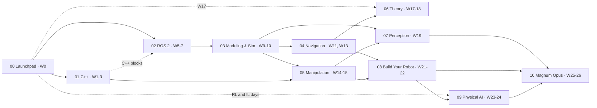

<a id="toc"></a>

# Robotics Mastery — From Zero to Building Robots That Do Wonders

> **Daily: 2–2.5 hours** | **Saturday: 4 hrs project** | **Sunday: 1.5 hrs reading (docs, papers, talks)**
> **Duration:** Week 0 + 26 weeks, **about six months** (Nov 23, 2026 → May 30, 2027 if you start tomorrow). See [Timeline: An Honest Accounting](#timeline)
> **Monthly rhythm:** 3 content weeks, then 1 **buffer week** to revise the month and build its **2 monthly projects**
> **Projects:** 1 weekly project every Saturday + **2 monthly projects** (novel, cumulative, portfolio-ready) + a 2-week **Magnum Opus**
> **Milestone (end of Month 4):** a simulated mobile manipulator that navigates, picks and delivers on a plain-language request
> **End goal:** your own robot, designed and built by you, that maps, navigates, sees, grasps, learns new skills and takes instructions in plain language, and the judgment to build the next one

> 📍 **You are here:** not started · **Next:** Week 0, Day 1 in [`00_Launchpad`](00_Launchpad/README.md). Ask Cursor for **"M1W0D1"**
> *(Update this line whenever you finish a day.)*

---

## 📑 Table of Contents

### 🎯 Getting Started
- [North Star](#north-star)
- [Why Robotics, Why Now (and What Six Months Cannot Do)](#why-robotics)
- [State of the Robotics Stack (Read This Before Planning)](#state-of-the-stack)
- [Your Lab (Hardware & Environment Reality)](#your-lab)
- [Phase Folders & Entry Points (Start Anywhere)](#phase-map)
- [How To Use This File](#how-to-use)
- [Timeline: An Honest Accounting](#timeline)
- [Owning Your Work: Git Discipline For A Six-Month Project](#git-discipline)
- [The Python ⇄ C++ Track](#language-track)
- [Retention: Still Knowing Month 1 When You Reach Month 6](#retention)
- [When You Fall Behind (You Will)](#falling-behind)
- [Project Philosophy: Novel + Useful + Cumulative](#project-philosophy)
- [Expertise Gates](#gates)
- [⚠️ Safety Rules](#safety)
- [How This Folder Relates To Your Other Tracks](#other-tracks)
- [⚡ The NVIDIA / Physical-AI Angle](#nvidia-angle)
- [Repo Layout & GitHub Setup](#repo-layout)
- [Progress Overview](#progress)

### 🏆 Monthly Capstone Project Catalog
- [Month 1 — MiniROS + GridPlanner Bench](#m1-project-a)
- [Month 2 — RoboTelemetry + BlackBox](#m2-project-a)
- [Month 3 — CityBot Challenge + NavBench](#m3-project-a)
- [Month 4 — WarehouseBot ⭐ + MotorBridge](#m4-project-a)
- [Month 5 — NavFromScratch + SeeAndServe](#m5-project-a)
- [Month 6 — Magnum Opus ⭐⭐](#magnum-opus)
- [Monthly Project Tracker (overview table)](#project-tracker)

### 📅 Month-by-Month Focus & Capabilities
- [Month 1 — The Lab + Modern C++](#month-1-focus)
- [Month 2 — ROS 2, From First Node to Intermediate](#month-2-focus)
- [Month 3 — Your Robot in Simulation + Navigation](#month-3-focus)
- [Month 4 — Advanced Navigation + Manipulation ⭐](#month-4-focus)
- [Month 5 — How Robots Really Work + How Robots See](#month-5-focus)
- [Month 6 — Build Your Robot + Robots That Learn + Magnum Opus ⭐⭐](#month-6-focus)

### 🛠 Month 1: The Lab + Modern C++ (Weeks 0–4)
- [Week 0 — Launchpad: Lab, Linux, Python, Git, Math](#week-0)
- [Week 1 — The Core Language, the C/Rust Programmer's Way](#week-1)
- [Week 2 — The Standard Library, Lambdas, and Templates](#week-2)
- [Week 3 — Concurrency, Real Builds, Testing, and Eigen](#week-3)
- [🔄 Buffer Week 4 (Month 1 Revision + Projects)](#buffer-1)

### 🚀 Month 2: ROS 2 (Weeks 5–8)
- [Week 5 — The ROS 2 Graph](#week-5)
- [Week 6 — Tools, the Build System, Time, and First TF](#week-6)
- [Week 7 — Intermediate ROS 2: Executors, QoS, DDS, Lifecycle, Components](#week-7)
- [🔄 Buffer Week 8 (Month 2 Revision + Projects)](#buffer-2)

### 🤖 Month 3: Your Robot in Simulation + Navigation (Weeks 9–12)
- [Week 9 — Describing a Robot: Frames, URDF, Xacro, TF2](#week-9)
- [Week 10 — Gazebo Harmonic and ros2_control](#week-10)
- [Week 11 — Mapping, Localization, and Nav2](#week-11)
- [🔄 Buffer Week 12 (Month 3 Revision + Projects)](#buffer-3)

### 🦾 Month 4: Advanced Navigation + Manipulation (Weeks 13–16) ⭐
- [Week 13 — Advanced Nav2: Missions, Zones, Plugins](#week-13)
- [Week 14 — ros2_control from the Inside](#week-14)
- [Week 15 — MoveIt 2 and Pick-and-Place](#week-15)
- [🔄 Buffer Week 16 (Month 4 Revision + Projects) ⭐](#buffer-4)

### 🧮 Month 5: How Robots Really Work + How Robots See (Weeks 17–20)
- [Week 17 — The Math of Motion: Rotations, Kinematics, Dynamics, Control](#week-17)
- [Week 18 — Estimation and Planning: Where Am I, Where Do I Go](#week-18)
- [Week 19 — How Robots See: Cameras, Detection, 3D, SLAM, GPU Perception](#week-19)
- [🔄 Buffer Week 20 (Month 5 Revision + Projects)](#buffer-5)

### 🔧 Month 6: Build Your Robot + Robots That Learn + Magnum Opus (Weeks 21–26) ⭐⭐
- [Week 21 — Electrons: Power, Microcontrollers, Motors, Firmware, CAD](#week-21)
- [Week 22 — Atoms to Autonomy: Build, Bring-up, Real-World Navigation, Shipping](#week-22)
- [Week 23 — Robots That Learn I: Reinforcement Learning, Isaac Lab, Isaac Sim](#week-23)
- [Week 24 — Robots That Learn II: Imitation Learning, VLAs, Agents, Safety](#week-24)
- [Weeks 25–26 — 🎖 Magnum Opus](#week-25)

### 📦 Appendix: Essential Resources
- [📚 Books](#books)
- [🎓 Courses, Labs & Free Texts](#courses)
- [💻 Code To Study](#code-to-study)
- [📄 Master Reading List (30 Items)](#reading-list)
- [🧠 Robotics Knowledge Checklist](#knowledge-checklist)
- [🔌 Robot Bring-up Checklist](#bringup-checklist)
- [🌐 Communities & Events](#communities)
- [🧰 Lab & Hardware Checklist](#lab-checklist)
- [🚑 Troubleshooting Cheat Sheet](#troubleshooting)

### 🏁 The End of Six Months
- [What You Can Build After Six Months](#what-you-can-build)
- [What To Learn Next (Not Planned Yet)](#learn-next)

---

<a id="north-star"></a>

## North Star

Become the kind of robotics engineer who can take a robot from idea to working machine, through every layer:

```text
mechanics & power → electronics & firmware → drivers (ros2_control) → middleware (ROS 2, DDS/Zenoh)
→ perception & state estimation → planning & control → behaviours & tasks → learning (RL, IL, VLAs)
→ people (voice, dashboard, safety)
```

After this roadmap, you should not merely "know ROS." You should be able to:

- Design a robot in CAD and URDF, wire its power and electronics safely, write its firmware, and bring it up
- Write production-quality ROS 2 code in C++ and Python, choosing executors, QoS and middleware deliberately
- Make a robot map, localize and navigate, and write the algorithms behind that yourself
- Make an arm find, pick and place objects, with MoveIt and with a policy you trained from your own demonstrations
- Train robot skills with reinforcement learning in Isaac Lab, and deploy them through ROS 2
- Put an AI agent in front of a robot so people can instruct it in plain language, safely
- Ship robot software the way professional teams do: tests, Docker, CI, documentation, safety cases
- Debug a misbehaving robot with bags, TF tools, plots and measurements instead of guesses

Most robotics engineers are deep in one or two of those layers and treat the rest as black boxes. This
roadmap makes you **T-shaped**: broad enough to build a whole robot yourself, and deep enough in the
software layers (ROS 2, navigation, manipulation, robot learning) that teams want to hire you for them.

The journey is deliberately hard. Robots fail physically, intermittently, and in ways simulation never
showed you. The reward is rare: very few people can hold the electronics, the math, the middleware and the
machine learning in their head at once. That intersection is where the most interesting robots get built.

---

<a id="why-robotics"></a>

## Why Robotics, Why Now (and What Six Months Cannot Do)

### The case for it

- **The software stack has matured.** ROS 2 Jazzy is a long-term-support release, and Nav2, MoveIt 2 and
  ros2_control run real products in warehouses, hospitals and farms. You are learning the tools industry ships
- **Simulation is good enough to learn in.** Gazebo, MuJoCo and Isaac Sim let you do Months 1–5 with no
  hardware at all, and the same code then runs on a real robot
- **Hardware got cheap.** A capable lidar robot costs about ₹35–45k and a six-joint learning arm about ₹30k.
  Ten years ago that was a university lab's budget
- **Robots learn now.** A GPU trains a walking policy in minutes; fifty demonstrations teach an arm a task;
  vision-language-action models take instructions in words. One person can now build what took a team
- **GPUs moved onto robots.** Jetson-class computers run perception and learned policies on board, which is
  exactly where an accelerated-computing background pays off

### What six months cannot do

- **It cannot cover all of robotics.** Drones, self-driving cars, humanoids, surgical and marine robots are
  whole fields. They are listed in [What To Learn Next](#learn-next), not squeezed in here
- **Demos are not reliability.** Getting a robot to work once takes a day; getting it to work 18 times out
  of 20 takes a week. This file always asks for the second
- **Learned policies are fragile.** They fail outside the situations they were trained on. You will learn
  to measure that, not to pretend otherwise
- **You will not become a mechanical or electrical engineer.** You will become a robotics engineer who can
  design, wire and program a robot safely, and who knows when to ask one
- **Specialisation comes next.** Six months buys a strong, complete foundation and a robot that proves it

**Honest expectation setting:** by the end you can build robots of this class (a lidar mobile base with an
arm, developed simulation-first on ROS 2, with learned skills) end to end. Your first robot will be slower,
clumsier and less reliable than the demos you have watched online. That is what everyone's first robot looks
like, and it is exactly the right place to start.

---

<a id="state-of-the-stack"></a>

## State of the Robotics Stack (Read This Before Planning)

Snapshot as of **November 2026**. Robotics software moves fast; verify before you rely on any of it.

| Fact | Detail |
|---|---|
| **ROS 2 for this roadmap** | **Jazzy Jalisco** (LTS, May 2024 → May 2029) on **Ubuntu 24.04** |
| Newest ROS 2 LTS | **Lyrical Luth** (released May 22, 2026, supported to May 2031). Tier 1 on Ubuntu 26.04; on 24.04 it is Tier 3 (build from source) |
| **Why Jazzy, not Lyrical** | Isaac Sim 6.2 recommends Jazzy on 24.04; Isaac ROS 4.6 is designed and tested for Jazzy; JetPack 7.2 (Jetson) is Ubuntu 24.04. Every NVIDIA tool in this roadmap lines up on Jazzy |
| Simulator pairing | Jazzy ↔ **Gazebo Harmonic** (gz-sim 8, LTS), installed with `ros-jazzy-ros-gz`. Lyrical pairs with Gazebo Jetty |
| Older tutorials | Many still use **Humble** (Ubuntu 22.04, supported to May 2027). Concepts carry over; expect small API differences |
| **Isaac Sim** | **6.2**: Ubuntu 22.04/24.04 or Windows 11. Minimum: RTX 4080-class GPU with **16 GB VRAM**, 32 GB RAM. Built-in ROS 2 Jazzy bridge. GPUs without RT cores (A100, H100) are unsupported |
| **Isaac Lab** | **3.0**, generally available Oct 20, 2026. Newton (Warp) physics by default, runs **without Isaac Sim**; Python 3.12, PyTorch 2.11 with CUDA 13; Turing-or-newer GPU; Windows 11 or Ubuntu |
| **Isaac ROS** | **4.6** (Aug 2026): Jazzy; Jetson Orin and Thor on JetPack 7.2; x86 needs an Ampere-or-newer GPU with 8 GB |
| Jetson | Orin Nano Super Developer Kit **$399** (67 TOPS); JetPack 7.2 = Ubuntu 24.04 |
| Raspberry Pi 5 | $110 (4 GB), $175 (8 GB), $305 (16 GB): memory costs pushed these up sharply since 2025 |
| LeRobot SO-101 | Leader + follower ≈ $237 servo kit + $30 printed frame, or ≈ $284–299 assembled |
| micro-ROS | Jazzy releases for ESP32 (official) and Raspberry Pi Pico (community / PlatformIO) |

### The mental model that matters

```text
   your behaviour (BTs, agents, policies)       <- what the robot decides to do
            |
   ROS 2 application packages                   <- Nav2, MoveIt 2, perception, your nodes
            |
   ros2_control  ·  sensor drivers              <- the boundary between software and the physical world
            |
   firmware on a microcontroller                <- timing-critical loops, watchdogs, safety
            |
   motors · encoders · lidar · cameras · IMU    <- physics, noise, and everything simulation forgot
```

**Rule:** every layer has an owner and a contract. Behaviour never talks to motors directly; firmware never
trusts a command that stopped arriving. When something breaks, find the layer whose contract was violated.

### Keeping this file honest — a ritual, not a hope

Over six months some of the specifics above will go stale. **Every buffer week, spend 30 minutes on this
file:**

- [ ] Check the ROS 2, Nav2, MoveIt, Isaac Lab, Isaac Sim and LeRobot release notes. Did anything you rely on change?
- [ ] Update the table above and its snapshot date
- [ ] Correct anything this file now gets wrong, and note *what* was wrong in the journal

A roadmap that quietly drifts from reality is worse than one you know is dated.

---

<a id="your-lab"></a>

## Your Lab (Hardware & Environment Reality)

Robotics needs a simulator you trust, a GPU for perception and learning, and eventually a robot you can
crash. Your primary machine is a Windows 11 laptop with an Intel Core Ultra, 31.5 GB RAM and an RTX 1000 Ada
laptop GPU (6 GB VRAM). That is plenty for Months 1–5, and it shapes the plan for Month 6.

| Tier | What it is | What you can do with it | When you need more |
|---|---|---|---|
| **Tier 1 — WSL2 `Ubuntu-24.04` (start here)** | ROS 2 Jazzy + Gazebo Harmonic in a dedicated WSL distro, rendering on the RTX GPU | Months 1–5 entirely: ROS 2, URDF, Gazebo, Nav2, MoveIt, ros2_control, your own algorithms | Real sensors or motors |
| **Tier 2 — The laptop GPU** | CUDA in WSL through the Windows driver | YOLO + TensorRT (Week 19), PyTorch, Isaac Lab 3.0 with Newton (Week 23) | Isaac Sim (needs 16 GB VRAM) |
| **Tier 3 — A bench electronics kit** | ESP32, motor driver, encoder motors, IMU, multimeter, soldering iron | Firmware, closed-loop motor control, MotorBridge on real hardware (Week 21) | A whole robot |
| **Tier 4 — Rover-1** | Raspberry Pi 5 or Jetson Orin Nano Super + RPLIDAR + your chassis | Real-world SLAM and Nav2, dashboard, Docker on hardware (Week 22) | Manipulation |
| **Tier 5 — LeRobot SO-101** | A leader arm and a follower arm | Imitation learning on a real arm (Week 24); real MoveIt (Week 15, optional) | — |
| **Tier 6 — A cloud RTX GPU, by the hour** | An L4 / L40S / A10G instance (not A100/H100: no RT cores) | Isaac Sim 6.2 (Week 23), VLA fine-tuning (Week 24) | — |

### Lab decisions to make in Week 0

- [ ] Create the dedicated `Ubuntu-24.04` WSL distro. Your existing `Ubuntu` distro is 26.04, which has no ROS 2 Jazzy packages
- [ ] Get Gazebo rendering on the NVIDIA GPU, not the Intel iGPU or software rendering
- [ ] Choose your entry path ([A–F](#entry-paths)), and decide whether `LKD_RUST` pauses or alternates (see [Timeline](#timeline))
- [ ] Put the hardware order-by dates in your calendar: **Mar 15** (electronics kit + Rover-1 parts), **Apr 1** (SO-101), **Apr 26** (cloud GPU account). Details in [HARDWARE.md](HARDWARE.md)
- [ ] Decide Raspberry Pi 5 vs Jetson for Rover-1 by the end of Month 4

### If the hardware never arrives — the contingency you need in writing

| If you cannot get | Then | Cost of the substitution |
|---|---|---|
| **Rover-1 parts** (Week 22) | Do Week 21 with a bench ESP32 and one motor; do Week 22's bring-up scripts, Docker, dashboard and CI against Gazebo | You lose real-world navigation experience; you keep about 70% of the month |
| **The SO-101** (Week 24) | LeRobot's simulated environments and Isaac Lab's SO-101 tasks | You lose an honest real-world success rate; the method is the same |
| **A cloud GPU** (Week 23) | Isaac Lab locally with Newton; skip the Isaac Sim day | Isaac Sim hands-on |

> **The rule:** never let a hardware dependency idle you. If Rover-1's parts are not in hand when Month 6
> starts, do Weeks 23–24 first (their reinforcement-learning days need no robot) and build Rover-1 when the
> parcel arrives.

**See [`SETUP.md`](SETUP.md) for the full step-by-step lab build, and [`HARDWARE.md`](HARDWARE.md) for parts,
prices and suppliers.**

---

<a id="phase-map"></a>

## Phase Folders & Entry Points (Start Anywhere)

This file runs week by week, and it is the only place you tick boxes. The **phase folders** split the same
weeks by topic, and each one holds that topic's lessons (`theory/`) and code (`codes/`). So you can start a
topic out of order and everything still lands in its place. Every folder's README has a
**"Can I Start Here?"** box.

| Folder | Topic | Weeks | Month |
|---|---|---|---|
| [`00_Launchpad`](00_Launchpad/README.md) | Lab, Linux, Python, Git, math | 0 | 1 |
| [`01_Cpp_for_Robotics`](01_Cpp_for_Robotics/README.md) | Modern C++ | 1–3 | 1 |
| [`02_ROS2_Core`](02_ROS2_Core/README.md) | ROS 2, from first node to intermediate | 5–7 | 2 |
| [`03_Modeling_and_Simulation`](03_Modeling_and_Simulation/README.md) | URDF, TF, Gazebo, ros2_control | 9–10 | 3 |
| [`04_Navigation_Nav2`](04_Navigation_Nav2/README.md) | SLAM, localization, Nav2 | 11, 13 | 3–4 |
| [`05_Manipulation_and_Control`](05_Manipulation_and_Control/README.md) | ros2_control internals, MoveIt 2 | 14–15 | 4 |
| [`06_How_Robots_Really_Work`](06_How_Robots_Really_Work/README.md) | Kinematics, control, estimation, planning | 17–18 | 5 |
| [`07_Perception_and_Vision`](07_Perception_and_Vision/README.md) | Cameras, detection, 3D, SLAM, Isaac ROS | 19 | 5 |
| [`08_Build_Your_Own_Robot`](08_Build_Your_Own_Robot/README.md) | Electronics, firmware, CAD, bring-up, shipping | 21–22 | 6 |
| [`09_Physical_AI_and_Isaac`](09_Physical_AI_and_Isaac/README.md) | RL, Isaac Lab/Sim, imitation learning, VLAs, agents | 23–24 | 6 |
| [`10_Capstone_and_Portfolio`](10_Capstone_and_Portfolio/README.md) | Magnum Opus and portfolio | 25–26 | 6 |

Buffer weeks (4, 8, 12, 16, 20) have no folder of their own: revision notes go in `journal/`, and each
monthly project lives in the folder of its main topic, under `codes/Projects/<Name>/`.

### What depends on what



Solid arrows are needed for the monthly projects; dotted arrows mean only part of the folder depends on it.

| Folder (weeks) | Hard prerequisites | Parts you can do earlier |
|---|---|---|
| 01 C++ (1–3) | Week 0 | All of it, in parallel with 02 |
| 02 ROS 2 (5–7) | Week 0 | The 🐍 track needs no C++; ⚙️ blocks need Weeks 1–2 |
| 03 Modeling & Sim (9–10) | Week 5 + Week 6 Day 4 | — |
| 04 Navigation (11, 13) | Weeks 9–10 | — |
| 05 Manipulation (14–15) | Weeks 9–10 + 1–3 (C++) | Week 14 without 04 |
| 06 Theory (17–18) | Week 17: Python, or Week 3 Day 5 (Eigen); Week 18: a simulated robot (Weeks 9–10) | Week 17 any time |
| 07 Perception (19) | Weeks 5–7, 9–10; Week 15 for the picking day | — |
| 08 Build Your Robot (21–22) | Weeks 9–11, 14 (MotorBridge) | Week 21 Days 1–3 as soon as parts arrive |
| 09 Physical AI (23–24) | Python and a GPU; ROS days need 02, 05, 08 | Week 23 Days 1–3 and Week 24 Days 1–3, any time |
| 10 Magnum Opus (25–26) | Whatever your chosen option lists | — |

<a id="entry-paths"></a>

### Entry paths

| Path | Order | Good for |
|---|---|---|
| **A — Straight through** (recommended) | Week 0 → Weeks 1–26 in order | The smoothest dependencies |
| **B — ROS first** | Week 0 → Weeks 5–6 (🐍 track only) → Weeks 1–3 → Buffer Week 4 → Week 7 + the ⚙️ catch-up → Buffer Week 8 → Week 9 onward | Seeing robots move sooner. Costs 2–3 catch-up days |
| **C — Interleaved** | Week 0 → Weeks 1–3 and 5–7 together over six weeks (ROS Mon/Wed/Fri, C++ Tue/Thu) → Buffer Weeks 4 and 8 back to back | Variety; same total time |
| **D — Hardware-hungry** | Path A, plus Week 21 Days 1–3 on Saturdays from Month 3 once the electronics kit arrives | Makers. Makes Week 21 lighter later |
| **E — AI-curious** | Path A, plus Week 23 Days 1–3 (PyTorch, PPO, Isaac Lab) as weekend side quests any time after Week 0 | Keeping the NVIDIA and AI excitement alive early |
| **F — Theory first** | Week 0 → Week 17 → Weeks 1–16 → Weeks 18 onward | People who like to understand before they use |

### The rules for starting in the middle

1. **Week 0 Day 1 and the lab check come first, always.** Nothing works without the lab
2. **Read the folder's "Can I Start Here?" box** before its first day. It lists the must-haves and a short bridge kit
3. **Log every skipped item in the [Catch-up Ledger](#catch-up-ledger)** with a week to come back by. Skipping is fine; forgetting is not
4. **Never skip a gate permanently.** A postponed gate goes in the ledger like anything else
5. **Monthly projects need the weeks they list.** If one is missing, build the simulation-only version now and finish later

---

<a id="how-to-use"></a>

## How To Use This File

- **Check off items** as you complete them: change `[ ]` to `[x]`, and add ✅ to a day's heading when the whole day is done. This file is the only place you tick boxes
- Each **day = 2–2.5 hours** of focused work, including running every example
- **Saturday** = the weekly project: something that runs and can be shown to another person. Record a GIF
- **Sunday** = rest + the listed reading, then 15 minutes of retention
- If a day takes longer, split it across two days. **No rush.** Robotics concepts do not compress
- **After every 3 content weeks:** a **buffer week** to revise the month and build its 2 monthly projects
- **Monthly projects** must use skills from the current month **and** earlier months, visibly
- **Get each day's lesson when you reach it:** ask Cursor for its ID, such as **"M3W9D1"** (see [How the daily notes work](#daily-notes))
- **Simulation first, then hardware.** Every feature works in simulation before it touches a motor, and every simulation result is labelled as one
- **Record a bag of every run you might want to talk about**, and write the journal the same day. The bug you hit in Week 10 will come back in Week 22 wearing a different hat
- **Read real code every week:** one real package's source, end to end (see [the reading ladder](#reading-ladder))
- **Use AI (Cursor) as a tutor, a pair programmer and a ruthless reviewer.** But never run code on a real robot that you have not read line by line and tested in simulation. A bug in a robot moves mass
- **Commit at the end of every session**, not "when it is finished" (see [Owning Your Work](#git-discipline))
- **Spend the last fifteen minutes on retention, not new material** (see [Retention](#retention))
- **When a week goes wrong, read [When You Fall Behind](#falling-behind)** instead of improvising

### The one rule that beats all the others

> **Run it.** A robot change that has not run, in simulation and then on hardware, does not exist. If you
> have not run it, you cannot claim it works, and you must not demo it.

---

<a id="timeline"></a>

## Timeline: An Honest Accounting

Count it properly:

| Item | Weeks |
|---|---|
| Week 0 (the lab) | 1 |
| Content weeks (3 in each of Months 1–5, 4 in Month 6) | 19 |
| Buffer weeks (one after each of Months 1–5) | 5 |
| Magnum Opus | 2 |
| **Total, assuming nothing ever goes wrong** | **27** |

At 15.5–18 hours a week that is **≈ 420–490 hours**. Twenty-seven weeks from Monday, November 23, 2026 ends
on **Sunday, May 30, 2027**: six months and a week, in the impossible case where nothing slips. Then add the
things this plan does not control:

- **Hardware arrives when it arrives.** Imports and customs can take weeks; that is why [HARDWARE.md](HARDWARE.md) has order-by dates
- **Monthly projects run long.** They are budgeted at one buffer week for two projects, and some will want more
- **Holidays.** Christmas lands in Buffer Week 4 on purpose, so it costs revision time rather than new material; New Year lands in Week 5
- **Your job.** You work full time. Crunches, travel and illness are certainties, not risks
- **Concepts that take longer.** This file tells you to split a day across two when it needs it. That instruction has a cost, and the cost is weeks

**Plan for six months. Do not be alarmed by seven or eight.**

What this changes in practice is **nothing about the content and everything about how you read a slipped
schedule.** The sequence matters, because each month depends on the one before it. The dates are yours to
move. The 🌶️ (stretch) items in every week are the release valve: cut those first.

### What was deliberately left out

Six months cannot hold all of robotics. To keep a buffer week every month, which is where learning
consolidates and portfolios get built, several topics got one day instead of a week, or none: advanced
dynamics and model predictive control, factor-graph SLAM, deep Isaac ROS and Isaac Sim work, large-scale VLA
training, humanoids, drones, autonomous driving, PCB design. They are collected in
[What To Learn Next](#learn-next) at the end of this file, ready for the next roadmap.

> **If you keep `LKD_RUST` going at the same time:** do not split each evening between the two; context
> switching wastes both. Alternate days (for example Robotics on Mon/Wed/Fri/Sat and the kernel on
> Tue/Thu/Sun) and expect this track to take 10–12 months, or pause one at a natural boundary. Decide in
> Week 0 and write the decision in the journal.

> **One honest milestone to judge yourself against:** WarehouseBot, Month 4's Project A. If it reaches
> 16 successes in 20 simulated tasks by Week 18 instead of Week 16, you are on a good pace, not a late one.

<a id="calendar"></a>

### The 27-week calendar (Path A)

Dates assume Week 0 starts on **Monday, November 23, 2026**. 🔄 = buffer week, 🎖 = Magnum Opus.

| Month | Week | Dates | Folder | Focus | 🔨 Saturday / 🏆 Monthly projects |
|---|---|---|---|---|---|
| 1 | 0 | Nov 23 – Nov 29 | 00 | Lab, Linux, Python, Git, math | Turtle Artist + lab check |
| 1 | 1 | Nov 30 – Dec 6 | 01 | Core C++, RAII, ownership | OdomCalc |
| 1 | 2 | Dec 7 – Dec 13 | 01 | STL, lambdas, templates | GridPlanner v0.1 |
| 1 | 3 | Dec 14 – Dec 20 | 01 | Concurrency, CMake, tests, Eigen | MiniROS v0.1 |
| 1 | 4 🔄 | Dec 21 – Dec 27 | — | Revise Month 1 | 🏆 MiniROS + GridPlanner Bench |
| 2 | 5 | Dec 28 – Jan 3 | 02 | The ROS 2 graph | Turtle Swarm Commander |
| 2 | 6 | Jan 4 – Jan 10 | 02 | Tools, build system, time, TF | BlackBox v0.1 |
| 2 | 7 | Jan 11 – Jan 17 | 02 | Executors, QoS, DDS, lifecycle, components | RoboTelemetry v0.1 |
| 2 | 8 🔄 | Jan 18 – Jan 24 | — | Revise Month 2 | 🏆 RoboTelemetry + BlackBox |
| 3 | 9 | Jan 25 – Jan 31 | 03 | Frames, URDF, xacro, tf2 | Robot Designer |
| 3 | 10 | Feb 1 – Feb 7 | 03 | Gazebo, ros2_control, plugins | CityBot v0.1 |
| 3 | 11 | Feb 8 – Feb 14 | 04 | SLAM, localization, Nav2 | PatrolBot |
| 3 | 12 🔄 | Feb 15 – Feb 21 | — | Revise Month 3 | 🏆 CityBot Challenge + NavBench |
| 4 | 13 | Feb 22 – Feb 28 | 04 | Advanced Nav2, plugins | ButlerBot |
| 4 | 14 | Mar 1 – Mar 7 | 05 | ros2_control from the inside | MotorBridge v0.1 |
| 4 | 15 | Mar 8 – Mar 14 | 05 | MoveIt 2, pick-and-place | Pick-Anything v1 |
| 4 | 16 🔄 | Mar 15 – Mar 21 | — | Revise Month 4 · **order robot parts** | 🏆 WarehouseBot ⭐ + MotorBridge |
| 5 | 17 | Mar 22 – Mar 28 | 06 | Rotations, kinematics, dynamics, control | KinLab |
| 5 | 18 | Mar 29 – Apr 4 | 06 | Estimation, planning | Filters From Scratch v0.1 |
| 5 | 19 | Apr 5 – Apr 11 | 07 | Cameras, detection, 3D, SLAM, Isaac ROS | TagNav + Detect |
| 5 | 20 🔄 | Apr 12 – Apr 18 | — | Revise Month 5 · bench-test parts | 🏆 NavFromScratch + SeeAndServe |
| 6 | 21 | Apr 19 – Apr 25 | 08 | Electronics, firmware, CAD | Wheel Module |
| 6 | 22 | Apr 26 – May 2 | 08 | Build, bring-up, real Nav2, Docker, CI | First Autonomous Run |
| 6 | 23 | May 3 – May 9 | 09 | RL, Isaac Lab, Isaac Sim | WalkerBot |
| 6 | 24 | May 10 – May 16 | 09 | Imitation learning, VLAs, agents, safety | Learned Grasp |
| 6 | 25 🎖 | May 17 – May 23 | 10 | Magnum Opus: build | First full demo run |
| 6 | 26 🎖 | May 24 – May 30 | 10 | Magnum Opus: polish, ship, present | 🎉 Demo Day |

---

<a id="git-discipline"></a>

## Owning Your Work: Git Discipline For A Six-Month Project

You initialise this repository yourself (Week 0 Day 4 practises the workflow on a scratch repo first). From
the day you do, git is the only thing between you and redoing a week. OneDrive syncs files; it is **not** a
backup for `.git`, and it can corrupt one mid-write. A pushed remote is your backup.

### The rules

- **Commit at the end of every session**, on a branch, even when it does not work yet. A commit hash is a
  permanent reference to a state you can return to
- **One branch per monthly project** (`m1-miniros`, `m3-citybot`). Merge to `main` when the project meets
  its [Definition of Done](#definition-of-done)
- **Tag every gate:** `git tag gate-03` when Phase 03's gate passes. Months later, `git log gate-03..gate-05`
  shows exactly what you built in between
- **Never commit** bags, datasets, model weights, videos, tokens, or maps and recordings of your home.
  `.gitignore` catches the mechanical cases; the privacy cases are on you
- **Git LFS for meshes and CAD** once they pass a few megabytes (`.gitattributes` has the lines ready to uncomment)
- **`git stash` is for interruptions, not storage.** Anything you want next week goes on a branch

### The commands that matter, and why

| Command | What it is for |
|---|---|
| `git switch -c m3-citybot` | Start a monthly project on its own branch |
| `git log --oneline --graph` | Your list of changes |
| `git show --stat <hash>` | What one commit touched |
| `git tag gate-04` · `git log gate-03..gate-04` | Mark a gate; review a month |
| `git lfs track "*.stl"` | Keep big binary assets out of the history |
| `git reflog` | Every position `HEAD` has held: the undo button. Deleted branches' commits are still in here |
| `git subtree split --prefix=my_robot -b my_robot-only` | Turn `my_robot/` into its own repository for your portfolio |

### Recovering when it goes wrong

```bash
git reflog                               # find the hash you were at
git switch -c rescue <hash>              # your work, back on a branch
git restore --source=<hash> -- <path>    # or pull individual files out
```

Deleting a branch removes the *name*, not the commits; they survive for about 90 days. Read this paragraph
again on the day you need it.

---

<a id="language-track"></a>

## The Python ⇄ C++ Track

Robotics runs on two languages, and you need both. **Python** is for prototypes, tools, glue, launch files
and machine learning. **C++** is for anything that runs fast, runs often, or runs inside someone else's
framework: Nav2 plugins, ros2_control drivers and controllers, MoveIt code, perception nodes, firmware.

### The policy

| Months | 🐍 Python | ⚙️ C++ |
|---|---|---|
| 1 | Week 0 refresher, plotting results | **The month's focus** |
| 2 | First for every concept | The core of every day, repeated; components are C++ only |
| 3–4 | Launch files, tools, behaviours, the Simple Commander API | Gazebo plugins, Nav2 plugins, behaviour-tree nodes, ros2_control drivers and controllers |
| 5 | First versions and plots | Final algorithms (Eigen), packaged as Nav2 plugins where possible |
| 6 | PyTorch, Isaac Lab, LeRobot, agents | ESP32 firmware, drivers, policy runners |

### The port-it habit

Once a month, port one node you wrote from Python to C++ (or the reverse) and measure CPU and latency both
ways. It is the fastest way to learn what each language is for.

<a id="reading-ladder"></a>

### The reading ladder: read real code every week

Your own code teaches you what you already know. Reading production code teaches you what experienced
engineers decided, and why. One package per week, end to end:

| Month | Read |
|---|---|
| 1 | `rclcpp`'s `Publisher` and `Subscription` headers (after MiniROS); one small Eigen-based library |
| 2 | `ros2/demos` (`demo_nodes_cpp`), the `rclcpp_components` examples, `diagnostic_aggregator` |
| 3 | `diff_drive_controller`, `robot_state_publisher`, one Gazebo system plugin, part of `slam_toolbox` |
| 4 | Nav2's NavFn planner and Regulated Pure Pursuit controller; the main calls of `MoveGroupInterface` |
| 5 | `robot_localization`'s EKF, Nav2's AMCL, `apriltag_ros` |
| 6 | A `micro_ros_platformio` example, LeRobot's ACT policy, one Isaac Lab locomotion task |

---

<a id="retention"></a>

## Retention: Still Knowing Month 1 When You Reach Month 6

Six months at this pace is roughly 450 hours and thousands of facts. The journal records; it does not
maintain. Three cheap mechanisms do.

### 1. A deck, not just a journal

Keep around 150 flashcards (Anki, or a text file you shuffle) for facts that are cheap to forget and
expensive to look up mid-debug:

- ROS messages store quaternions as (x, y, z, w); Eigen's constructor takes (w, x, y, z)
- REP-103: X forward, Y left, Z up. REP-105: who publishes `map → odom` and `odom → base_link`, and why there are two
- A reliable subscriber hears nothing from a best-effort publisher
- The order of ros2_control's loop: `read()` → controllers' `update()` → `write()`
- The EKF prediction and update equations; differential-drive forward kinematics
- Jazzy's `diff_drive_controller` wants `TwistStamped`
- A LiPo cell's safe voltage range

**Add a card the second time you look something up.** That trigger is the entire system: no card is ever made
speculatively, so the deck holds only what you have proven you forget.

### 2. The re-derive drill

Every buffer week, **on paper, before opening any notes**: draw your robot's TF tree; sketch Nav2's servers;
write the DH table for the SO-101; write the Kalman filter equations; trace `/cmd_vel` to a wheel and back to
`/odom`, naming every component. Whatever you cannot produce cold is what that buffer week is for.

### 3. The teach test

Once a month, explain one concept to a real person who asks follow-up questions: a colleague, a friend, a
forum. Answering a stranger's question on ROS Discourse or Robotics Stack Exchange counts double: retention
*and* reputation, in twenty minutes.

> **The honest signal:** if you have to reread your own journal to answer a Month 2 question in Month 5, you
> learned it once and never maintained it. That is completely normal, it is fixable, and the fix is fifteen
> minutes a day rather than another month.

---

<a id="falling-behind"></a>

## When You Fall Behind (You Will)

Most long self-study plans die in month two or three, and nearly all the same way: a two-week interruption
becomes a gap, the gap becomes guilt, and the guilt makes reopening the file unpleasant. No amount of
technical content prevents this, so it gets its own protocol. Decide how you will handle it now, while it is
still theoretical.

### The triage rule

When a week has less time than it needs, cut in exactly this order:

1. **Never cut the Saturday project; cut its scope.** A v0.1 that runs beats a v1.0 that is imagined
2. **Cut 🌶️ stretch items first.** That is what they are for
3. **On days with 🐍 and ⚙️ versions, do one language** (except in Month 1 and Week 14)
4. **Cut Sunday reading to one item.** Choose the official documentation over the paper
5. **Never skip a gate.** If it fails, take an extra buffer week: move the date, not the content

### Minimum viable week

On a genuinely bad week this is enough to stay alive: **three 45-minute sessions, one simulation run, three
journal lines.** It preserves the two things that are expensive to rebuild: a working lab and an intact habit.

### Getting back after a real gap

Do not restart, and do not try to catch up.

- [ ] Run `bash ~/Robotics/setup/check_lab.sh` and fix the lab first; a broken lab is why gaps continue
- [ ] `rpull`, then rebuild your most recent week's code from clean
- [ ] Re-read your last three journal entries, not the roadmap
- [ ] Redo your most recent Saturday project from memory. It is faster than you fear, and it shows exactly what you lost
- [ ] Resume at the week you were on. **Do not** compress two weeks into one to make up time; that is how the gap returns
- [ ] Move the date, not the content. Nobody but you enforces any deadline in this file

> **The only real failure mode is stopping permanently.** A month off followed by a return is a rounding
> error across six months. Treat a gap as a scheduling fact, not a verdict on you.

---

<a id="project-philosophy"></a>

## Project Philosophy: Novel + Useful + Cumulative

Every month has two projects because robotics needs two muscles:

- **Project A:** a deep build of the month's main theme, the thing that teaches you the subject
- **Project B:** a reusable tool, driver, benchmark or calibration kit that packages the learning so other
  people (and you, three months from now) benefit

Both are built in the month's buffer week, starting from seeds you planted on Saturdays. For Month `N`, both
must use Month `1…N` skills, with visible evidence of that cumulative learning:

- **Month 1+ code proof:** tested, sanitizer-clean, multithreaded C++20 built with CMake
- **Month 2+ ROS proof:** a multi-package ROS 2 system with deliberate QoS that starts from one command
- **Month 3+ robot proof:** your robot moves in simulation through ros2_control, maps and navigates
- **Month 4+ integration proof:** Nav2, MoveIt and a behaviour tree working together, with your own C++ plugins and drivers in the loop
- **Month 5+ understanding proof:** your own estimator, planner and controller, compared with Nav2's using numbers; calibrated perception
- **Month 6+ reality proof:** it works on real hardware, with measured success rates, and it has learned skills

Nothing is thrown away: your Month 1 A* becomes a Nav2 plugin in Month 4 and a Hybrid-A* in Month 5;
MotorBridge (Month 4) drives real motors in Month 6; your Month 5 PID runs on the ESP32; BlackBox and NavBench
debug Rover-1.

### Novelty Scorecard

Before starting any monthly project, fill this in. If the score is weak, redesign the project.

| Question | Must be true |
|---|---|
| Who is this for? | A specific person exists: you in three months, a ROS beginner, a hobbyist building a robot, a team debugging one |
| What pain does it remove? | It saves debugging time, tuning time or build time, or prevents a class of failure |
| What is new about it? | A missing tool, a measurement nobody publishes, a comparison, or a capability tutorials skip |
| What will you measure? | Success rate, error, latency, CPU, time to recover, number of trials |
| Which earlier months are visible? | The README says which Month 1…N skills appear, and where |
| Can someone else run it? | One-command launch, documented setup, sane defaults; no "works on my machine" |
| Would an experienced roboticist respect it? | If the answer is no, it is a toy. Toys are fine on Saturdays, not for monthly projects |

<a id="definition-of-done"></a>

### Definition Of Done For Monthly Projects

A monthly project is not done when it "runs once." It is done when it has:

- [ ] A clear problem statement: who it helps and why it matters
- [ ] A working implementation that starts from **one command** from a clean build
- [ ] Evidence: success rate over repeated trials, a benchmark table, plots, a bag, a video
- [ ] An architecture diagram: what the nodes are and how they talk
- [ ] A "Skills from Months 1…N" section naming where each appears in the code
- [ ] Tests for the core logic (gtest, pytest, or `launch_testing`)
- [ ] A failure analysis: where it breaks, what is fragile, what you would do next
- [ ] Safety notes for anything that moves on hardware
- [ ] A public-quality README with setup, usage, examples and results
- [ ] One short write-up of the hardest idea you hit
- [ ] Reusable code graduated into [`my_robot/`](my_robot/README.md) where it belongs

### Anti-Tutorial Rule

You may learn from tutorials, but monthly projects must not look like tutorials. To pass, each one must:

- Add one original capability that solves a real problem
- Compare against a baseline (stock Nav2, stock MoveIt, a default controller, or "no tool at all") and publish numbers
- Explain one design decision using physical, mathematical or software reasoning
- Be runnable by someone who is not you, on a machine that is not yours

### Open-Source Rule

From **Month 4 onward**, every monthly project answers: *"What part of this could help the community?"* A
documentation fix, a bug report with a minimal reproduction, a small pull request to Nav2, MoveIt,
ros2_control or LeRobot, or publishing your tool as its own package. Identify it, and try at least one by the
end of Month 6. A merged contribution is worth ten projects that live only on your laptop.

---

<a id="gates"></a>

## Expertise Gates

Use these gates to decide whether you are truly levelling up. Each phase also has its own detailed gate at
the end of its last week.

| Point | You should be able to |
|---|---|
| End of Month 1 | Rebuild your lab from `SETUP.md` in an evening; write tested, sanitizer-clean, multithreaded C++20 with CMake; explain how your own middleware delivers a message |
| End of Month 2 | Build a multi-package ROS 2 system in Python and C++ that installs with `rosdep` alone; diagnose a QoS mismatch and a callback deadlock in minutes; explain DDS discovery and switch middleware |
| End of Month 3 | Describe a new robot in URDF with correct inertias; debug a broken TF tree; drive a robot in Gazebo through ros2_control; map, localize and navigate with Nav2 tuned from measurements |
| End of Month 4 | Write Nav2 plugins, behaviour-tree nodes, a ros2_control driver and a controller; configure MoveIt for a new arm; run a simulated mobile manipulator that fetches and delivers on request |
| End of Month 5 | Derive and implement kinematics, filters, planners and controllers; show your navigation stack's numbers next to Nav2's; calibrate a camera and an arm, and build 2D and 3D perception pipelines |
| End of Month 6 | Design, build and bring up a real robot; run it autonomously in your home from a dashboard; train a skill with RL or imitation learning and deploy it; ship a signature project with video, write-up and talk |

If a gate feels weak, pause and build one more small thing before moving on. Speed is worthless here;
compounding correctly is everything.

---

<a id="safety"></a>

## ⚠️ Safety Rules

Non-negotiable, every hardware session. The full version is in [HARDWARE.md](HARDWARE.md#safety).

1. **Lithium batteries:** balance charger, LiPo bag, non-flammable surface, **never unattended**. Never use a puffed or damaged pack
2. **Every robot has a fuse near the battery and a physical power switch**, and an e-stop from Week 22 onward
3. **First test of any new motion code: wheels off the ground.** First power-up of new electronics: a current-limited supply
4. **Firmware watchdog:** motors stop when commands stop. Software speed and acceleration limits on top
5. **Arms:** stay out of reach while powered; lower torque limits when testing new code
6. **AI-written or learned behaviour never runs on hardware untested in simulation**, and always runs behind guardrails
7. **Privacy:** maps and camera recordings of your home stay in `_internal/`, never in the public repo

---

<a id="other-tracks"></a>

## How This Folder Relates To Your Other Tracks

You already have adjacent work in this workspace. Use it; do not duplicate it.

| Folder | What it gives you | How it feeds this roadmap |
|---|---|---|
| `LKD_RUST/` | Linux internals, drivers, concurrency, Rust | Device access on the robot computer (serial, I2C/SPI/GPIO, udev), real-time Linux (PREEMPT_RT), firmware discipline. Later options: Rust for ROS 2 (`rclrs`) and embedded Rust on the ESP32 |
| `AI_ML_LLM/` | PyTorch, transformers, LLM agents | Week 19 (detectors), Weeks 23–24 (robot learning, VLAs, agents) |
| `CUDA/` | GPU programming | TensorRT and Isaac ROS (Week 19); Isaac Lab's Newton physics is written in Warp, Python that compiles to CUDA kernels |
| `HFT/` | Low-latency C++ | Week 3 (timing, jitter), ros2_control's real-time loop, executors |
| `Projects/` (ray tracing, game worlds, culling, Vite apps) | 3D math, rendering, three.js | Transforms (Weeks 9, 17), Isaac Sim's rendering and USD (Week 23), the dashboard (Week 22) |

**Study rhythm:** this roadmap assumes it is your primary track. If another track runs alongside, alternate
days rather than splitting each day.

---

<a id="nvidia-angle"></a>

## ⚡ The NVIDIA / Physical-AI Angle

> **This is a robotics roadmap first.** Nothing below dilutes that. But one intersection is worth being
> deliberate about: **GPUs are becoming the robot's second brain**, for perception on the robot, for
> simulation and synthetic data, and for learning skills.

Plenty of people know ROS. Plenty know CUDA. The number who can reason across both, and explain why a
perception pipeline drops frames or why a learned policy fails on the real robot, is small.

### The stack you are learning to see through

```text
   behaviour & instructions        behaviour trees · LLM agents · VLAs (GR00T, π0, SmolVLA)
            │
   learning                        Isaac Lab (Newton / PhysX) · LeRobot · Cosmos world models
            │
   simulation & synthetic data     Isaac Sim (USD, RTX, Replicator) · Gazebo · MuJoCo
            │
   GPU perception & planning       Isaac ROS (NITROS, cuVSLAM, nvblox, FoundationPose) · cuMotion
            │
   middleware                      ROS 2 on DDS or Zenoh · type adaptation (REP-2007/2009)
            │
   edge computer                   Jetson Orin Nano Super / Thor (JetPack 7.2)
            │
   motors & sensors                ros2_control · micro-ROS
```

### Where each piece is covered

| Piece | Where |
|---|---|
| Type adaptation and NITROS | Week 7 Day 5 (concept), Week 19 Day 5 (hands-on) |
| TensorRT | Week 19 Day 3 |
| Isaac ROS (cuVSLAM, nvblox) | Week 19 Day 5; on a Jetson in Week 22 if Rover-1 has one |
| GPU motion planning (cuRobo / cuMotion) | Week 17 Day 4 (context) |
| Isaac Lab 3.0 | Week 23 Days 3–4 |
| Isaac Sim 6.2 + Replicator | Week 23 Day 5 |
| GR00T, Cosmos, VLAs | Week 24 Day 4 |
| Jetson Orin Nano Super | Week 22 (robot computer option) |
| NVIDIA's free [Physical AI learning path](https://docs.nvidia.com/learning/physical-ai/index.html) | Sunday reading, Week 24 |

### How to use this angle

**Do not chase it at the expense of fundamentals.** You cannot debug a GPU perception pipeline without
understanding TF, time stamps and QoS, and you cannot deploy a learned policy without ros2_control. The order
in this file is the order that works. What you *should* do is ask one extra question at every stage: **"how
would this look on a GPU, or on a Jetson?"**

> **Public sources only.** Everything in this repository must come from public documentation, open-source
> code, books, papers and talks, or from your own work. Internal material, however helpful for
> understanding, never appears in this repo. The rules are in `_internal/README.md`, which is local only and
> never committed.

---

<a id="repo-layout"></a>

## Repo Layout & GitHub Setup

```text
Robotics/
├── README.md                    # this file: the six-month roadmap (the plan, every week, every day)
├── SETUP.md                     # build the lab: WSL2, ROS 2 Jazzy, Gazebo, GPU; later Docker, USB, cloud
├── HARDWARE.md                  # what to buy, when, why; safety; contingency
├── LICENSE                      # MIT for these notes and code; third-party assets keep their own licenses
├── .gitignore  .gitattributes   # colcon output, bags, weights blocked; LF endings for Linux files
├── _internal/                   # git-ignored: hostnames, tokens, maps of your home, anything non-public
├── _templates/DAY_TEMPLATE.md   # the shape of every generated lesson
├── setup/                       # sync_from_repo.sh, sync_to_repo.sh, check_lab.sh
├── journal/                     # weekly entries, experiments, incidents, tuning and hardware logs
├── my_robot/                    # your robot's ROS 2 workspace, growing from Month 3 to Month 6
├── 00_Launchpad/
│   ├── README.md                # the folder guide: can I start here, software, resources
│   ├── theory/Week_0/Day_1.md   # lessons, generated as you go
│   └── codes/Week_0/Day_1/      # the code for each lesson, mirroring theory/
├── 03_Modeling_and_Simulation/
│   ├── theory/Week_9/Day_1.md
│   ├── codes/Week_9/Day_1/
│   └── codes/Projects/CityBot/  # Month 3 Project A lives with its main topic
└── ... (one folder per phase, 00 to 10)
```

### theory/ and codes/ mirror each other

```text
<phase>/theory/Week_9/Day_1.md      <->   <phase>/codes/Week_9/Day_1/
<phase>/theory/Week_9/Saturday.md   <->   <phase>/codes/Week_9/Saturday/
<phase>/theory/Projects/CityBot.md  <->   <phase>/codes/Projects/CityBot/
```

Week numbers are global (Week 9 is Week 9 everywhere), so a lesson's ID tells you exactly where its files are.
The theory file explains what you learned; the code folder holds what you ran.

<a id="daily-notes"></a>

### How the daily notes work

**This file is the plan.** Every week below lists the concepts for each day, the Saturday project and the
Sunday reading. It is deliberately not a textbook.

**`theory/` is where the lessons live, and they are generated one day at a time, when you reach that day.**
Ask Cursor for the lesson by its ID:

| You ask for | You get |
|---|---|
| **"M3W9D1"** (Month 3, Week 9, Day 1) | `03_Modeling_and_Simulation/theory/Week_9/Day_1.md` + `codes/Week_9/Day_1/` |
| **"M3W9SAT"** | The Saturday project guide + starter code |
| **"M3 Project A"** | The monthly project guide (`theory/Projects/CityBot.md`) + scaffolding in `codes/Projects/CityBot/` |
| **"next day"** | Whatever comes after the last lesson you finished |

Each lesson is built from that day's checklist below, the previous lesson (its "Next:" line and anything you
said you did not understand), your recent journal entries, and the [Catch-up Ledger](#catch-up-ledger). It
follows [`_templates/DAY_TEMPLATE.md`](_templates/DAY_TEMPLATE.md): a time table, "🆕 New" boxes,
predict-then-run examples with real output, deliberate errors, a "Your Turn" exercise, a `check_dayN.sh`
script, "My Notes", "Done When", and a revision section to read first when you come back.

**Do not pre-generate a week.** Today's mistakes and questions should shape tomorrow's lesson; a lesson written
before you have done the previous day is just the plan, copied twice. Add a `Day_N_REVISION.md` when a buffer
week makes you revisit something.

| Marker | Meaning |
|---|---|
| 🐍 | Python track |
| ⚙️ | C++ track (needs Weeks 1–3) |
| 🧮 | Math and theory |
| 🔧 | Hands-on hardware |
| ☁️ | Needs a cloud GPU |
| 🌶️ | Stretch: optional, cut first when behind |

**Where code is built:** never on `/mnt/c`. The repo stays in OneDrive; `rpull` copies the code trees into
`~/Robotics` inside WSL, `rb <folder>` builds them into `~/ros2_ws`, and `rpush` brings your changes back. See
[`setup/README.md`](setup/README.md).

### Connecting to GitHub (when you are ready)

You initialise the repository yourself. When you do:

```bash
cd Robotics
git init -b main
git add .
git commit -m "Robotics mastery roadmap: six months, weekly and monthly projects, lab setup"
gh repo create robotics-mastery --private --source=. --remote=origin --push
# or, without gh:
#   git remote add origin git@github.com:<you>/robotics-mastery.git
#   git push -u origin main
```

Then pin the repo for OneDrive, `.git` included (see SETUP.md, "Where Code Lives").

**Do not commit:** colcon `build/`, `install/`, `log/`; bags; datasets; model weights; videos; tokens; maps or
recordings of your home; anything from an employer. `.gitignore` covers the mechanical cases; the last three
are on you.

### Sources for this roadmap

Everything here is derived from public material, and it needs to stay that way:

- The official documentation of ROS 2, Nav2, MoveIt 2, ros2_control, Gazebo, Isaac Sim, Isaac Lab, Isaac ROS and LeRobot
- Open-source code on GitHub, published books, papers, conference talks and datasheets that are freely available
- The topic list was cross-checked against the public syllabus of The Construct's Robotics Developer
  Masterclass, used purely as a reference for coverage. This roadmap is independent of that course and goes
  well beyond it

If you cannot point at a public URL or a published book for something you wrote here, take it out.

---

<a id="progress"></a>

## Progress Overview

| Month | Weeks | Folders | Focus | Monthly projects | Status |
|---|---|---|---|---|---|
| 1 | 0–4 | 00, 01 | The lab + modern C++ | MiniROS + GridPlanner Bench | ⬜ Not Started |
| 2 | 5–8 | 02 | ROS 2, first node to intermediate | RoboTelemetry + BlackBox | ⬜ Not Started |
| 3 | 9–12 | 03, 04 | Your robot in simulation + navigation | CityBot Challenge + NavBench | ⬜ Not Started |
| 4 | 13–16 | 04, 05 | Advanced navigation + manipulation ⭐ | WarehouseBot + MotorBridge | ⬜ Not Started |
| 5 | 17–20 | 06, 07 | How robots really work + how they see | NavFromScratch + SeeAndServe | ⬜ Not Started |
| 6 | 21–26 | 08, 09, 10 | Build your robot + robots that learn ⭐⭐ | Magnum Opus | ⬜ Not Started |

Status keys: ⬜ Not Started · 🟨 In Progress · ✅ Done (gate passed)

> **On "Month":** a month here is a block of the plan (four weeks; Month 1 also holds Week 0 and Month 6 holds
> the Magnum Opus), not a calendar month. Track your position by **week number completed**, never by the date.

**My entry path:** _(write A–F here in Week 0)_

<a id="catch-up-ledger"></a>

### Catch-up Ledger

Everything you skip goes here, with a week to come back by. Starting in the middle is fine; losing track is not.

| Skipped item | Why | Needs first | Come back by (week) | Done |
|---|---|---|---|---|
| *e.g. M2W5D2 ⚙️ rclcpp publisher/subscriber* | *Path B: C++ not done yet* | *Weeks 1–2* | *Week 7* | ⬜ |

[⬆ Back to Table of Contents](#toc)

---

# ═══════════════════════════════════════════════════════════
# MONTHLY CAPSTONE PROJECT CATALOG (Build Only When Reached)
# ═══════════════════════════════════════════════════════════

> **TWO projects per month.** Each must combine skills from the current month AND all previous months, and
> each must have a **novelty angle**: a missing tool, a measurement nobody publishes, a comparison, or a
> capability tutorials skip. This is a catalog of future project briefs. Build each project during the
> **buffer week** after its weeks are done; each one starts from a seed you planted on a Saturday.
> These are the projects you put on your résumé and your GitHub.
>
> **Project A** = the deep technical build. **Project B** = the reusable tool, driver, benchmark or kit.

Each brief is a starting point, not a cage. If you discover a sharper problem while studying, improve the
project, but keep the cumulative rule: Month `N` must visibly use Month `1…N`.

Every monthly project README should include:

- **User:** who this helps
- **Pain:** what slow, confusing or dangerous thing it fixes
- **Novelty:** what is different from what already exists in tutorials or on GitHub
- **Cumulative skills:** which months are used, and where in the code
- **Evidence:** success rate over N trials, benchmark table, plots, a bag, a video
- **Reproduce:** the one command that runs it
- **Safety notes:** for anything that moves on hardware
- **Open-source angle:** which part could help the community (required from Month 4 on)

---

<a id="m1-project-a"></a>

## Month 1 Project A: "MiniROS — A Tiny Robot Middleware in C++"
**When to build:** Buffer Week 4, after Weeks 0–3. Seeded on Week 3's Saturday (MiniROS v0.1).
**What:** a small C++20 library with typed topics, publishers, subscriptions with callbacks, timers, nodes,
single-threaded and multi-threaded executors, keep-last-N queues, and zero-copy hand-off of `std::unique_ptr`
messages between nodes in one process.
**Novelty:** you build the core of ROS 2 *before* learning ROS 2, then check your design against `rclcpp` in
Month 2. Its design will stop being a list of rules and become a set of trade-offs you have already made.
**Skills used:** classes and RAII, smart pointers and move semantics (Week 1); templates, lambdas and STL
(Week 2); threads, atomics, CMake and GoogleTest (Week 3).
**Deliverables:**
- [ ] `Topic<T>`, `Publisher<T>`, `Subscription<T>`, `Timer`, `Node`, `Executor` (single- and multi-threaded)
- [ ] Keep-last-N history per subscription, with a dropped-message counter
- [ ] Zero-copy path: a `std::unique_ptr<T>` published to one subscriber is moved; with several subscribers it falls back to shared ownership
- [ ] A demo wiring a fake 10 Hz lidar node, a 100 Hz IMU node, a fusion node and a logger node in one process
- [ ] A `miniros_cli` that lists topics and prints message rates
- [ ] Benchmarks: publish → callback latency (p50, p99) for 1 KB and 1 MB messages, copy vs zero-copy
- [ ] A GoogleTest suite, clean under ASan and TSan
- [ ] A README with an architecture diagram, your numbers, and a section titled **"Decisions I expect ROS 2 made differently"**, checked in Buffer Week 8
- [ ] **Publish to GitHub with the benchmark table in the README**

<a id="m1-project-b"></a>

## Month 1 Project B: "GridPlanner Bench — Planning Algorithms You Can Measure"
**When to build:** Buffer Week 4. Seeded on Week 2's Saturday (GridPlanner v0.1).
**What:** a C++ planning library and benchmark harness on Nav2-format maps (PGM + YAML): Dijkstra, A*,
weighted A* and Theta*, with obstacle inflation, a command-line runner, image output of every path, and a
results table.
**Novelty:** planner comparisons are usually hand-waved. Yours publishes nodes expanded, path length, time and
smoothness on the same maps. The library becomes a real Nav2 planner plugin in Week 13 and grows a Hybrid-A*
in Week 18.
**Skills used:** STL containers and `priority_queue`, templates, lambdas (Week 2); file handling and classes
(Week 1); CMake, GoogleTest and Eigen (Week 3).
**Deliverables:**
- [ ] A map loader for PGM + YAML, honouring resolution, origin and occupancy thresholds the way `map_server` does
- [ ] Dijkstra, A* (4- and 8-connected; Manhattan, Euclidean, octile), weighted A*, Theta* (any-angle)
- [ ] Obstacle inflation by robot radius, as a cost layer rather than a binary mask
- [ ] A benchmark runner over a folder of maps and start/goal pairs, writing a Markdown table and plots
- [ ] Tests: optimality on hand-made maps, a clean failure when no path exists, no out-of-bounds access under ASan
- [ ] A README that states which planner you would choose for which map, with the numbers that justify it

---

<a id="m2-project-a"></a>

## Month 2 Project A: "RoboTelemetry — A Fleet Health Monitor"
**When to build:** Buffer Week 8, after Weeks 5–7. Seeded on Week 7's Saturday (RoboTelemetry v0.1).
**What:** three namespaced simulated robots publish battery level, CPU temperature, motor currents and
status. A lifecycle-managed aggregator turns them into OK/WARN/ERROR per subsystem with `diagnostic_updater`
and `diagnostic_aggregator`; BlackBox (Project B) saves a snapshot whenever anything reaches ERROR; a
Foxglove dashboard shows the whole fleet.
**Novelty:** every topic's QoS is chosen deliberately and justified in a table; nodes are composed where
zero-copy matters and the latency gain is measured; and the README ends with a written comparison of your
MiniROS design against `rclcpp`.
**Skills used:** the ROS 2 graph, interfaces, launch and parameters (Week 5); bags and Foxglove (Week 6);
executors, QoS, DDS, lifecycle and components (Week 7); C++ and MiniROS (Month 1).
**Deliverables:**
- [ ] Fake robots (🐍), an aggregator as a lifecycle node (⚙️), integration with BlackBox
- [ ] A QoS decision table covering every topic
- [ ] One launch command for the whole system, parameters in YAML; works on Fast DDS and on Zenoh
- [ ] A Foxglove layout committed with the project
- [ ] Unit tests for the health logic, and a `launch_testing` test that checks an overheating robot is reported as ERROR
- [ ] The MiniROS-vs-rclcpp comparison: what ROS 2 did the same, what it did differently, and why

<a id="m2-project-b"></a>

## Month 2 Project B: "BlackBox — A Flight Recorder for ROS 2 Robots"
**When to build:** Buffer Week 8. Seeded on Week 6's Saturday (BlackBox v0.1).
**What:** a reusable package that keeps the last N seconds of chosen topics in memory (rosbag2 snapshot mode)
and writes an MCAP snapshot automatically when a trigger fires: a message on `/emergency`, a node
disappearing, a value crossing a threshold, or a diagnostic going to ERROR. Rules live in YAML; a small CLI
lists and replays incidents.
**Novelty:** rosbag2 can take snapshots, but almost nobody wires automatic triggers to it. This is the tool
that will tell you what Rover-1 was doing in the ten seconds before it hit the sofa.
**Skills used:** topics, services, parameters and launch (Week 5); bags, MCAP and Foxglove (Week 6);
lifecycle and QoS (Week 7).
**Deliverables:**
- [ ] Trigger rules in YAML: topic value thresholds, node liveness, diagnostics level, manual trigger service
- [ ] Each snapshot saved as MCAP with a metadata summary (trigger, time, topics, duration)
- [ ] `blackbox list` and `blackbox replay <incident>` commands
- [ ] A Foxglove layout that opens any snapshot ready to inspect
- [ ] A demo: crash a turtle into a wall and replay its last 30 seconds
- [ ] A README written for someone who has never used rosbag2

---

<a id="m3-project-a"></a>

## Month 3 Project A: "CityBot Challenge — An Autonomy Course With an Automatic Referee"
**When to build:** Buffer Week 12, after Weeks 9–11. Seeded on Week 10's Saturday (CityBot v0.1).
**What:** a small Gazebo city with lanes, obstacles, a tunnel, a sign and a parking bay. Your robot must
follow the lane with its camera, stop for an obstacle in its path detected by lidar, wall-follow through the
tunnel where the lane markings disappear, and park inside a marked bay. A state machine coordinates the
behaviours.
**Novelty:** an automatic **referee node** scores every run (time, collisions, lane departures, parking error),
so every change you make is measured instead of eyeballed.
**Skills used:** URDF, TF and Gazebo (Weeks 9–10); ros2_control (Week 10); nodes, parameters, launch and bags
(Month 2); C++ for the Gazebo obstacle plugin (Month 1).
**Deliverables:**
- [ ] The city world and your robot in it, started by one launch command
- [ ] Lane follower, obstacle stop, wall follower and parking, coordinated by a state machine
- [ ] A moving obstacle driven by your own Gazebo system plugin
- [ ] The referee node, and a results table over 10 runs (target: ≥ 8 clean runs)
- [ ] A demo video and a README describing the architecture and what failed along the way

<a id="m3-project-b"></a>

## Month 3 Project B: "NavBench — Measure Nav2, Don't Guess"
**When to build:** Buffer Week 12. Seeded on Week 11's Saturday (PatrolBot).
**What:** a benchmark and tuning harness for Nav2. It runs a goal set in a Gazebo world (headless if you
like), varies planner, controller and parameters, records success, time, path length, minimum obstacle
distance, recoveries triggered and CPU, and produces a Markdown report with plots. BlackBox captures every
failure.
**Novelty:** Nav2 tuning is mostly folklore passed around in forum posts. This turns it into experiments. You
will reuse it on your own planner plugin (Month 4), your from-scratch stack (Month 5) and the real Rover-1
(Month 6).
**Skills used:** SLAM, AMCL, Nav2, the Simple Commander API (Week 11); Gazebo worlds (Week 10); launch, bags and
BlackBox (Month 2); data handling and plotting (Week 0).
**Deliverables:**
- [ ] Goal sets defined in YAML; repeatable start poses; a seed for every random element
- [ ] Variant definitions (planner, controller, parameter overrides) in YAML
- [ ] Metrics: success, time, path length, minimum obstacle distance, recoveries, CPU and memory
- [ ] A generated report comparing at least two planner/controller pairs on 20 goals
- [ ] A headless mode suitable for CI later
- [ ] A README with one worked tuning story: the parameter you changed, why, and the number that moved

---

<a id="m4-project-a"></a>

## Month 4 Project A: "WarehouseBot — Mobile Pick-and-Place on Request" ⭐ (MILESTONE PROJECT)
**When to build:** Buffer Week 16, after Weeks 13–15. Seeded on Week 15's Saturday (Pick-Anything v1).
**What:** your base with an SO-101 arm in a Gazebo warehouse. A behaviour tree runs the task: navigate to a
shelf, align precisely, detect the requested item, pick it with MoveIt Task Constructor, carry it to the drop
zone and place it. Tasks arrive in plain language through a guarded LLM agent.
**Novelty:** whole-system integration that is *tested*: a headless integration test, failure injection (the
item moved, the aisle blocked, a detection dropped), and an agent with guardrails that refuses unsafe requests.
**Skills used:** advanced Nav2 and plugins (Week 13); ros2_control (Week 14); MoveIt and fiducial perception
(Week 15); URDF, Gazebo and Nav2 (Month 3); lifecycle, actions, launch (Month 2); C++ (Month 1).
**Deliverables:**
- [ ] A combined base + arm URDF, Nav2 and MoveIt running side by side, the arm stowed while driving
- [ ] Precise final approach (docking server or visual servoing) within ±2 cm and ±2°
- [ ] A behaviour tree with retries and safe aborts
- [ ] Natural-language task entry through an agent whose tools are robot capabilities, with an allow-list, geofences and a confirmation step
- [ ] A `launch_testing` integration test that runs headless; a success rate over 20 tasks (target: ≥ 16)
- [ ] A demo video; control, MoveIt config and task packages graduated into `my_robot/`
- [ ] **Open-source angle:** one issue or documentation fix you found along the way, reported upstream

<a id="m4-project-b"></a>

## Month 4 Project B: "MotorBridge — A Reusable ros2_control Driver for DIY Robots"
**When to build:** Buffer Week 16. Seeded on Week 14's Saturday (MotorBridge v0.1).
**What:** a documented serial protocol for two-wheel motor boards (set wheel velocities, read encoder ticks,
heartbeat, errors), a ros2_control `SystemInterface` that speaks it, a fake board that simulates two motors on
a pseudo-terminal, tests, and a reference firmware skeleton you finish on the ESP32 in Week 21.
**Novelty:** most hobby robots hand-roll a fragile driver. This one is tested, documented and reusable, and it
drives your real Rover-1 in Month 6 unchanged.
**Skills used:** ros2_control hardware interfaces and controllers (Week 14); lifecycle and parameters (Month 2);
C++, threads, tests (Month 1).
**Deliverables:**
- [ ] A protocol specification document with framing, checksums, versioning and error codes
- [ ] The hardware interface: configure/activate lifecycle, non-blocking reads and writes, reconnect on cable unplug
- [ ] The fake board, good enough that `diff_drive_controller` drives your simulated robot through it
- [ ] A watchdog in the protocol: the board stops the motors when heartbeats stop
- [ ] Unit tests for encoding and decoding; an integration test against the fake board
- [ ] **Open-source angle:** published as its own repository, written for someone building their first robot

---

<a id="m5-project-a"></a>

## Month 5 Project A: "NavFromScratch — Your Navigation Stack vs Nav2"
**When to build:** Buffer Week 20, after Weeks 17–19. Seeded on Week 18's Saturday (Filters From Scratch v0.1).
**What:** a complete navigation stack where every algorithm is yours: an **EKF** fusing wheel odometry and IMU
(`odom → base_link`), an **MCL** particle filter (`map → odom`), an **A\*/Hybrid-A\*** global planner as a Nav2
planner plugin, and a **pure-pursuit or MPC** controller as a Nav2 controller plugin where possible. Then
NavBench compares it with stock Nav2 (AMCL + Smac + MPPI) on the same 20 goals.
**Novelty:** a rigorous comparison against ground truth, with plots and an explanation of where your stack wins,
where it loses, and why.
**Skills used:** kinematics and control (Week 17); estimation and planning (Week 18); NavBench and GridPlanner
(Months 1, 3); Nav2 plugins (Month 4); Gazebo (Month 3).
**Deliverables:**
- [ ] All four components running together on your Gazebo robot from one launch file
- [ ] A NavBench report: success rate, time, path length, CPU, and localization error against Gazebo ground truth
- [ ] Plots: estimated vs true trajectory, particle-cloud snapshots, tracking error
- [ ] A write-up of the three most surprising differences between your stack and Nav2
- [ ] The algorithms graduated into `my_robot/src/<name>_algorithms`

<a id="m5-project-b"></a>

## Month 5 Project B: "SeeAndServe — Hand-Eye Calibration Studio + Vision-Guided Pick"
**When to build:** Buffer Week 20. Seeded on Week 19's Saturday (TagNav + Detect).
**What:** two parts. (1) A reusable **hand-eye calibration tool** for eye-to-hand and eye-in-hand setups that
moves the arm through poses, solves the calibration and reports the error in millimetres. (2) A **vision-guided
pick**: the camera finds a cup (YOLO or open-vocabulary detection plus depth), the arm picks it with MoveIt and
places it on a mobile robot's tray, and the mobile robot delivers it to a table with Nav2.
**Novelty:** the calibration tool is reusable on the real SO-101 in Month 6, and the pipeline comes with a
stage-by-stage latency budget.
**Skills used:** cameras, calibration, detection, point clouds (Week 19); MoveIt and MTC (Month 4); Nav2
(Months 3–4); composition and QoS (Month 2).
**Deliverables:**
- [ ] The calibration tool with a procedure, an error report, and a saved calibration file
- [ ] Detection → grasp → pick → hand-over → delivery from one launch command
- [ ] Success rate over 20 runs with the cup position varied (target: ≥ 16)
- [ ] A latency table for each perception stage
- [ ] A demo video; the perception package graduated into `my_robot/src/<name>_perception`
- [ ] **Open-source angle:** the calibration tool published with a clear README

---

<a id="magnum-opus"></a>

## Month 6 Project: "Magnum Opus — Your Signature Robot" ⭐⭐
**When to build:** Weeks 25–26, after Weeks 21–24. Built on top of Week 22's Rover-1 and Week 24's Learned Grasp.
**What:** one signature project on **real hardware** that combines Rover-1, the SO-101, a learned skill and a
natural-language interface. Choose one option (details in [`10_Capstone_and_Portfolio`](10_Capstone_and_Portfolio/README.md)):
- **Option A — Talk-to-Robot (default):** speak a request; an agent plans with your robot's capabilities as tools; Rover-1 navigates with Nav2, the SO-101 picks with your learned policy (MoveIt as fallback), and the robot reports back by voice
- **Option B — Robot Café:** the arm uses a depth camera to pick a cup and hands it to Rover-1, which delivers it to a table
- **Option C — Tidy-Up Bot:** the mobile manipulator finds clutter on the floor and drops it in a bin with a learned grasp
- **Option D — Tic-Tac-Toe Arm:** the SO-101 reads the board with a camera, picks a move with minimax and plays a person
- **Option E — Learned Quadruped (ambitious):** a small 12-servo quadruped whose gait is trained in Isaac Lab and deployed for real
- **Option F — Shelf Returner:** a small warehouse robot docks under a miniature shelf, lifts it with a servo and returns it home
- **Option G — Your own idea**, if it passes the [Novelty Scorecard](#project-philosophy)
**Novelty:** yours, end to end: designed, built, programmed, taught and shipped by you, with the evidence to prove it.
**Skills used:** every month.
**Deliverables:**
- [ ] Works on real hardware with a measured success rate over at least 20 trials (target: ≥ 18)
- [ ] One command brings up the whole system (Docker); dashboard showing state, map and camera
- [ ] Tests pass and CI is configured
- [ ] A written safety case, with its tests implemented
- [ ] README, architecture diagram, bill of materials, and a "skills from every month" section
- [ ] A 2–3 minute demo video and a technical write-up
- [ ] A recorded 15-minute talk
- [ ] **Publish everything, and pin it on your GitHub profile**

---

<a id="project-tracker"></a>

### Monthly Project Tracker (2 projects per month)

| Month | Project A | ✓ | Project B | ✓ |
|---|---|---|---|---|
| 1 | MiniROS — Tiny Robot Middleware | ⬜ | GridPlanner Bench — Measurable Planning | ⬜ |
| 2 | RoboTelemetry — Fleet Health Monitor | ⬜ | BlackBox — ROS 2 Flight Recorder | ⬜ |
| 3 | CityBot Challenge — Course + Referee | ⬜ | NavBench — Measure Nav2 | ⬜ |
| 4 | WarehouseBot — Mobile Pick & Place ⭐ | ⬜ | MotorBridge — Reusable ros2_control Driver | ⬜ |
| 5 | NavFromScratch — Your Stack vs Nav2 | ⬜ | SeeAndServe — Calibration + Vision Pick | ⬜ |
| 6 | Magnum Opus — Your Signature Robot ⭐⭐ | ⬜ | *(portfolio, demo video, talk)* | ⬜ |

[⬆ Back to Table of Contents](#toc)

---

# ═══════════════════════════════════════════════════════════
# MONTH-BY-MONTH FOCUS & CAPABILITIES
# "After this month, I can..."
# ═══════════════════════════════════════════════════════════

---

<a id="month-1-focus"></a>

### Month 1 — The Lab + Modern C++
**Focus:** A lab you trust: a dedicated WSL2 Ubuntu 24.04, ROS 2 Jazzy and Gazebo Harmonic rendering on the
RTX GPU, sync scripts and a workspace; Linux, Python, Git and the geometry of "where is that point?". Then
C++20 the C/Rust programmer's way: toolchain and sanitizers, RAII, ownership and move semantics, smart
pointers, STL, lambdas, templates and concepts, errors and `std::expected`, threads and atomics, control-loop
timing, CMake, GoogleTest, Eigen.
**Projects:** MiniROS + GridPlanner Bench

**After this month, you can:**
- [ ] Rebuild your robotics lab from `SETUP.md` and prove it with `check_lab.sh`
- [ ] Explain what sourcing a ROS 2 workspace changes, and drive a turtle with your own node
- [ ] Write multi-file C++20 with CMake, warnings as errors and sanitizers on, and debug it with gdb
- [ ] Map RAII, `unique_ptr`, `shared_ptr` and move semantics onto their Rust equivalents
- [ ] Use STL containers and algorithms fluently, including a priority queue for A*
- [ ] Write callback APIs with lambdas, and generic containers with templates and concepts
- [ ] Write TSan-clean multithreaded code and measure a 1 kHz loop's jitter
- [ ] Transform points between frames with Eigen, avoiding the quaternion-order trap
- [ ] Explain how a pub/sub middleware delivers a message, because you wrote one

---

<a id="month-2-focus"></a>

### Month 2 — ROS 2, From First Node to Intermediate
**Focus:** Nodes, topics, services, actions, parameters and launch in Python and C++; custom interfaces;
colcon, rosdep and package structure; rosbag2 (MCAP) and Foxglove; ROS time, sim time and header stamps; tf2
first contact; then the parts real robots depend on: executors and callback groups, QoS, DDS and Zenoh,
lifecycle nodes, components and zero-copy intra-process communication.
**Projects:** RoboTelemetry + BlackBox

**After this month, you can:**
- [ ] Write publishers, subscribers, services, actions and parameterised nodes in Python and C++
- [ ] Design custom interfaces and a multi-package workspace that installs with `rosdep` alone
- [ ] Launch complex systems with arguments, namespaces, remapping and YAML parameters
- [ ] Inspect, record and replay any robot with the CLI, rqt, RViz, rosbag2 and Foxglove
- [ ] Reason about time: ROS time, sim time, and why header stamps matter
- [ ] Diagnose a callback deadlock and fix it with callback groups and the right executor
- [ ] Predict QoS compatibility and choose QoS deliberately for every topic
- [ ] Switch middleware between Fast DDS, Cyclone DDS and Zenoh, and say when each fits
- [ ] Write lifecycle-managed nodes and composable components, and measure what zero-copy buys

---

<a id="month-3-focus"></a>

### Month 3 — Your Robot in Simulation + Navigation
**Focus:** REP-103/105 coordinate frames; URDF and xacro with real inertias; tf2 in depth; Gazebo Harmonic
worlds, sensors, bridges and system plugins; ros2_control in simulation; coding with an AI assistant
responsibly. Then mapping with slam_toolbox, AMCL, sensor fusion with robot_localization, Nav2's architecture,
costmaps, planners, controllers and behaviour trees. Your robot is born and learns to get around.
**Projects:** CityBot Challenge + NavBench

**After this month, you can:**
- [ ] Describe any robot in URDF/xacro with correct joints, collision geometry and inertias
- [ ] Explain REP-103/105 and debug a broken TF tree in minutes
- [ ] Transform sensor data between frames at the right timestamp, in Python and C++
- [ ] Build Gazebo worlds, spawn a robot with lidar, cameras and an IMU, and bridge it all to ROS 2
- [ ] Drive a simulated robot through ros2_control, and explain Jazzy's `TwistStamped` change
- [ ] Write a Gazebo system plugin
- [ ] Map a world with slam_toolbox and localize on it with AMCL and robot_localization
- [ ] Configure Nav2 for your own robot, and choose planners and controllers with measurements

---

<a id="month-4-focus"></a>

### Month 4 — Advanced Navigation + Manipulation ⭐ (MILESTONE)
**Focus:** Missions with the Simple Commander API; keepout and speed zones; the collision monitor; docking;
custom behaviour-tree nodes and Nav2 plugins, where your Month 1 A* becomes a real planner. ros2_control from
the inside: hardware interfaces, controllers, a quadruped exercise. MoveIt 2: setup, planning from code, the
planning scene, MoveIt Task Constructor, Servo, and finding objects with fiducials. Then mobile manipulation
and plain-language task entry in WarehouseBot.
**Projects:** WarehouseBot ⭐ + MotorBridge

**After this month, you can:**
- [ ] Drive missions from code, and restrict where and how fast a robot may go
- [ ] Write a Nav2 planner plugin and a behaviour-tree node, and use them at run time
- [ ] Explain ros2_control's architecture and write a hardware interface and a controller in C++
- [ ] Trace `/cmd_vel` to a wheel command and back to `/odom`, naming every component
- [ ] Configure MoveIt 2 for an arm you have never used, and plan pose and Cartesian goals from code
- [ ] Build pick-and-place pipelines with MoveIt Task Constructor
- [ ] Run Nav2 and MoveIt together on a mobile manipulator, orchestrated by a behaviour tree
- [ ] Put an LLM agent in front of a robot with guardrails that refuse unsafe requests
- [ ] **Run a simulated mobile manipulator that fetches and delivers on request, and prove it with a test**

---

<a id="month-5-focus"></a>

### Month 5 — How Robots Really Work + How Robots See
**Focus:** Linear algebra, rotations and SE(3); mobile and arm kinematics; Jacobians and inverse kinematics;
dynamics, PID and LQR; Bayes, Kalman and particle filters; A*, Hybrid-A*, RRT*, pure pursuit and MPC, all
implemented by you. Then cameras and calibration, fiducials and hand-eye calibration, YOLO with TensorRT,
open-vocabulary detection, point clouds and 3D object pose, visual SLAM, and Isaac ROS.
**Projects:** NavFromScratch + SeeAndServe

**After this month, you can:**
- [ ] Work fluently with rotation matrices, quaternions, axis-angle and SE(3)
- [ ] Derive kinematics for differential-drive, Ackermann and mecanum robots
- [ ] Compute forward kinematics, Jacobians and numerical IK for any serial arm
- [ ] Tune a PID loop with anti-windup, and balance a cart-pole with LQR
- [ ] Implement Kalman and particle filters, and explain when each fails
- [ ] Implement A*, Hybrid-A* and RRT*, and track paths with pure pursuit or MPC
- [ ] Calibrate a camera and an arm-camera pair, and report the error
- [ ] Train and accelerate a detector with TensorRT, and turn detections into 3D object poses
- [ ] Explain how visual SLAM works and how NITROS keeps images on the GPU

---

<a id="month-6-focus"></a>

### Month 6 — Build Your Robot + Robots That Learn + Magnum Opus ⭐⭐
**Focus:** Power, batteries and safety; ESP32 firmware; closed-loop motor control; MotorBridge on real motors;
CAD and fabrication; assembly, robot-computer bring-up, calibration, real-world SLAM and Nav2; Docker, a
browser dashboard and CI. Then PyTorch, PPO, Isaac Lab locomotion, sim-to-real deployment and Isaac Sim;
imitation learning on the real SO-101, VLAs, agents, speech and safety standards. Finally, the Magnum Opus.
**Projects:** Magnum Opus ⭐⭐ (portfolio, demo video, talk)

**After this month, you can:**
- [ ] Power and wire a robot safely, and defend every fuse and switch in it
- [ ] Write microcontroller firmware with a closed-loop speed controller and a watchdog
- [ ] Design a chassis in CAD, fabricate it, and bring up a robot computer that starts at boot
- [ ] Calibrate a real robot so its URDF and odometry match reality
- [ ] Run SLAM and Nav2 on real hardware, and debug the gap between simulation and reality
- [ ] Ship robot software as multi-architecture Docker images with tests and CI
- [ ] Train a locomotion policy in Isaac Lab and deploy it through ROS 2
- [ ] Collect demonstrations, train an imitation-learning policy, and report an honest real-world success rate
- [ ] Explain what VLAs can and cannot do today, and run one
- [ ] **Ship a signature robot with a video, a write-up and a talk**

[⬆ Back to Table of Contents](#toc)

---

# ═══════════════════════════════════════════════
# MONTH 1: THE LAB + MODERN C++ (Weeks 0–4)
# Folders: 00_Launchpad · 01_Cpp_for_Robotics
# ═══════════════════════════════════════════════

---

<a id="week-0"></a>

## Week 0 — Launchpad: Lab, Linux, Python, Git, Math (DO THIS IMMEDIATELY)

> **Folder:** `00_Launchpad` · **Lesson IDs:** M1W0D1 – M1W0D5, M1W0SAT
>
> This week has one job: make every later week possible. Full instructions live in [`SETUP.md`](SETUP.md);
> this is the checklist. **Do not move on until `check_lab.sh` passes and you have driven a turtle with your
> own code.**

### Day 1 — The Lab: WSL2, ROS 2 Jazzy, Gazebo Harmonic
- [ ] Create a **dedicated** WSL2 distro for robotics (`Ubuntu-24.04`). Your existing `Ubuntu` distro runs 26.04, which has no ROS 2 Jazzy packages, and ROS installs hundreds of packages you do not want next to your kernel toolchain anyway
- [ ] Review `%USERPROFILE%\.wslconfig` (shared with the kernel lab): memory, processors, swap
- [ ] Put WSLg on the RTX GPU instead of the Intel iGPU: `glxinfo -B`, `MESA_D3D12_DEFAULT_ADAPTER_NAME=NVIDIA`
- [ ] Install ROS 2 Jazzy (`ros-jazzy-desktop` + `ros-dev-tools`), initialise `rosdep`, source Jazzy in `~/.bashrc`
- [ ] Install Gazebo Harmonic with `ros-jazzy-ros-gz`; run `gz sim shapes.sdf`
- [ ] Smoke tests: C++ talker → Python listener, `turtlesim` + teleop, `rviz2`, `ros2 doctor`
- [ ] Bootstrap the working copy (`setup/sync_from_repo.sh`) and run `setup/check_lab.sh`
- [ ] **Journal:** the GPU renderer string, versions that worked, every error and its fix

### Day 2 — Linux for Robotics
- [ ] Shell fluency: paths, pipes, redirection, `grep`/`find`/`rg`, globbing, job control, `history`
- [ ] Environment: variables, `export`, `source` vs running a script, `~/.bashrc`; exactly what `install/setup.bash` adds to `PATH`, `AMENT_PREFIX_PATH`, `PYTHONPATH` and `LD_LIBRARY_PATH`
- [ ] Processes: `ps`, `htop`, signals (why Ctrl-C shuts a node down cleanly and `kill -9` does not), `systemd` units (you autostart Rover-1 with one in Week 22)
- [ ] Devices and permissions: `/dev/ttyUSB*` and `/dev/ttyACM*`, the `dialout` group, `udev` rules for stable names
- [ ] Working on a robot with no screen: `ssh` with keys, `scp`/`rsync`, `tmux`
- [ ] **Code:** `robot_env.sh`, which prints every ROS-related environment variable and warns about the classic mistakes (Jazzy not sourced, domain ID 0, a workspace sourced twice)

### Day 3 — Python for Robotics
- [ ] Python 3.12 on Ubuntu 24.04: system Python, PEP 668, and why ROS uses `apt install python3-*`; a venv with `--system-site-packages` when you need extras
- [ ] Classes, inheritance, `super()`, dataclasses, type hints: every `rclpy` node is a class
- [ ] Callbacks, closures and lambdas: every `rclpy` subscription is a callback
- [ ] NumPy essentials (arrays, broadcasting, vectorised math) and Matplotlib plots
- [ ] One paragraph on threads: why a callback that blocks freezes the whole node
- [ ] **Code:** simulate a robot driving with constant speed and turn rate in NumPy, plot its path, then add noise and watch the path drift. That is your first motion model

### Day 4 — Git and GitHub the Robotics-Team Way
- [ ] Branches, commits, `rebase` vs `merge`, resolving a conflict, `git log --graph --oneline`
- [ ] Pull-request workflow: feature branch → push → PR → review → squash-merge
- [ ] Robotics specifics: `.gitignore` for colcon, never committing bags, datasets or weights, Git LFS for meshes and maps, `vcstool` and `.repos` files
- [ ] Practise on a scratch repo (this repo is yours to initialise; see [Owning Your Work](#git-discipline))
- [ ] **Code:** a `.repos` file that pulls two public ROS 2 example repositories into a scratch workspace with `vcs import`, then builds them

### Day 5 — Math Warm-up: "Where Is That Point?"
- [ ] Vectors, dot and cross products, norms; radians; `atan2` and why plain `atan` is a bug
- [ ] Matrices as transformations: the 2D rotation matrix; rotation followed by translation
- [ ] Rates and accumulation: derivative = velocity, integral = position (odometry *is* an integral)
- [ ] The probability you need on the first day of state estimation: mean, variance, the Gaussian, noise
- [ ] **Code:** a lidar on a robot at (3, 1) facing 45° sees an obstacle 2 m away, 30° to its left. Compute the obstacle's world position by hand, then in NumPy. This is your first TF problem

### 🔨 Saturday Project
- [ ] **Turtle Artist** — a Python node that makes `turtlesim` draw something you choose (a spirograph, your initials, a robot) using `/turtle1/cmd_vel` and the `teleport_absolute` and `set_pen` services
  - [ ] Size and colour as parameters; one launch file starts `turtlesim` and your node
  - [ ] Record a GIF: the first entry in `journal/media/`
- [ ] **Lab check** — add one check of your own to `setup/check_lab.sh`, then make it fail on purpose to prove it works

### 📄 Sunday Reading
- [ ] ROS 2 docs: [Concepts → Basic](https://docs.ros.org/en/jazzy/Concepts/Basic.html), every page
- [ ] [REP-103](https://www.ros.org/reps/rep-0103.html) (units and coordinate conventions) and [REP-105](https://www.ros.org/reps/rep-0105.html) (`map` / `odom` / `base_link`). You will lean on these for six months
- [ ] Re-read [Phase Folders & Entry Points](#phase-map) and choose your entry path

<a id="gate-00"></a>

### ✅ Phase 00 Gate — Launchpad
- [ ] `bash ~/Robotics/setup/check_lab.sh` exits 0
- [ ] Gazebo renders on the NVIDIA GPU (the renderer string names NVIDIA, not llvmpipe or Intel)
- [ ] You can explain underlay, overlay, and what `source install/setup.bash` does
- [ ] Turtle Artist starts from one launch command
- [ ] Your entry path (A–F) is written in the journal and in [Progress Overview](#progress)

---

<a id="week-1"></a>

## Week 1 — The Core Language, the C/Rust Programmer's Way

> **Folder:** `01_Cpp_for_Robotics` · **Lesson IDs:** M1W1D1 – M1W1D5, M1W1SAT
>
> Nav2, MoveIt 2, ros2_control and Gazebo are C++. You already write C and are learning Rust, so every idea
> this month appears next to its C and Rust equivalent: RAII next to `Drop`, `unique_ptr` next to `Box`,
> references next to borrows, and the checks C++ does not do for you.

### Day 1 — Toolchain, Build, and the Safety Net
- [ ] Compile vs link; headers vs sources; the one-definition rule; `#pragma once`
- [ ] Flags you always use: `-std=c++20 -Wall -Wextra -Wpedantic -Werror`, plus `-fsanitize=address,undefined` in debug builds, from today rather than "later"
- [ ] A minimal CMake project: `add_executable`, `target_compile_features(cxx_std_20)`, `target_compile_options`, build types, out-of-source builds with Ninja
- [ ] Editor setup: clangd + `compile_commands.json` so completion and errors work in Cursor
- [ ] `gdb` in ten minutes: breakpoints, `bt`, `p`, stepping
- [ ] **Code:** `wheel_distance`, which converts encoder ticks into distance for a given wheel radius and ticks per revolution; then break it with an out-of-bounds read and watch AddressSanitizer catch it

### Day 2 — Types, References, `const`, and Vocabulary Types
- [ ] Values vs references vs pointers; `const` everywhere it fits; `constexpr`; `auto` and when it hides too much
- [ ] References vs Rust borrows: what C++ does *not* check (a dangling reference compiles)
- [ ] `enum class`, structured bindings, `std::optional`, `std::variant` + `std::visit`, `std::string_view`, `std::span`
- [ ] Integer traps robots hit: signed/unsigned comparisons, encoder counters wrapping at `uint32_t` max
- [ ] **Code:** parse one sensor-log line (`t, left_ticks, right_ticks, imu_yaw`) into a struct, with `std::optional` for missing fields and `std::variant` for "reading or error"

### Day 3 — Classes and RAII
- [ ] Constructors (member-initialiser lists, `explicit`, delegating), destructors, class invariants
- [ ] RAII: C++'s answer to Rust's `Drop` and to the kernel's `goto err_*` ladders
- [ ] Rule of zero, three and five; `= default` and `= delete`
- [ ] Operator overloading done sensibly (`*`, `==`, `<<`); `[[nodiscard]]`
- [ ] **Code:** a `Pose2D` (x, y, θ) with `compose()`, `inverse()` and `operator*`, normalising θ into (−π, π]. This is your first transform algebra

### Day 4 — Inheritance, Polymorphism, and Plugin-Shaped Interfaces
- [ ] Virtual functions, abstract base classes, `override`, `final`, virtual destructors (and the leak when you forget one)
- [ ] vtables: the same mechanism as a C struct of function pointers and the kernel's `#[vtable]`
- [ ] Composition vs inheritance; interfaces as contracts
- [ ] Why it matters: a Nav2 planner *is* a subclass of `nav2_core::GlobalPlanner`, loaded at run time by `pluginlib`
- [ ] **Code:** a `Sensor` interface with `Lidar`, `Imu` and `WheelEncoder` implementations, polled through `std::vector<std::unique_ptr<Sensor>>`

### Day 5 — Memory, Ownership, and Move Semantics
- [ ] Stack vs heap; why raw `new`/`delete` is a smell in modern C++
- [ ] `std::unique_ptr` (≈ `Box`), `std::shared_ptr` (≈ `Arc`), `std::weak_ptr` (≈ `Weak`), `make_unique` and `make_shared`
- [ ] Move semantics: lvalues and rvalues, `std::move` (which moves nothing by itself), move constructors, copy elision
- [ ] Why ROS 2 is full of `Node::SharedPtr`, and why publishing a `std::unique_ptr<Msg>` can be zero-copy
- [ ] **Code:** an ownership drill: create a use-after-free, a double free and a leak on purpose, and read what AddressSanitizer and LeakSanitizer say about each

### 🔨 Saturday Project
- [ ] **OdomCalc** — a command-line tool that integrates a differential-drive robot's pose from a CSV of encoder ticks (plus optional IMU yaw)
  - [ ] Classes `Robot`, `Pose2D`, `OdometryIntegrator`; RAII file handling; `std::optional` for missing IMU readings
  - [ ] Write the trajectory as CSV and plot it with a ten-line Python script
  - [ ] Generate a log for a 1 m square. Does the robot come back to the start? By how much does it miss, and why?
  - [ ] CMake with warnings as errors; sanitizers on in Debug

### 📄 Sunday Reading
- [ ] *A Tour of C++* (Stroustrup, 3rd ed.), chapters 1–6, skimming what you know from C
- [ ] [C++ Core Guidelines](https://isocpp.github.io/CppCoreGuidelines/CppCoreGuidelines): section R (resource management) and C.20–C.22 (rule of zero/five)
- [ ] [learncpp.com](https://www.learncpp.com/) on move semantics, if Day 5 felt shaky

---

<a id="week-2"></a>

## Week 2 — The Standard Library, Lambdas, and Templates

> **Folder:** `01_Cpp_for_Robotics` · **Lesson IDs:** M1W2D1 – M1W2D5, M1W2SAT

### Day 1 — Containers and Complexity
- [ ] `vector`, `array`, `deque`, `map`/`unordered_map`, `set`, `priority_queue`: when each one wins
- [ ] Big-O for the operations planners and maps use; why a `vector` beats a linked list on real hardware
- [ ] Iterator invalidation: the bug class Rust's borrow checker forbids and C++ lets you write
- [ ] **Code:** an `OccupancyGrid` class backed by `std::vector<int8_t>` with world↔cell conversion, the same layout as `nav_msgs/OccupancyGrid`

### Day 2 — Algorithms, Iterators, and Ranges
- [ ] `<algorithm>`: `sort`, `find_if`, `count_if`, `transform`, `accumulate`, `minmax_element`, erase–remove
- [ ] C++20 ranges and views (`filter`, `transform`, `take`), and how close they feel to Rust iterators
- [ ] **Code:** clean a fake `LaserScan`: drop NaN, infinite and out-of-range readings, then find the closest obstacle in the front, left and right sectors

### Day 3 — Lambdas, `std::function`, and Callbacks
- [ ] Lambda syntax, captures by value and by reference, `[this]`, `mutable`, generic lambdas
- [ ] `std::function` vs templates for callbacks; what type erasure costs
- [ ] Callbacks *are* ROS 2: `create_subscription<Msg>("scan", qos, [this](Msg::ConstSharedPtr m) { ... })`
- [ ] Dangling captures: the classic callback bug
- [ ] **Code:** a tiny in-process event bus, `subscribe(topic, callback)` and `publish(topic, value)`, the seed of MiniROS

### Day 4 — Templates and Concepts
- [ ] Function and class templates, argument deduction, `if constexpr`
- [ ] Type traits; C++20 concepts as the nearest thing to Rust trait bounds
- [ ] Why `create_publisher<MsgT>()` is a template, and how to read a template error message without panic
- [ ] **Code:** a generic `RingBuffer<T, N>` that never allocates after construction, and a typed `Topic<T>`

### Day 5 — Errors: Exceptions, Error Codes, and `std::expected`
- [ ] Exceptions done right: RAII makes them safe; `noexcept`; what happens when one escapes a destructor or a thread
- [ ] Where ROS 2 throws (parameter declaration, invalid QoS, failed transform lookups) and where it returns codes
- [ ] `std::expected` (C++23, available in GCC 13 with `-std=c++23`): Rust's `Result`, in C++
- [ ] Real-time rule preview: no exceptions and no allocation inside a control loop
- [ ] **Code:** a robot-config loader (`key = value` files) that reports errors with `std::expected`, then a version with exceptions; compare the call sites

### 🔨 Saturday Project
- [ ] **GridPlanner v0.1** — the seed of Month 1 Project B
  - [ ] Load a map in the PGM + YAML format Nav2's `map_server` uses (draw one in any paint program)
  - [ ] Dijkstra and A* (4- and 8-connected; Manhattan, Euclidean and octile heuristics) with `std::priority_queue`
  - [ ] Draw the path back onto the map as an image; print nodes expanded and time taken
  - [ ] Compare A* and Dijkstra on three maps
  - [ ] 🌶️ Inflate obstacles by the robot's radius before planning: your first costmap

### 📄 Sunday Reading
- [ ] Red Blob Games: [Introduction to A*](https://www.redblobgames.com/pathfinding/a-star/introduction.html) and [Implementation of A*](https://www.redblobgames.com/pathfinding/a-star/implementation.html)
- [ ] *Effective Modern C++* (Meyers), Items 1–6 (type deduction, `auto`) and 31–34 (lambdas)

---

<a id="week-3"></a>

## Week 3 — Concurrency, Real Builds, Testing, and Eigen

> **Folder:** `01_Cpp_for_Robotics` · **Lesson IDs:** M1W3D1 – M1W3D5, M1W3SAT

### Day 1 — Threads and Synchronisation
- [ ] `std::thread`, `std::jthread` with stop tokens, `std::mutex`, `lock_guard`, `scoped_lock`, `unique_lock`, `condition_variable`
- [ ] Data races, deadlocks and lock ordering; ThreadSanitizer (`-fsanitize=thread`)
- [ ] Why ROS 2 has executors and callback groups (Week 7)
- [ ] **Code:** three "sensor" threads at 10, 50 and 100 Hz feed a fusion thread through a thread-safe queue; run it under TSan, break it, fix it

### Day 2 — Atomics, Clocks, and Control-Loop Timing
- [ ] `std::atomic` and memory orders on one page (you know the Rust version from the kernel track)
- [ ] `std::chrono`: `steady_clock` vs `system_clock`, a preview of ROS time vs wall time vs sim time
- [ ] Fixed-rate loops with `sleep_until`; measuring jitter (min, mean, p99, max)
- [ ] Real-time basics: no allocation, locks or I/O in the hot loop; thread priorities; what PREEMPT_RT (in mainline Linux since 6.12) changes
- [ ] **Code:** a 1 kHz loop that records its own jitter histogram, run idle and under load; save both results

### Day 3 — CMake for Real
- [ ] Targets and usage requirements: `PUBLIC`, `PRIVATE`, `INTERFACE`; libraries vs executables
- [ ] `find_package`, `FetchContent`, `install()` and `export()`; generator expressions, just enough
- [ ] How ROS 2's `ament_cmake` is ordinary CMake plus conventions (preview)
- [ ] **Code:** restructure OdomCalc and GridPlanner into a `robotcore` library, two apps and a `tests/` folder

### Day 4 — Testing and Code Quality
- [ ] GoogleTest: `TEST`, fixtures, parameterised tests; GMock in one example
- [ ] Coverage with `gcov`/`lcov`; `clang-format`; `clang-tidy` checks that catch real bugs
- [ ] ROS 2's linters (`ament_lint_auto`: cpplint, uncrustify, cppcheck), as a preview
- [ ] **Code:** tests for `Pose2D` (compose with inverse gives identity; angles wrap) and for A* (optimal on hand-made maps; fails cleanly when there is no path)

### Day 5 — Eigen: The Linear Algebra Under Every Robot
- [ ] `Vector3d`, `Matrix3d`, block operations, solving `Ax = b`
- [ ] Rotations four ways (`Matrix3d`, `AngleAxisd`, `Quaterniond`, Euler angles) and the conversions between them
- [ ] `Isometry3d` for rigid transforms; composing camera → base → map
- [ ] Traps: aliasing (`a = a * b`), fixed-size alignment, and the quaternion-order trap: Eigen's constructor takes `(w, x, y, z)`, ROS messages store `(x, y, z, w)`
- [ ] **Code:** move a small point cloud from a camera frame into the map frame through two transforms, and check against values computed by hand

### 🔨 Saturday Project
- [ ] **MiniROS v0.1** — the seed of Month 1 Project A
  - [ ] `Topic<T>`, `Publisher<T>`, `Subscription<T>` with callbacks, and a single-threaded executor that runs them
  - [ ] A demo: a fake 10 Hz lidar node and a logger node in one process
  - [ ] GoogleTest for delivery order and for a subscription removed mid-run; clean under ASan
  - [ ] Write down three design questions you cannot answer yet (queue depth? threads? copies?). Buffer Week 4 answers them

### 📄 Sunday Reading
- [ ] *C++ Concurrency in Action* (Williams, 2nd ed.), chapters 2–4, skimmed
- [ ] ROS 2 docs: [About Executors](https://docs.ros.org/en/jazzy/Concepts/Intermediate/About-Executors.html). Read it *after* MiniROS v0.1 and list the decisions you made the same way

<a id="gate-01"></a>

### ✅ Phase 01 Gate — Modern C++
- [ ] A class hierarchy with smart pointers that is leak-free under LeakSanitizer
- [ ] Explain move semantics and RAII, and map each to its Rust equivalent, without notes
- [ ] A lambda-based callback API and a template container written from scratch
- [ ] Multithreaded code that is TSan-clean, and a measured jitter figure for a 1 kHz loop
- [ ] A CMake project with a library, two apps and GoogleTest tests
- [ ] Points transformed between frames with Eigen, and the quaternion-order trap explained

---

<a id="buffer-1"></a>

## 🔄 Buffer Week 4 (Month 1 Revision + Projects)

> **The standing buffer-week routine — do these in every buffer week, before the month-specific items below:**
> 1. **The re-derive drill, on paper, before opening any notes.** Whatever you cannot produce cold is your revision list; see [Retention](#retention)
> 2. **Rebuild from clean and re-run.** `rm -rf ~/ros2_ws/build ~/ros2_ws/install`, rebuild, run the month's last Saturday project. It proves the lab and your scripts still work
> 3. **30 minutes updating this file** against reality; see [Keeping this file honest](#state-of-the-stack)
> 4. **Push and publish.** Projects to GitHub with real READMEs, the journal up to date, the [Catch-up Ledger](#catch-up-ledger) reviewed
>
> Christmas falls in this week. Take the day; the routine still fits.

- [ ] Revise C++: RAII and the rule of zero/five; move semantics; smart pointers; templates and concepts; lambdas and captures; threads, mutexes and atomics; CMake targets; Eigen transforms
- [ ] Re-read every sanitizer report from Weeks 1–3 and explain each one without notes
- [ ] Redo OdomCalc's square test from memory: why does the robot miss the start?
- [ ] Answer the three design questions you wrote down on Week 3's Saturday
- [ ] **Build Monthly Project A:** [MiniROS — A Tiny Robot Middleware in C++](#m1-project-a)
- [ ] **Build Monthly Project B:** [GridPlanner Bench — Planning Algorithms You Can Measure](#m1-project-b)
- [ ] Push both projects with real READMEs (once your repo exists)
- [ ] **Gate check:** Phase 00 and Phase 01 gates fully ticked
- [ ] **Gate check:** you can explain, on paper, how a message travels from a MiniROS publisher to a callback

---

# ═══════════════════════════════════════════════
# MONTH 2: ROS 2, FROM FIRST NODE TO INTERMEDIATE (Weeks 5–8)
# Folder: 02_ROS2_Core
# ═══════════════════════════════════════════════

> **How a ROS 2 day works:** each idea is taught in 🐍 Python first, the quickest way to see a graph working,
> and the core of it is repeated in ⚙️ C++. If you started ROS before C++ (Path B), do the 🐍 parts and log the
> ⚙️ parts in the [Catch-up Ledger](#catch-up-ledger). Week 7 Day 5 (components) is C++ only.

---

<a id="week-5"></a>

## Week 5 — The ROS 2 Graph

> **Folder:** `02_ROS2_Core` · **Lesson IDs:** M2W5D1 – M2W5D5, M2W5SAT · New Year falls in this week

### Day 1 — Concepts, the CLI, and Your First Package
- [ ] The graph live: nodes, topics, services, actions and parameters, explored with `turtlesim` and `ros2 node / topic (echo, hz, bw, pub) / service call / action send_goal / param`
- [ ] `rqt_graph`; discovery in one paragraph; `ROS_DOMAIN_ID` and `ROS_AUTOMATIC_DISCOVERY_RANGE` (which replaced `ROS_LOCALHOST_ONLY`)
- [ ] Workspaces: underlay vs overlay, `colcon build`, `source install/setup.bash`, and the `rb` helper
- [ ] 🐍 `ros2 pkg create --build-type ament_python`, a node class, `entry_points`, `ros2 run`
- [ ] ⚙️ The same with `ament_cmake` and `rclcpp`
- [ ] **Code:** `hello_robot`, a node that logs its name, a counter and the current ROS time once a second

### Day 2 — Topics: Publishers, Subscribers, Timers
- [ ] Message types: `std_msgs`, `geometry_msgs/Twist`, `turtlesim/Pose`, `sensor_msgs/LaserScan`; `ros2 interface show`
- [ ] 🐍 Publisher, subscriber and timer in one node; logging levels
- [ ] ⚙️ The same in `rclcpp`, with member-function callbacks and lambdas
- [ ] **Code:** `wall_bouncer`, a turtle that drives forward and turns away from the walls using `/turtle1/pose`

### Day 3 — Services and Custom Interfaces
- [ ] `.srv` files; servers and clients; synchronous vs asynchronous calls
- [ ] The rclpy trap: calling a service synchronously from inside a callback deadlocks. See it happen, then fix it with `call_async`
- [ ] A dedicated interfaces package (`ament_cmake` + `rosidl_default_generators`) for `.msg` and `.srv`
- [ ] **Code:** `robot_interfaces` with `SetSpeedLimit.srv` and `RobotStatus.msg`, and a server that enforces the limit on `wall_bouncer`

### Day 4 — Actions
- [ ] Goal, feedback, result and cancellation; when to use a topic, a service or an action
- [ ] 🐍 Action server and client; ⚙️ an action client in C++
- [ ] **Code:** `DrawPolygon.action`: the turtle draws an N-sided polygon, reports percent complete, and stops cleanly when cancelled

### Day 5 — Parameters and Launch
- [ ] Declaring, reading and changing parameters; validation callbacks; YAML parameter files
- [ ] Python launch: `Node`, arguments, substitutions, namespaces, remapping, `IncludeLaunchDescription`, `GroupAction`; when XML or YAML launch files read better
- [ ] **Code:** one launch file starts two namespaced turtles with different parameters loaded from YAML

### 🔨 Saturday Project
- [ ] **Turtle Swarm Commander** — spawn N turtles with `/spawn`: one leader you teleoperate, followers that chase the turtle ahead with a proportional controller (gains as parameters)
  - [ ] An action that makes the swarm form a shape (line, circle, V) and reports progress
  - [ ] One launch file, one YAML config; N is a launch argument
  - [ ] A GIF in the journal

### 📄 Sunday Reading
- [ ] ROS 2 docs: Concepts → Basic again, now with experience, plus any Beginner tutorials you skipped
- [ ] Macenski et al., ["Robot Operating System 2: Design, architecture, and uses in the wild"](https://www.science.org/doi/10.1126/scirobotics.abm6074), *Science Robotics* (2022)

---

<a id="week-6"></a>

## Week 6 — Tools, the Build System, Time, and First TF

> **Folder:** `02_ROS2_Core` · **Lesson IDs:** M2W6D1 – M2W6D5, M2W6SAT

### Day 1 — Seeing Inside a Running Robot
- [ ] `rqt` (plot, console, topic monitor), `ros2 doctor`, logger configuration
- [ ] `ros2 bag record / play / info`: MCAP is Jazzy's default storage; `--clock` on playback
- [ ] Foxglove (or Lichtblick) through `foxglove_bridge`; RViz2 basics (fixed frame, displays, saving a config)
- [ ] **Code:** record ten minutes of the swarm, replay it into a fresh graph, and plot follower error in Foxglove

### Day 2 — Packages, Dependencies, and colcon in Depth
- [ ] `package.xml` dependency tags; `rosdep install --from-paths src --ignore-src -y`
- [ ] `ament_cmake` properly: `find_package`, linking exported targets with `target_link_libraries` (the newer style) vs `ament_target_dependencies`, `install()` rules for launch and config files, `ament_package()`
- [ ] `ament_python`: `setup.py`, `setup.cfg`, data files; mixed C++/Python packages with `ament_cmake_python`
- [ ] colcon flags you will use daily: `--symlink-install`, `--packages-select`, `--packages-up-to`, `--event-handlers console_direct+`, `--cmake-args`
- [ ] **Code:** reorganise Week 5 into a clean multi-package workspace that installs from scratch with `rosdep`

### Day 3 — Time, Clocks, and Headers
- [ ] ROS time vs system time vs steady time; `use_sim_time` and `/clock`; what timers do when time pauses or jumps
- [ ] `std_msgs/Header`: `stamp` and `frame_id`, the two fields every sensor message depends on
- [ ] **Code:** a latency probe that compares header stamps with arrival time, then replays a bag with `--clock` and explains the difference

### Day 4 — tf2, First Contact
- [ ] Static vs dynamic transforms; broadcasters and listeners; `lookupTransform` with timeouts
- [ ] `ros2 run tf2_ros tf2_echo`, `ros2 run tf2_tools view_frames`; why you ask for the transform *at the time the data was taken*
- [ ] **Code:** the classic, in 🐍 and ⚙️: turtle 2 follows turtle 1 using TF instead of pose topics

### Day 5 — C++/Python Parity, Style, and Tests
- [ ] An idiomatic `rclcpp` node (composition-ready class, `SharedPtr`, lambdas vs `std::bind`) and an idiomatic `rclpy` node
- [ ] Unit tests: `pytest` for Python logic, `ament_cmake_gtest` for C++; `ament_lint_auto`; pre-commit hooks
- [ ] **Code:** pull `wall_bouncer`'s decision logic into a pure function and test it in both languages

### 🔨 Saturday Project
- [ ] **BlackBox v0.1** — the seed of Month 2 Project B
  - [ ] rosbag2's snapshot mode (`ros2 bag record --snapshot-mode` plus its snapshot service) keeps the last 30 seconds of chosen topics in memory
  - [ ] A trigger node that saves a snapshot when an `/emergency` message arrives
  - [ ] Crash a turtle into a wall on purpose and replay its last 30 seconds in Foxglove

### 📄 Sunday Reading
- [ ] The rosbag2 README (storage plugins, snapshot mode) and the MCAP format overview
- [ ] ROS 2 docs: Tutorials → Intermediate. Skim the list; you will do most of it next week

---

<a id="week-7"></a>

## Week 7 — Intermediate ROS 2: Executors, QoS, DDS, Lifecycle, Components

> **Folder:** `02_ROS2_Core` · **Lesson IDs:** M2W7D1 – M2W7D5, M2W7SAT

### Day 1 — Executors and Callback Groups
- [ ] Single-threaded and multi-threaded executors (and `rclcpp`'s experimental events executor)
- [ ] Mutually exclusive vs reentrant callback groups; what "my callback never runs" looks like from outside
- [ ] **Code:** reproduce the service-call-inside-a-callback deadlock in both languages, fix it with a callback group and a multi-threaded executor, and measure callback latency before and after

### Day 2 — Quality of Service
- [ ] Reliability, durability, history and depth, deadline, lifespan, liveliness; `SensorDataQoS` and the other presets
- [ ] Compatibility rules (a reliable subscriber hears nothing from a best-effort publisher); incompatible-QoS events; `ros2 topic info --verbose`
- [ ] `transient_local`: how `/robot_description` and maps reach nodes that start late
- [ ] **Code:** a QoS lab with five mismatched publisher/subscriber pairs: predict which pairs talk, then check

### Day 3 — DDS and the RMW Layer
- [ ] What DDS (RTPS) does: participants, discovery, transports, shared memory
- [ ] Middleware choices: Fast DDS (default), Cyclone DDS, and Zenoh (`rmw_zenoh_cpp`, router-based, friendly to Wi-Fi and WSL); switching with `RMW_IMPLEMENTATION`
- [ ] Discovery server, domain IDs, and a first look at SROS2 security
- [ ] **Code:** benchmark latency and throughput for 1 KB and 1 MB messages on all three; the table goes in your journal

### Day 4 — Lifecycle (Managed) Nodes
- [ ] States and transitions: unconfigured → inactive → active → finalized; `on_configure`, `on_activate`, `on_deactivate`, `on_cleanup`, `on_shutdown`
- [ ] Lifecycle publishers; driving transitions from the CLI and from a manager; why Nav2 manages every server this way
- [ ] **Code:** a lifecycle `FakeLidarDriver` and a small manager that brings several nodes up in order and takes them down on error

### Day 5 — Components and Composition ⚙️
- [ ] `rclcpp_components`: writing a component, component containers, `ros2 component load`, `ComposableNodeContainer` in launch files
- [ ] Intra-process communication: zero-copy with `std::unique_ptr` (compare with MiniROS)
- [ ] Type adaptation (REP-2007) in one paragraph: how Isaac ROS keeps images on the GPU between nodes (Week 19)
- [ ] **Code:** a camera-like publisher and an image processor, first as two processes, then composed into one container; measure the latency difference

### 🔨 Saturday Project
- [ ] **RoboTelemetry v0.1** — the seed of Month 2 Project A
  - [ ] Three namespaced fake robots publishing battery level, temperature and status
  - [ ] A lifecycle-managed aggregator using `diagnostic_updater`, brought up by your Day 4 manager
  - [ ] A QoS decision table for every topic, with the reason for each choice

### 📄 Sunday Reading
- [ ] ROS 2 docs: Concepts → Intermediate (executors, QoS, DDS tuning, lifecycle, composition), as review
- [ ] ROS 2 design article on [managed nodes](https://design.ros2.org/articles/node_lifecycle.html)

<a id="gate-02"></a>

### ✅ Phase 02 Gate — ROS 2 Core
- [ ] From a blank workspace, write a publisher, subscriber, service, action and parameterised node in Python, and the publisher/subscriber pair in C++
- [ ] Build a multi-package workspace with custom interfaces that installs with `rosdep` alone
- [ ] Explain and fix a callback deadlock and a QoS mismatch, each in under five minutes
- [ ] Switch a running system between Fast DDS, Cyclone and Zenoh, and explain when you would choose each
- [ ] Write a lifecycle node and a component, and explain why Nav2 uses both
- [ ] Record, replay and analyse a bag in Foxglove

---

<a id="buffer-2"></a>

## 🔄 Buffer Week 8 (Month 2 Revision + Projects)

> Start with the [standing buffer-week routine](#buffer-1): re-derive drill, rebuild from clean, update this
> file, push and publish.

- [ ] Revise ROS 2: the graph; interfaces; launch and parameters; time; tf2; executors and callback groups; QoS rules; middleware choices; lifecycle; components
- [ ] Re-run the QoS lab predictions cold: which pairs talk, and why?
- [ ] Redo the callback deadlock and its fix from memory, in C++
- [ ] Check MiniROS's "Decisions I expect ROS 2 made differently" against what you now know, and correct it
- [ ] **Build Monthly Project A:** [RoboTelemetry — A Fleet Health Monitor](#m2-project-a)
- [ ] **Build Monthly Project B:** [BlackBox — A Flight Recorder for ROS 2 Robots](#m2-project-b)
- [ ] Push both projects with real READMEs
- [ ] **Gate check:** Phase 02 gate fully ticked
- [ ] **Gate check:** RoboTelemetry runs from one command on both Fast DDS and Zenoh

---

# ═══════════════════════════════════════════════
# MONTH 3: YOUR ROBOT IN SIMULATION + NAVIGATION (Weeks 9–12)
# Folders: 03_Modeling_and_Simulation · 04_Navigation_Nav2
# ═══════════════════════════════════════════════

---

<a id="week-9"></a>

## Week 9 — Describing a Robot: Frames, URDF, Xacro, TF2

> **Folder:** `03_Modeling_and_Simulation` · **Lesson IDs:** M3W9D1 – M3W9D5, M3W9SAT
>
> This is the week your robot is born: the same differential-drive robot you will build for real in Week 22.
> Almost every bug in robotics eventually turns out to be a frame problem, so TF gets proper attention.

### Day 1 — Coordinate Frames and the Conventions Everyone Uses
- [ ] REP-103: right-handed axes, X forward, Y left, Z up, SI units. REP-105: `map`, `odom`, `base_footprint`, `base_link`, sensor frames, and who publishes each
- [ ] Rotations in practice: roll/pitch/yaw vs quaternions (the theory comes in Week 17)
- [ ] The question you will answer a thousand times: "the cup is 30 cm in front of the camera; where should the gripper go relative to the arm's base?"
- [ ] **Code:** static transforms for a sensor rig, then transform a `PointStamped` from the camera frame to `base_link` in 🐍 and ⚙️

### Day 2 — URDF: Links, Joints, Geometry
- [ ] Links (visual, collision, inertial) and joints (fixed, revolute, continuous, prismatic); origins; meshes and materials
- [ ] `check_urdf`, `urdf_to_graphviz`, `robot_state_publisher`, `joint_state_publisher_gui`, RViz `RobotModel` and `TF` displays
- [ ] **Code:** model **your** robot: chassis, two drive wheels, a caster, and frames for lidar, camera and IMU, with realistic dimensions. **Give it a name** (this file calls it Rover-1 until you do; see [`my_robot/`](my_robot/README.md))

### Day 3 — Xacro, Inertia, and Physical Realism
- [ ] Xacro properties, math, macros, includes, arguments and conditionals
- [ ] Inertia tensors for boxes, cylinders and spheres, and why wrong inertia makes a simulation explode or slide
- [ ] Friction (`mu1`, `mu2`), damping, and simplified collision geometry instead of meshes
- [ ] **Code:** refactor your robot into xacro macros (a `wheel` macro used twice) with an inertia macro library

### Day 4 — Arms: Joint Limits, Grippers, and a Second Robot
- [ ] Joint limits (position, velocity, effort), mimic joints for grippers, the `<ros2_control>` tag (preview)
- [ ] Load real arm descriptions: the UR3e from `ur_description`, and the SO-101 from its open-source repository
- [ ] **Code:** move both arms with the joint sliders, inspect their TF trees, and note the frame names you will need for MoveIt

### Day 5 — tf2 in Depth
- [ ] The tf2 buffer: looking up transforms in the past, interpolation, cache length
- [ ] `tf2_ros::MessageFilter`: process a sensor message only once its transform is available
- [ ] The classic errors (extrapolation into the future, two unconnected trees, a frame published by two nodes) and how to find them with `view_frames` and `tf2_monitor`
- [ ] **Code:** transform a `LaserScan` into the `odom` frame and accumulate the points while you drive: a crude map, your first taste of mapping

### 🔨 Saturday Project
- [ ] **Robot Designer** — your robot, finished in xacro, with one launch file that shows it in RViz with joint sliders
  - [ ] Generated documentation: a TF-tree PDF and a table of link masses and inertias
  - [ ] A **mobile-manipulator variant**: your base with an SO-101 mounted on top (used in Month 4)
  - [ ] The description graduates into `my_robot/src/<name>_description`: its first package

### 📄 Sunday Reading
- [ ] REP-103 and REP-105 again (now they make sense), and skim [REP-120](https://www.ros.org/reps/rep-0120.html) on humanoid frames
- [ ] ROS 2 docs: the URDF tutorials and the tf2 tutorials
- [ ] Articulated Robotics (YouTube): the URDF and TF videos

---

<a id="week-10"></a>

## Week 10 — Gazebo Harmonic and ros2_control

> **Folder:** `03_Modeling_and_Simulation` · **Lesson IDs:** M3W10D1 – M3W10D5, M3W10SAT

### Day 1 — Gazebo Sim Fundamentals
- [ ] Architecture: server and GUI, entity-component-system, systems (plugins), SDF worlds and models, Gazebo Fuel
- [ ] `gz sim`, `gz topic`, `gz service`; physics settings and real-time factor
- [ ] Rendering in WSLg: GPU selection, `--render-engine ogre` as a fallback, headless mode (`-s`)
- [ ] **Code:** a world of **your own flat**: walls from a floor plan, a few furniture models, lighting

### Day 2 — Spawning Robots and Bridging to ROS 2
- [ ] `ros_gz_sim create` (spawning from `robot_description`), `ros_gz_bridge` with a YAML config, `ros_gz_image`
- [ ] Simulated sensors: GPU lidar, camera, depth camera and IMU; the `/clock` bridge and `use_sim_time`
- [ ] **Code:** spawn your robot with all four sensors and view everything in RViz

### Day 3 — ros2_control in Simulation
- [ ] `gz_ros2_control`, the controller manager, `joint_state_broadcaster`, `diff_drive_controller`, the controllers YAML
- [ ] The Jazzy detail that trips everyone up: `diff_drive_controller` expects `geometry_msgs/TwistStamped`; make teleop publish stamped messages or bridge with a stamper node
- [ ] `ros2 control list_controllers`, `list_hardware_interfaces`, `switch_controllers`
- [ ] **Code:** drive your robot around the flat with keyboard or gamepad; check wheel odometry and TF in RViz

### Day 4 — Gazebo Plugins and Dynamic Worlds ⚙️
- [ ] Writing a Gazebo system plugin in C++: configure, pre-update, update, post-update; talking to it through Gazebo transport
- [ ] Moving obstacles: actors (walking people) and scripted models
- [ ] **Code:** a plugin that moves an obstacle back and forth across a corridor, for testing obstacle avoidance

### Day 5 — Simulation-Driven Development, and Coding with AI
- [ ] A clean bringup structure: description, gazebo, control and bringup packages; one `sim.launch.py`
- [ ] Headless simulation for tests; recording bags of simulated runs; when to use Gazebo vs Isaac Sim vs MuJoCo vs Webots
- [ ] **Coding with an AI assistant, responsibly:** scaffold a `wall_follower` package with Cursor, then review every line, write tests for it, and fix what it got wrong. Record in the journal what it got wrong
- [ ] **Code:** the reviewed, tested `wall_follower`, following the walls of your flat

### 🔨 Saturday Project
- [ ] **CityBot v0.1** — the seed of Month 3 Project A
  - [ ] A simple Gazebo road with lane markings and one obstacle
  - [ ] Lane following with the camera (simple OpenCV line detection is enough)
  - [ ] Stop for the obstacle (detected by lidar) and continue when it moves away (use your Day 4 plugin)

### 📄 Sunday Reading
- [ ] Gazebo Harmonic docs: SDF worlds, sensors, and the ROS 2 integration tutorials
- [ ] [ros2_control docs](https://control.ros.org/jazzy/index.html): Getting Started; the `ros2_control_demos` README

<a id="gate-03"></a>

### ✅ Phase 03 Gate — Modeling & Simulation
- [ ] Write a URDF/xacro for a new robot with correct inertias, and explain each joint type
- [ ] Draw your robot's TF tree from memory and say which node publishes each transform
- [ ] Diagnose a deliberately broken TF tree in under ten minutes
- [ ] Spawn a robot with sensors in Gazebo and drive it through ros2_control
- [ ] Explain the `TwistStamped` change in Jazzy's `diff_drive_controller`
- [ ] CityBot v0.1 follows the lane and stops for the obstacle

---

<a id="week-11"></a>

## Week 11 — Mapping, Localization, and Nav2

> **Folder:** `04_Navigation_Nav2` · **Lesson IDs:** M3W11D1 – M3W11D5, M3W11SAT
>
> A robot that can be told "go to the kitchen" and simply goes, around furniture and people, is the first
> thing that feels like magic. This week makes you a confident Nav2 *user*; Week 13 makes you a Nav2 *developer*.

### Day 1 — Maps and SLAM
- [ ] Occupancy grids and log-odds; scan matching; pose graphs and loop closure, intuitively
- [ ] slam_toolbox: online asynchronous mapping, mapping vs localization mode, serialising and resuming maps; `map_saver_cli`
- [ ] **Code:** map your simulated flat by teleoperating through it; save the map (PGM + YAML) and compare it with your floor plan

### Day 2 — Localization and Sensor Fusion
- [ ] AMCL: particle-filter localization, intuitively (you write one in Week 18); initial pose; laser model parameters
- [ ] Odometry drift; `robot_localization`'s EKF fusing wheel odometry and IMU for `odom → base_link`, with AMCL providing `map → odom`
- [ ] **Code:** configure `robot_localization`, then plot raw vs fused odometry against Gazebo's ground truth after a few laps

### Day 3 — Nav2 Architecture
- [ ] The lifecycle-managed servers: planner, controller, smoother, behaviour, BT navigator, waypoint follower, velocity smoother, collision monitor, docking; the lifecycle manager
- [ ] Costmap 2D: static, obstacle/voxel and inflation layers; footprint vs radius; global vs local costmaps
- [ ] A complete Nav2 parameters file, one block at a time
- [ ] **Code:** Nav2 on your robot with your own parameters file; goals from RViz; tune inflation and footprint until it threads your doorways

### Day 4 — Planners and Controllers
- [ ] Global planners: NavFn (Dijkstra/A*), Smac 2D, Hybrid-A* and State Lattice, Theta*; path smoothers
- [ ] Controllers: DWB, Regulated Pure Pursuit, MPPI, Graceful; the rotation shim; how each one chooses a velocity
- [ ] A tuning method: change one thing, measure, log it in `journal/tuning/`
- [ ] **Code:** a script that sends the same 10 goals with different planner/controller pairs and records time, path length, minimum obstacle distance and failures (the seed of NavBench)

### Day 5 — Behaviour Trees
- [ ] BehaviorTree.CPP v4: tick, sequence, fallback, decorators, ports, blackboard
- [ ] Nav2's default trees (navigate with replanning and recovery); recovery behaviours: spin, back up, wait, clear costmaps
- [ ] Groot2 for viewing and editing trees
- [ ] **Code:** modify the navigation tree: replan only when the path is blocked, or wait at a closed door before recovering

### 🔨 Saturday Project
- [ ] **PatrolBot** — the seed of Month 3 Project B
  - [ ] Map, localize, then patrol a list of waypoints forever using the Simple Commander API
  - [ ] Log every lap: time, distance, recoveries triggered
  - [ ] On failure, retry a waypoint once, then skip it and report
  - [ ] Drop your moving-obstacle plugin into a corridor and watch it cope

### 📄 Sunday Reading
- [ ] Nav2 docs: [Concepts](https://docs.nav2.org/concepts/index.html) and the whole [First-Time Robot Setup Guide](https://docs.nav2.org/setup_guides/index.html), the most useful document this month
- [ ] Macenski et al., "The Marathon 2: A Navigation System" (IROS 2020)
- [ ] Nav2's [Tuning Guide](https://docs.nav2.org/tuning/index.html)

---

<a id="buffer-3"></a>

## 🔄 Buffer Week 12 (Month 3 Revision + Projects)

> Start with the [standing buffer-week routine](#buffer-1): re-derive drill, rebuild from clean, update this
> file, push and publish.

- [ ] Revise: REP-103/105 frames; URDF, xacro and inertia; the tf2 buffer and time; Gazebo systems and bridges; ros2_control's flow; SLAM; AMCL; Nav2's servers, costmaps and behaviour trees
- [ ] On paper, cold: your robot's TF tree, and Nav2's server diagram with the topics between them
- [ ] Re-run Week 11's goal script and confirm the numbers still match your journal
- [ ] **Build Monthly Project A:** [CityBot Challenge — An Autonomy Course With an Automatic Referee](#m3-project-a)
- [ ] **Build Monthly Project B:** [NavBench — Measure Nav2, Don't Guess](#m3-project-b)
- [ ] Push both projects with real READMEs
- [ ] **Gate check:** Phase 03 gate fully ticked
- [ ] **Gate check:** CityBot scores ≥ 8 clean runs in 10; NavBench has a report for two planner/controller pairs

---

# ═══════════════════════════════════════════════
# MONTH 4: ADVANCED NAVIGATION + MANIPULATION (Weeks 13–16) ⭐ MILESTONE
# Folders: 04_Navigation_Nav2 · 05_Manipulation_and_Control
# ═══════════════════════════════════════════════

---

<a id="week-13"></a>

## Week 13 — Advanced Nav2: Missions, Zones, Plugins

> **Folder:** `04_Navigation_Nav2` · **Lesson IDs:** M4W13D1 – M4W13D5, M4W13SAT

### Day 1 — The Simple Commander API
- [ ] `goToPose`, `followWaypoints`, `followPath`, `getPath`, task status and cancellation, docking calls
- [ ] Missions as code: named poses in YAML, feedback, timeouts
- [ ] **Code:** a "room service" command line: `go kitchen`, `go bedroom`, `patrol`, `stop`

### Day 2 — Keepout Zones, Speed Zones, and Safety Layers
- [ ] Costmap filters: filter masks, the costmap filter info server, keepout and speed-limit filters
- [ ] The collision monitor (stop, slow-down and approach polygons) and the velocity smoother
- [ ] **Code:** a no-go zone around a "sleeping baby" room and a slow zone in the hallway; prove both with NavBench

### Day 3 — Custom Behaviour-Tree Nodes ⚙️
- [ ] Writing a BehaviorTree.CPP condition and action node as a Nav2 BT plugin; registering it; using it in your XML
- [ ] Writing a custom behaviour-server plugin
- [ ] **Code:** a battery-aware tree: an `IsBatteryLow` condition (from a simulated battery topic) that sends the robot to its dock

### Day 4 — Writing Nav2 Plugins ⚙️
- [ ] `pluginlib` and the `nav2_core` interfaces: `GlobalPlanner`, `Controller`, costmap layers
- [ ] **Code:** port your **GridPlanner** A* (Month 1 Project B) into a real Nav2 global-planner plugin, select it at run time, and compare it with Smac using NavBench
- [ ] 🌶️ A custom costmap layer, for example one that raises the cost around detected people

### Day 5 — Docking, Multiple Robots, and Real-World Concerns
- [ ] The docking server: dock plugins, staging poses, charging detection (simulated)
- [ ] Namespaces for multiple robots, one Nav2 stack each
- [ ] Making Nav2 light enough for a Raspberry Pi: costmap resolution and size, controller frequency, CPU measurement
- [ ] **Code:** two robots patrolling the same flat without colliding

### 🔨 Saturday Project
- [ ] **ButlerBot** — a home-service robot in your simulated flat
  - [ ] Room-name requests from a command line or a minimal web page; named poses in YAML
  - [ ] A battery-aware behaviour tree with docking, using your custom BT node
  - [ ] Keepout and speed zones, collision monitor on
  - [ ] Your A* planner plugin selectable at run time, with a quick NavBench comparison against Smac
  - [ ] Parameters and trees graduate into `my_robot/src/<name>_navigation`

### 📄 Sunday Reading
- [ ] Nav2 plugin tutorials: "Writing a New Planner Plugin", "Writing a New Costmap2D Plugin", "Writing a New Behavior Tree Plugin"
- [ ] [BehaviorTree.CPP documentation](https://www.behaviortree.dev/): ports, blackboard, reactive nodes

<a id="gate-04"></a>

### ✅ Phase 04 Gate — Navigation
- [ ] Map an unfamiliar world and localize on it, from a blank terminal
- [ ] Explain who publishes `map → odom` and `odom → base_link`, and why there are two
- [ ] Configure Nav2 for a new robot from scratch and tune it with logged measurements
- [ ] Explain how MPPI and Regulated Pure Pursuit each choose a velocity
- [ ] Write a Nav2 plugin and a behaviour-tree node, and use both
- [ ] ButlerBot handles room requests, zones and low battery

---

<a id="week-14"></a>

## Week 14 — ros2_control from the Inside ⚙️

> **Folder:** `05_Manipulation_and_Control` · **Lesson IDs:** M4W14D1 – M4W14D5, M4W14SAT
>
> You write the C++ that sits between ROS 2 and real motors. You write it against a *fake* motor board now,
> with a protocol you design; in Week 21 your ESP32 firmware implements the same protocol, so the driver
> works on the real robot unchanged.

### Day 1 — The Architecture
- [ ] Controller manager, resource manager, hardware components (System, Actuator, Sensor), command and state interfaces, controller lifecycle
- [ ] The `<ros2_control>` URDF tag; `mock_components/GenericSystem` for running without hardware
- [ ] `ros2 control list_controllers`, `list_hardware_interfaces`, `switch_controllers`, `load_controller`
- [ ] **Code:** bring up the UR3e with mock hardware and `joint_trajectory_controller`; send it trajectories from the command line and from a Python script

### Day 2 — Writing a Hardware Interface
- [ ] `hardware_interface::SystemInterface`: `on_init`, `on_configure`, `on_activate`, `read()`, `write()`; parameters from the URDF; exporting the plugin
- [ ] Real-time rules inside `read()` and `write()`: no allocation, no blocking I/O, bounded time
- [ ] **Design:** a small serial protocol for a two-wheel motor board (set wheel velocities, read encoder ticks, heartbeat). Write it down: it is MotorBridge's specification
- [ ] **Code:** a fake motor board (a Python process on a pseudo-terminal that simulates two motors) and a hardware interface that drives your robot through it with `diff_drive_controller`

### Day 3 — Controllers in Depth
- [ ] `joint_trajectory_controller`: interpolation, tolerances, goal and path constraints
- [ ] `forward_command_controller`, `pid_controller`, gripper action controllers; chaining controllers
- [ ] **Code:** tune trajectory tolerances until goals succeed reliably; add a gripper and close it on an object in Gazebo

### Day 4 — Writing a Controller
- [ ] `controller_interface::ControllerInterface`: claiming interfaces, `update()`, `realtime_tools` (`RealtimeBuffer`, `RealtimePublisher`)
- [ ] **Code:** a custom controller: a velocity limiter with acceleration ramps for the diff drive, or a simple joint impedance-style controller for the arm

### Day 5 — The Legged-Robot Exercise
- [ ] A 12-joint quadruped in Gazebo (a CHAMP-based model or the Unitree Go2 description, whichever builds on Jazzy) with `joint_trajectory_controller`
- [ ] Gait basics: stance and swing phases, foot trajectories, a trot pattern
- [ ] **Code:** make it stand, sit, and walk a scripted trot with open-loop trajectories. In Week 23 a learned policy replaces your script

### 🔨 Saturday Project
- [ ] **MotorBridge v0.1** — the seed of Month 4 Project B
  - [ ] Watchdog (the fake board stops its motors when heartbeats stop), error reporting, reconnect
  - [ ] The protocol specification document, ready for the ESP32
  - [ ] Unit tests for encoding and decoding; an integration test with the fake board
  - [ ] A one-page "ros2_control debugging cheat sheet" in the journal

### 📄 Sunday Reading
- [ ] [ros2_control docs](https://control.ros.org/jazzy/index.html): "Writing a Hardware Component" and "Writing a Controller"
- [ ] The `ros2_control_demos` repository: read examples 1, 2, 4 and 7

---

<a id="week-15"></a>

## Week 15 — MoveIt 2 and Pick-and-Place

> **Folder:** `05_Manipulation_and_Control` · **Lesson IDs:** M4W15D1 – M4W15D5, M4W15SAT
>
> If an SO-101 has arrived early (see [HARDWARE.md](HARDWARE.md)), this is a great week to run MoveIt on the
> real arm too.

### Day 1 — MoveIt Concepts and Setup
- [ ] `move_group`, the planning scene, SRDF (planning groups, end effectors, disabled collisions), kinematics plugins (KDL, pick_ik)
- [ ] The MoveIt Setup Assistant; the MotionPlanning panel in RViz
- [ ] **Code:** use the official UR3e MoveIt configuration; then generate your own configuration for the **SO-101** and plan with both in RViz

### Day 2 — Planning from Code
- [ ] `MoveGroupInterface` (C++) and `moveit_py` (Python): joint goals, pose goals, Cartesian paths, path constraints
- [ ] Planning pipelines: OMPL, the Pilz industrial motion planner (PTP, LIN, CIRC), STOMP, CHOMP; time parameterisation
- [ ] **Code:** draw a square in the air with the end effector using a Cartesian path, then with Pilz LIN moves; compare

### Day 3 — The Planning Scene
- [ ] Adding, moving and removing collision objects; attaching objects to the gripper; the allowed collision matrix
- [ ] The perception pipeline: octomaps from a depth camera
- [ ] **Code:** a scripted pick of a box from a table in Gazebo, with a known pose and no vision yet

### Day 4 — MoveIt Task Constructor and MoveIt Servo
- [ ] MTC: stages (current state, move-to, move-relative, connect, generate grasp pose, compute IK), containers, introspection in RViz
- [ ] MoveIt Servo: real-time Cartesian jogging from a keyboard or gamepad
- [ ] **Code:** a full pick-and-place in MTC; jog the arm with Servo

### Day 5 — Finding Objects, and Mobile Manipulation Preview
- [ ] AprilTag/ArUco detection and pose estimation; detections → TF frames → grasp poses in the arm's base frame
- [ ] Your base plus the SO-101 (Week 9's variant) in one system: one `robot_state_publisher`, two controller sets, Nav2 and MoveIt side by side, the arm stowed while driving
- [ ] Behaviour trees for multi-step tasks (navigate → align → detect → pick → place), and when a state machine (YASMIN, FlexBE) reads better
- [ ] **Code:** detect a tagged cube in the simulated camera image and pick it; then bring up the mobile manipulator in a Gazebo warehouse world

### 🔨 Saturday Project
- [ ] **Pick-Anything v1** — the seed of Month 4 Project A
  - [ ] The arm picks tagged objects from a table and sorts them into bins by tag ID
  - [ ] Retries on failure; a success-rate log over 20 attempts
  - [ ] Runs on both the UR3e and your SO-101 configuration

### 📄 Sunday Reading
- [ ] [MoveIt 2 tutorials](https://moveit.picknik.ai/main/index.html): MoveGroup C++ interface, MoveItPy, MoveIt Task Constructor, MoveIt Servo
- [ ] Russ Tedrake, [*Robotic Manipulation*](https://manipulation.csail.mit.edu/), chapters 1–2 (free online)
- [ ] Ahn et al., "Do As I Can, Not As I Say" (SayCan, 2022), before you build WarehouseBot's agent

<a id="gate-05"></a>

### ✅ Phase 05 Gate — Manipulation & Control
- [ ] Write a ros2_control hardware interface and a controller from a blank file
- [ ] Trace `/cmd_vel` to a wheel command and back to `/odom`, naming every component
- [ ] Configure MoveIt for an arm you have never used, and plan pose and Cartesian goals from code
- [ ] Build a pick-and-place with MoveIt Task Constructor and explain each stage
- [ ] Pick-Anything sorts at least 16 of 20 objects correctly

---

<a id="buffer-4"></a>

## 🔄 Buffer Week 16 (Month 4 Revision + Projects) ⭐ MILESTONE

> Start with the [standing buffer-week routine](#buffer-1): re-derive drill, rebuild from clean, update this
> file, push and publish.

- [ ] Revise: Nav2 plugins and BT nodes; costmap filters; docking; ros2_control's `read()` → `update()` → `write()` loop; controllers; MoveIt's planning scene, pipelines and MTC stages; fiducial poses
- [ ] On paper, cold: the path from `/cmd_vel` to a wheel and back to `/odom`, and the stages of your MTC pick
- [ ] **Build Monthly Project A:** [WarehouseBot — Mobile Pick-and-Place on Request ⭐](#m4-project-a)
- [ ] **Build Monthly Project B:** [MotorBridge — A Reusable ros2_control Driver for DIY Robots](#m4-project-b)
- [ ] Push both projects with real READMEs; report one issue or documentation fix upstream (the [Open-Source Rule](#project-philosophy) starts now)
- [ ] **Hardware:** order the electronics kit and Rover-1's parts **this week** (by Mar 15), and the SO-101 by **Apr 1**; see [HARDWARE.md](HARDWARE.md). Decide Raspberry Pi 5 vs Jetson
- [ ] **Gate check:** Phase 04 and Phase 05 gates fully ticked
- [ ] **⭐ Milestone check:** WarehouseBot completes at least 16 of 20 simulated tasks from plain-language requests, and its integration test passes headless

---

# ═══════════════════════════════════════════════
# MONTH 5: HOW ROBOTS REALLY WORK + HOW ROBOTS SEE (Weeks 17–20)
# Folders: 06_How_Robots_Really_Work · 07_Perception_and_Vision
# ═══════════════════════════════════════════════

> For three months you have used tools that work: Nav2 plans, AMCL localizes, MoveIt solves inverse
> kinematics. This month opens every one of those boxes. You derive the math, implement it yourself in
> C++/Eigen (Python/NumPy for first versions and plots), and check your versions against the tools you
> trust. It is the month that separates someone who can configure a robot from someone who can fix one.

---

<a id="week-17"></a>

## Week 17 — The Math of Motion: Rotations, Kinematics, Dynamics, Control 🧮

> **Folder:** `06_How_Robots_Really_Work` · **Lesson IDs:** M5W17D1 – M5W17D5, M5W17SAT

### Day 1 — Linear Algebra and Rotations
- [ ] Linear maps, rank, null space, eigen-decomposition, the SVD; least squares (normal equations, QR, pseudo-inverse) and RANSAC
- [ ] SO(3): rotation matrices, Euler angles and gimbal lock, axis-angle, unit quaternions (composition, interpolation, double cover); SE(3) homogeneous transforms; exp/log maps, intuitively
- [ ] **Code:** your own `SE3` class (compose, inverse, exp, log) tested against tf2; align two lidar scans with the SVD (the Kabsch step inside ICP)

### Day 2 — Mobile Robot Kinematics
- [ ] Differential drive: forward and inverse kinematics, odometry integration, the instantaneous centre of rotation
- [ ] Nonholonomic constraints; the unicycle model; Ackermann steering; omnidirectional robots (mecanum, omni wheels); swerve drives
- [ ] Motion models with noise: the bridge to Week 18
- [ ] **Code:** simulate differential, Ackermann and mecanum robots following the same path; write a mecanum inverse-kinematics node

### Day 3 — Arm Forward Kinematics
- [ ] Denavit–Hartenberg parameters (standard and modified) and the product of exponentials
- [ ] FK for the SO-101 and the UR3e; workspace plots
- [ ] **Code:** an FK library for any serial arm (DH and PoE), verified against MoveIt's TF output

### Day 4 — Jacobians and Inverse Kinematics
- [ ] The geometric Jacobian, singularities, manipulability
- [ ] Analytic IK (the 2-link planar arm) vs numerical IK (Newton–Raphson, damped least squares); redundancy and the null space
- [ ] IK in practice: KDL, TRAC-IK, pick_ik, and GPU solvers (cuRobo/cuMotion)
- [ ] **Code:** a damped-least-squares IK solver that drives the simulated arm's end effector around a circle

### Day 5 — Dynamics and Control
- [ ] Equations of motion for a pendulum and a cart-pole (Lagrangian); simulating them with RK4 and checking energy
- [ ] PID properly: anti-windup, derivative filtering, feed-forward, cascaded loops, tuning from a step response
- [ ] LQR in one session: linearise, choose Q and R, solve the Riccati equation (SciPy), balance the cart-pole
- [ ] **Code:** a PID wheel-speed controller on a simulated DC motor with saturation and encoder quantisation (this exact code runs on your ESP32 in Week 21); an LQR-balanced cart-pole in MuJoCo

### 🔨 Saturday Project
- [ ] **KinLab** — your kinematics library: FK, IK and Jacobians for any DH/PoE arm in C++/Eigen, with a small Python binding (pybind11)
  - [ ] Visualised in RViz by publishing `joint_states`; benchmarked against KDL for speed and accuracy
  - [ ] Randomised tests: FK(IK(pose)) ≈ pose
  - [ ] 🌶️ Push the LQR cart-pole and record it recovering

### 📄 Sunday Reading
- [ ] Lynch & Park, [*Modern Robotics*](http://hades.mech.northwestern.edu/index.php/Modern_Robotics) (free PDF and videos), chapters 2–6
- [ ] Brian Douglas's PID and LQR videos (MATLAB Tech Talks, YouTube)
- [ ] Read code: KDL's chain solvers, or pick_ik's main loop

---

<a id="week-18"></a>

## Week 18 — Estimation and Planning: Where Am I, Where Do I Go 🧮

> **Folder:** `06_How_Robots_Really_Work` · **Lesson IDs:** M5W18D1 – M5W18D5, M5W18SAT

### Day 1 — Probability and the Bayes Filter
- [ ] Random variables, Gaussians, covariance, Bayes' rule, the Markov assumption; motion and measurement models
- [ ] **Code:** grid (histogram) localization in 1D, then 2D, with a plotted belief

### Day 2 — Kalman Filters
- [ ] The Kalman filter; the EKF (Jacobians); the UKF (sigma points); tuning Q and R; checking consistency (NEES)
- [ ] **Code:** an EKF fusing wheel odometry, IMU yaw and landmark fixes for your Gazebo robot; compare it with `robot_localization` on the same bag

### Day 3 — Particle Filters
- [ ] Monte Carlo localization; the likelihood-field measurement model; low-variance resampling; KLD-adaptive sample counts; the kidnapped-robot problem
- [ ] **Code:** MCL from scratch on your Gazebo map, with particles in RViz as a `PoseArray`

### Day 4 — Search-Based Planning
- [ ] Dijkstra and A* revisited; admissible and consistent heuristics; weighted A*; D* Lite for replanning; Hybrid-A* for car-like robots; state lattices
- [ ] **Code:** upgrade your Week 13 Nav2 planner plugin to Hybrid-A* (or D* Lite)

### Day 5 — Sampling-Based Planning and Path Tracking
- [ ] Configuration space; PRM, RRT, RRT-Connect, RRT*; potential fields and their local minima; OMPL as the library MoveIt uses
- [ ] Path tracking: pure pursuit and Stanley; model predictive control in one lesson (a receding-horizon QP solved with OSQP)
- [ ] **Code:** RRT* in 2D with obstacles; pure pursuit vs MPC tracking the same path on your robot

### 🔨 Saturday Project
- [ ] **Filters From Scratch v0.1** — the seed of Month 5 Project A
  - [ ] Your EKF (`odom → base_link`) and MCL (`map → odom`) running together on your Gazebo robot, replacing `robot_localization` and AMCL
  - [ ] Localization error against Gazebo ground truth, plotted over a full patrol

### 📄 Sunday Reading
- [ ] Thrun, Burgard & Fox, *Probabilistic Robotics*, chapters 2–4 and 8
- [ ] Roger Labbe, [*Kalman and Bayesian Filters in Python*](https://github.com/rlabbe/Kalman-and-Bayesian-Filters-in-Python), chapters 1–8, skimmed
- [ ] Read code: Nav2's AMCL (`nav2_amcl`), next to your own MCL

<a id="gate-06"></a>

### ✅ Phase 06 Gate — How Robots Really Work
- [ ] Derive differential-drive kinematics and the odometry update on paper
- [ ] Explain quaternions, the double cover, and the exp/log maps of SO(3)
- [ ] Write FK and damped-least-squares IK for a 6-joint arm, and explain singularities
- [ ] Tune a PID loop with anti-windup and explain each term; balance a cart-pole with LQR
- [ ] Write the EKF prediction and update equations from memory
- [ ] Explain why a particle filter can recover from a kidnapping and a Kalman filter cannot
- [ ] Implement A* and RRT*, and say when you would choose each

---

<a id="week-19"></a>

## Week 19 — How Robots See: Cameras, Detection, 3D, SLAM, GPU Perception

> **Folder:** `07_Perception_and_Vision` · **Lesson IDs:** M5W19D1 – M5W19D5, M5W19SAT
>
> WSL's default kernel lacks USB webcam drivers, so this week uses simulated cameras and recorded bags; real
> cameras run on the robot computer in Week 22. Ultralytics and PyTorch live in their own environment
> (SETUP.md Step 10).

### Day 1 — Cameras, Calibration, and OpenCV in ROS 2
- [ ] The pinhole model, intrinsics K, distortion, extrinsics; `CameraInfo`; checkerboard calibration with `camera_calibration`; rectification
- [ ] `cv_bridge`, `image_transport`, thresholds, contours, a bird's-eye view
- [ ] **Code:** calibrate a simulated camera in Gazebo and compare with the true intrinsics; rebuild CityBot's lane follower with a bird's-eye view

### Day 2 — Fiducials, Pose, and Hand-Eye Calibration
- [ ] AprilTag and ArUco detection; `solvePnP`; tag poses as TF frames
- [ ] Hand-eye calibration: eye-in-hand vs eye-to-hand, the AX = XB problem, error metrics
- [ ] **Code:** AprilTags on the walls of your simulated flat, fed as landmarks into your Week 18 EKF

### Day 3 — Deep-Learning Detection on Your GPU
- [ ] Ultralytics YOLO: a dataset auto-labelled from simulation, training, ONNX export, a TensorRT engine on the RTX GPU; `vision_msgs/Detection2DArray`
- [ ] Open-vocabulary detection (Grounding DINO, OWLv2, YOLO-World) and promptable segmentation (Segment Anything): when each is worth its latency
- [ ] **Code:** detect cups and boxes in Gazebo camera images; frame rate on CPU vs GPU

### Day 4 — Depth and Point Clouds
- [ ] Depth sensing (stereo, time-of-flight, structured light); depth → `PointCloud2`; PCL and Open3D: voxel grid, outlier removal, normals
- [ ] RANSAC plane segmentation, Euclidean clustering, PCA bounding boxes, ICP; a grasp pose from a cluster
- [ ] **Code:** table-top segmentation → object poses as TF frames → a MoveIt pick, closing the loop with Week 15

### Day 5 — Visual SLAM and GPU Perception
- [ ] Visual odometry and VSLAM (ORB-SLAM3, RTAB-Map); 3D lidar odometry (KISS-ICP), in one session
- [ ] Isaac ROS: NITROS (type adaptation), cuVSLAM, nvblox; platform requirements; latency budgets and `message_filters` synchronisation
- [ ] **Code:** RTAB-Map with your robot's simulated RGB-D camera; one Isaac ROS package (AprilTag or cuVSLAM on a bag) in its Docker environment. If 6 GB of VRAM is not enough, note it and revisit on a Jetson

### 🔨 Saturday Project
- [ ] **TagNav + Detect** — the seed of Month 5 Project B
  - [ ] The robot localizes with AprilTags while it navigates your simulated flat
  - [ ] It detects objects as it drives and drops them on the map as labelled markers: a semantic object map
  - [ ] Query it: "where did you last see a cup?"

### 📄 Sunday Reading
- [ ] Szeliski, [*Computer Vision: Algorithms and Applications*](https://szeliski.org/Book/) (2nd ed., free), chapter 2 and the calibration chapter
- [ ] Vizzo et al., "KISS-ICP" (2023), short and readable
- [ ] Read code: `apriltag_ros`

<a id="gate-07"></a>

### ✅ Phase 07 Gate — Perception
- [ ] Explain the pinhole model and calibrate a camera, reporting reprojection error
- [ ] Build an OpenCV pipeline in ROS 2 that keeps up with the camera rate
- [ ] Train, export and run a detector with TensorRT, and report its frame rate
- [ ] Segment a table-top scene and publish object poses as TF frames
- [ ] Run a VSLAM system and explain what makes it lose tracking
- [ ] Explain how NITROS avoids CPU copies between nodes

---

<a id="buffer-5"></a>

## 🔄 Buffer Week 20 (Month 5 Revision + Projects)

> Start with the [standing buffer-week routine](#buffer-1): re-derive drill, rebuild from clean, update this
> file, push and publish.

- [ ] Revise: SE(3) and quaternions; DH and PoE; Jacobians and IK; PID and LQR; KF, EKF and PF; A*, Hybrid-A* and RRT*; pure pursuit and MPC; the camera model, PnP, hand-eye calibration, YOLO → TensorRT, the point-cloud pipeline, NITROS
- [ ] On paper, cold: the EKF equations, the MCL loop, and the DH table for the SO-101
- [ ] **Build Monthly Project A:** [NavFromScratch — Your Navigation Stack vs Nav2](#m5-project-a)
- [ ] **Build Monthly Project B:** [SeeAndServe — Hand-Eye Calibration Studio + Vision-Guided Pick](#m5-project-b)
- [ ] Push both projects with real READMEs
- [ ] **Hardware prep:** parts arrived? Bench-test the battery, charger, regulator and motors before Week 21. If you are using a printing service, do Week 21 Day 5 (CAD) now and order the prints
- [ ] **Cloud GPU:** create the account and launch a test instance before Week 23
- [ ] **Gate check:** Phase 06 and Phase 07 gates fully ticked

---

# ═══════════════════════════════════════════════
# MONTH 6: BUILD YOUR ROBOT + ROBOTS THAT LEARN + MAGNUM OPUS (Weeks 21–26) ⭐⭐
# Folders: 08_Build_Your_Own_Robot · 09_Physical_AI_and_Isaac · 10_Capstone_and_Portfolio
# ═══════════════════════════════════════════════

> **Safety first, every hardware session.** Read the [Safety Rules](#safety) before you connect a battery.
> Wheels off the ground for every first test, a fuse and a physical switch on every robot, and never leave a
> lithium battery charging unattended.

---

<a id="week-21"></a>

## Week 21 — Electrons: Power, Microcontrollers, Motors, Firmware, CAD 🔧

> **Folder:** `08_Build_Your_Own_Robot` · **Lesson IDs:** M6W21D1 – M6W21D5, M6W21SAT
>
> USB devices reach WSL through `usbipd-win` (SETUP.md Step 12).

### Day 1 — Electronics for Robots, and Safety
- [ ] Voltage, current, power; Ohm's law; using a multimeter (voltage, continuity, current)
- [ ] Batteries: Li-ion vs LiPo; C-rating; battery management systems; safe charging, storage and disposal
- [ ] Regulation (buck, boost, LDO), wire gauge, connectors (XT60, JST), fuses, a kill switch and an e-stop, common ground, decoupling
- [ ] **Bench:** Rover-1's power budget (motors at stall, computer, lidar, camera) and a power-distribution plan you can defend; measure real voltages

### Day 2 — Microcontrollers
- [ ] The ESP32: GPIO, PWM (LEDC), ADC, timers, interrupts, UART, I2C, SPI, FreeRTOS tasks
- [ ] PlatformIO; flashing from WSL through `usbipd-win`
- [ ] **Code:** blink → fade an LED with PWM → read an IMU over I2C → stream readings at a fixed rate

### Day 3 — Motors, Drivers, Encoders, and the Closed Loop
- [ ] H-bridge drivers, PWM frequency, quadrature encoders (interrupts or the ESP32's pulse-counter peripheral)
- [ ] **Your Week 17 PID on the real motor:** tuning, saturation, anti-windup, a step-response plot
- [ ] Bus servos (the SO-101's STS3215), steppers, BLDC motors with field-oriented control (SimpleFOC), on one page
- [ ] **Code:** closed-loop wheel speed on the ESP32, with commanded vs measured speed plotted

### Day 4 — Firmware Meets ROS 2: MotorBridge and micro-ROS
- [ ] Implement **MotorBridge's protocol** (Month 4 Project B) on the ESP32, so your ros2_control driver drives real motors unchanged
- [ ] micro-ROS in one session: agent and client, XRCE-DDS, `micro_ros_platformio` for Jazzy, and when to choose it instead
- [ ] Failsafes: a command watchdog, a hardware e-stop that cuts motor power, brown-out handling
- [ ] **Code:** `diff_drive_controller` → MotorBridge → ESP32 → wheels, with the watchdog proven

### Day 5 — Mechanical Design
- [ ] CAD in Onshape or Fusion (free personal plans): sketch, extrude, assemble, mate
- [ ] Design for 3D printing: tolerances, wall thickness, heat-set inserts, print orientation and strength
- [ ] Layout: centre of mass, wheel and caster placement, lidar height and field of view, camera placement, cable paths
- [ ] **CAD:** Rover-1's chassis plate, motor mounts and lidar mount; export STL for printing and meshes for the URDF

### 🔨 Saturday Project
- [ ] **Wheel Module** — a bench rig: two encoder motors, the driver, the ESP32 and a battery, driven from ROS 2 through MotorBridge
  - [ ] Plots of commanded vs measured wheel speed
  - [ ] Kill the ROS side and watch the watchdog stop the wheels
  - [ ] Start printing (or cutting) the chassis parts
  - [ ] Firmware graduates into `my_robot/src/<name>_firmware` (with a `COLCON_IGNORE` file)

### 📄 Sunday Reading
- [ ] Scherz & Monk, *Practical Electronics for Inventors*: the chapters on power supplies and motors
- [ ] The [micro-ROS tutorials](https://micro.ros.org/docs/tutorials/core/overview/)
- [ ] Read code: a `micro_ros_platformio` example

---

<a id="week-22"></a>

## Week 22 — Atoms to Autonomy: Build, Bring-up, Real-World Navigation, Shipping

> **Folder:** `08_Build_Your_Own_Robot` · **Lesson IDs:** M6W22D1 – M6W22D5, M6W22SAT
>
> A real robot on Wi-Fi needs WSL's mirrored networking or Zenoh (SETUP.md Step 13).

### Day 1 — Fabrication and Assembly 🔧
- [ ] Printed or cut parts; mounting the computer and power distribution; cable management and strain relief
- [ ] The first power-on checklist: continuity checks, a current-limited first power-up, the wheels-up test (see the [Robot Bring-up Checklist](#bringup-checklist))
- [ ] **Build:** assemble Rover-1

### Day 2 — Robot Computer Bring-up
- [ ] Raspberry Pi 5 with Ubuntu 24.04 Server, or Jetson Orin Nano Super with JetPack 7.2; ROS 2 Jazzy `ros-base`
- [ ] Networking: Wi-Fi, a fixed IP, SSH keys, time sync with chrony; laptop ↔ robot (domain ID, mirrored networking or a Zenoh router)
- [ ] udev rules for stable device names (`/dev/lidar`, `/dev/esp32`); a systemd service that starts the robot's bringup at boot
- [ ] **Code:** `real.launch.py` on the robot (MotorBridge, controllers, `robot_state_publisher`, lidar driver), teleoperated from the laptop

### Day 3 — Sensors and Calibration
- [ ] Lidar driver (`sllidar_ros2` or `ldlidar`), IMU calibration and axis alignment to REP-103, a USB camera
- [ ] UMBmark odometry calibration (wheel radius, track width); measured sensor offsets; a URDF that matches reality
- [ ] **Code:** run UMBmark before and after calibration and record the improvement

### Day 4 — SLAM and Nav2 in the Real World
- [ ] slam_toolbox on the real robot (keep the map in `_internal/`: it is private); robot_localization or your own EKF; Nav2 parameters adapted from simulation; the collision monitor as a safety layer
- [ ] The sim-to-real gap: wheel slip, reflective surfaces, latency, Wi-Fi. Debug it with bags, BlackBox and NavBench
- [ ] **Code:** autonomous navigation between the rooms of your home

### Day 5 — Shipping Robot Software: Docker, Dashboard, CI
- [ ] Docker for robots: `ros:jazzy-ros-base` images, multi-stage builds, devices, host networking, `buildx` for arm64
- [ ] A minimal browser dashboard over rosbridge and roslibjs: teleop, battery, the map with click-to-go
- [ ] Tests and CI: `launch_testing`, a headless simulation test, GitHub Actions with `ros-tooling/action-ros-ci`
- [ ] **Code:** one image runs Rover-1 in simulation on the laptop and on the real robot

### 🔨 Saturday Project
- [ ] **First Autonomous Run** — Rover-1 maps your home and drives to the rooms you click on the dashboard
  - [ ] A demo video and a bag of the run
  - [ ] A published bill of materials with prices, and a wiring diagram
  - [ ] 🌶️ The SO-101 mounted on the base and driven by MoveIt: a real mobile manipulator for the Magnum Opus

### 📄 Sunday Reading
- [ ] Borenstein & Feng, "Measurement and correction of systematic odometry errors in mobile robots" (the UMBmark paper, 1996)
- [ ] The [ROS 2 Developer Guide](https://docs.ros.org/en/jazzy/The-ROS2-Project/Contributing/Developer-Guide.html) and [REP-2004](https://www.ros.org/reps/rep-2004.html) (package quality)
- [ ] Read code: `sllidar_ros2`

<a id="gate-08"></a>

### ✅ Phase 08 Gate — Build Your Own Robot
- [ ] Explain your robot's power system, including what the fuse and the kill switch protect against
- [ ] Show your wheel-speed step response and explain how you tuned it
- [ ] MotorBridge drives real motors through your own protocol, with a working watchdog
- [ ] Rover-1's URDF matches the real robot within a centimetre, checked with a tape measure
- [ ] Rover-1 navigates between rooms of your home, and you can name three sim-to-real differences you fixed
- [ ] The same Docker image runs the robot in simulation and on hardware, and CI is configured

---

<a id="week-23"></a>

## Week 23 — Robots That Learn I: Reinforcement Learning, Isaac Lab, Isaac Sim

> **Folder:** `09_Physical_AI_and_Isaac` · **Lesson IDs:** M6W23D1 – M6W23D5, M6W23SAT
>
> **Your hardware, honestly:** Isaac Lab 3.0 trains on your laptop's RTX GPU without Isaac Sim, using the
> Newton physics engine (fewer parallel environments than a big GPU, but it works). **Isaac Sim 6.2 needs a
> 16 GB RTX GPU**, so Day 5 uses a cloud instance with an RTX-class GPU (L4, L40S or A10G; not A100/H100).
> Every ML tool gets its own Python environment, never the system Python that ROS uses.

### Day 1 — PyTorch for Robot Learning
- [ ] Tensors, autograd, `nn.Module`, a training loop, the GPU, datasets and loaders; MLPs and small CNNs
- [ ] Behaviour cloning as plain supervised learning, and where it fails
- [ ] **Code:** train a network to imitate your Week 18 pure-pursuit controller from logged (state, action) pairs, then let it drive the simulation

### Day 2 — Reinforcement Learning and PPO
- [ ] MDPs, returns, value functions, Bellman equations; REINFORCE; actor-critic; PPO (clipped objective, GAE); SAC on one page
- [ ] Reward design and reward hacking; exploration; the Gymnasium API
- [ ] **Code:** PPO on CartPole and Pendulum (from scratch, or CleanRL's single-file version read line by line), then a MuJoCo Hopper

### Day 3 — Isaac Lab on Your GPU
- [ ] Installing Isaac Lab 3.0 (Newton backend, no Isaac Sim); manager-based vs direct task workflows; thousands of parallel environments; RSL-RL's PPO
- [ ] **Code:** train a quadruped (Unitree Go2 or ANYmal) to walk on flat ground; tune the number of environments for 6 GB of VRAM; watch the learned policy and the TensorBoard curves

### Day 4 — From Simulation to Reality
- [ ] Domain randomisation (mass, friction, motor strength, latency, sensor noise), terrain curricula, proprioceptive observations, teacher–student distillation
- [ ] Deployment: export to ONNX or TorchScript; a 50 Hz ROS 2 node that turns observations into joint targets through ros2_control
- [ ] **Code:** train on rough terrain with a curriculum, export the policy, and run it in a ROS 2 node driving your Week 14 quadruped

### Day 5 — Isaac Sim ☁️
- [ ] USD basics (stages, prims, references, physics schemas); importing your robot's URDF
- [ ] The ROS 2 bridge (clock, TF, odometry, lidar, camera, velocity commands); your Nav2 stack against Isaac Sim instead of Gazebo; Replicator for synthetic data
- [ ] **Code:** on a cloud RTX instance, Rover-1 in Isaac Sim driven by your own Nav2 configuration, plus 1,000 labelled images to retrain your Week 19 detector

### 🔨 Saturday Project
- [ ] **WalkerBot** — a quadruped locomotion policy trained in Isaac Lab, flat ground then rough terrain, with videos
  - [ ] Sim-to-sim transfer: deploy the exported policy in a *different* simulator (MuJoCo or Gazebo) through your ROS 2 policy node
  - [ ] The honest robustness test: how much worse does it get, and why?

### 📄 Sunday Reading
- [ ] Sutton & Barto, [*Reinforcement Learning: An Introduction*](http://incompleteideas.net/book/the-book-2nd.html) (free), chapters 1, 3 and 13
- [ ] OpenAI [Spinning Up](https://spinningup.openai.com/), the PPO page
- [ ] Rudin et al., "Learning to Walk in Minutes Using Massively Parallel Deep Reinforcement Learning" (CoRL 2021)

---

<a id="week-24"></a>

## Week 24 — Robots That Learn II: Imitation Learning, VLAs, Agents, Safety

> **Folder:** `09_Physical_AI_and_Isaac` · **Lesson IDs:** M6W24D1 – M6W24D5, M6W24SAT
>
> Needs the SO-101 (Tier 5 in [Your Lab](#your-lab)). Without it, use LeRobot's simulated environments and
> Isaac Lab's SO-101 tasks; the method is the same.

### Day 1 — Imitation Learning, and SO-101 Bring-up 🔧
- [ ] Behaviour cloning and covariate shift; DAgger; why multimodal demonstrations break a mean-squared-error policy; action chunking (ACT); diffusion policies; dataset design
- [ ] The SO-101: assembly (if unassembled), motor IDs, calibration, leader–follower teleoperation with LeRobot, wrist and third-person cameras
- [ ] **Code:** teleoperate the arm, and record ten practice episodes

### Day 2 — A Data Campaign 🔧
- [ ] One task: "pick the cube and put it in the bowl", with varied positions, lighting and distractors
- [ ] At least 50 good episodes; review every one and drop the bad ones; write a data card
- [ ] **Code:** the dataset, with its data card and statistics

### Day 3 — Training and Honest Evaluation
- [ ] Training ACT with LeRobot; fitting it into 6 GB of VRAM (batch size, image size) or using a cloud GPU
- [ ] Evaluation on the real arm: 20 trials, a success rate, a taxonomy of failures; iterate on the *data*, not just the model
- [ ] **Code:** a trained policy and its evaluation report, wrapped as a ROS 2 action (`pick_cube`)

### Day 4 — Foundation Models and VLAs
- [ ] Vision-language models vs vision-language-action models; RT-2, OpenVLA, π0 (open weights via `openpi`), SmolVLA, NVIDIA GR00T; world models (NVIDIA Cosmos); cross-robot datasets (Open X-Embodiment); what they can and cannot do today
- [ ] **Code:** SmolVLA zero-shot on frames from your dataset; ☁️🌶️ fine-tune SmolVLA on your dataset and compare it with ACT on the same 20 trials

### Day 5 — Agentic Robotics, Speech, and Safety
- [ ] LLM agents whose tools are your robot's capabilities (`navigate`, `pick`, `describe_scene`); MCP servers for ROS 2; NASA JPL's ROSA as a reference design; planning, verification and re-planning after failure
- [ ] Speech in (Whisper) and out (text-to-speech); a vision-language model describing what the camera sees
- [ ] Safety: allow-lists, geofences, speed limits, human confirmation; ISO 13482, ISO 10218 and ISO/TS 15066 in overview; a safety case (hazards → mitigations → tests)
- [ ] **Code:** "Robot, bring the cube to the kitchen": voice → agent → tools, with an unsafe request refused

### 🔨 Saturday Project
- [ ] **Learned Grasp** — the real SO-101 performs your pick-and-place task with a policy trained from *your* demonstrations
  - [ ] At least 16 successes in 20 trials, with a video and a write-up of every failure type
  - [ ] Callable as a ROS 2 action, ready for the Magnum Opus

### 📄 Sunday Reading
- [ ] Zhao et al., "Learning Fine-Grained Bimanual Manipulation with Low-Cost Hardware" (the ACT paper, RSS 2023)
- [ ] Chi et al., "Diffusion Policy" (RSS 2023)
- [ ] NVIDIA's free [Physical AI learning path](https://docs.nvidia.com/learning/physical-ai/index.html): the Isaac Sim, Isaac Lab, Isaac ROS and SO-101 sim-to-real modules
- [ ] Read code: LeRobot's ACT policy

<a id="gate-09"></a>

### ✅ Phase 09 Gate — Physical AI
- [ ] Explain PPO's objective and why parallel simulation makes learned locomotion practical
- [ ] Train a policy in Isaac Lab and deploy it through a ROS 2 node, at least sim-to-sim
- [ ] Run your robot in Isaac Sim over ROS 2 (or note why you skipped it), and generate a labelled synthetic dataset
- [ ] Collect data, train an imitation policy, and report an honest real-world success rate
- [ ] Explain what a VLA is and how fine-tuning one differs from training ACT
- [ ] Demonstrate an agent refusing an unsafe request

---

<a id="week-25"></a>

## Weeks 25–26 — 🎖 Magnum Opus

> **Folder:** `10_Capstone_and_Portfolio` · **Lesson IDs:** M6W25D1 – M6W26D5
>
> Six months ago you installed ROS 2. Now you pick one project that uses as much of what you built as
> possible, make it work reliably on real hardware, and show it to the world. This is not where you learn new
> topics; it is where you prove the old ones compose. The brief and the options are in the
> [project catalog](#magnum-opus).

### Week 25 — Build

#### Day 1 — Choose, Scope, Design
- [ ] Pick an option; write a one-page design document: goal, success metric (for example "≥ 18 of 20 deliveries"), architecture diagram, risks, test plan
- [ ] List what you reuse from earlier months and `my_robot/`, and what is new
- [ ] A day-by-day plan for both weeks, with the riskiest piece first

#### Day 2 — Integration First
- [ ] A walking skeleton: every component present and wired end to end, even if each one is crude
- [ ] One launch command; a bag of the first full run

#### Day 3 — Build Sprint
- [ ] Replace the riskiest crude component with the real one, and test it on hardware
- [ ] Journal: what broke, and the numbers

#### Day 4 — Build Sprint
- [ ] The next component; first full runs on real hardware
- [ ] Start the evaluation log: every run, success or failure, with a reason

#### Day 5 — Feature-Complete
- [ ] Everything is in. From here on, no new features: only reliability

#### 🔨 Saturday — First Full Demo Run
- [ ] Run the whole task ten times in a row and record every run
- [ ] A failure list ordered by frequency: next week's work

#### 📄 Sunday
- [ ] Rest. Read your Week 0 journal and notice how far you have come

### Week 26 — Polish, Ship, Present

#### Day 1 — Reliability
- [ ] Fix the top three failure causes; re-run 20 trials; record the success rate

#### Day 2 — Documentation
- [ ] README: what it does, why it matters, architecture diagram, a one-command Docker quick start, results table, safety case, known limitations
- [ ] Clean up `my_robot/`: every package has a README and tests

#### Day 3 — Demo Video and Write-up
- [ ] A 2–3 minute video: the problem, the robot doing it, one interesting technical moment, the numbers
- [ ] A technical write-up or blog post on the hardest problem you solved

#### Day 4 — Portfolio
- [ ] GitHub: pin your best six repositories (suggested: MiniROS, NavBench, MotorBridge, NavFromScratch, `my_robot`, the Magnum Opus) and write a profile README linking the demos
- [ ] Résumé bullets with numbers; a LinkedIn post with the video
- [ ] 🌶️ Land your upstream contribution (the [Open-Source Rule](#project-philosophy))

#### Day 5 — The Talk and the Retrospective
- [ ] A 15-minute talk on your Magnum Opus; record it; take questions from a friend, colleague or mentor
- [ ] A six-month retrospective in the journal: what worked, what you would do differently, what you want to master next
- [ ] Choose your next direction from [What To Learn Next](#learn-next)

#### 🎉 Saturday — Demo Day
- [ ] Show the robot to people. Live.

#### 📄 Sunday
- [ ] Celebrate. You can build robots now.

<a id="gate-10"></a>

### ✅ Magnum Opus — Definition of Done
- [ ] Works on real hardware, with a measured success rate over at least 20 trials
- [ ] One command brings up the whole system (Docker)
- [ ] Tests pass and CI is configured
- [ ] README, architecture diagram, bill of materials, safety case, and a section naming the skills from every month and where they appear
- [ ] Demo video and technical write-up published
- [ ] The talk recorded
- [ ] Every monthly project in the [tracker](#project-tracker) ticked

[⬆ Back to Table of Contents](#toc)

---

# ═══════════════════════════════════════════════
# 📦 APPENDIX: ESSENTIAL RESOURCES
# ═══════════════════════════════════════════════

---

<a id="books"></a>

## 📚 Books

| Book | For | Month |
|---|---|---|
| Stroustrup, *A Tour of C++* (3rd ed.) | The fastest complete overview of modern C++ | 1 |
| Meyers, *Effective Modern C++* | Move semantics, smart pointers, lambdas | 1 |
| Williams, *C++ Concurrency in Action* (2nd ed.) | Threads, atomics, synchronisation | 1 |
| Martín Rico, *A Concise Introduction to Robot Programming with ROS 2* | ROS 2 through a robot's eyes, C++-focused | 2–3 |
| Thrun, Burgard & Fox, *Probabilistic Robotics* | State estimation, localization, SLAM | 3, 5 |
| Siegwart, Nourbakhsh & Scaramuzza, *Introduction to Autonomous Mobile Robots* | Mobile robots end to end | 3, 5 |
| Colledanchise & Ögren, *Behavior Trees in Robotics and AI* (free on arXiv) | Behaviour trees, properly | 3–4 |
| Tedrake, [*Robotic Manipulation*](https://manipulation.csail.mit.edu/) (free online) | Manipulation, perception for grasping | 4–5 |
| Lynch & Park, *Modern Robotics* (free PDF + videos) | Kinematics, dynamics, planning, control | 5 |
| Corke, *Robotics, Vision and Control* (3rd ed., Python) | Kinematics and vision with runnable code | 5 |
| LaValle, [*Planning Algorithms*](http://lavalle.pl/planning/) (free online) | Motion planning | 5 |
| Åström & Murray, [*Feedback Systems*](https://fbswiki.org/) (free) | Control | 5 |
| Szeliski, [*Computer Vision: Algorithms and Applications*](https://szeliski.org/Book/) (2nd ed., free) | Perception | 5 |
| Barfoot, *State Estimation for Robotics* (2nd ed., free PDF) | Estimation, beyond Month 5 | 5+ |
| Scherz & Monk, *Practical Electronics for Inventors*; Platt, *Make: Electronics* | Electronics, hands-on | 6 |
| Sutton & Barto, [*Reinforcement Learning: An Introduction*](http://incompleteideas.net/book/the-book-2nd.html) (free) | Reinforcement learning | 6 |
| Tedrake, [*Underactuated Robotics*](https://underactuated.mit.edu/) (free online) | Dynamics and control beyond this roadmap | 6+ |

---

<a id="courses"></a>

## 🎓 Courses, Labs & Free Texts

- [ROS 2 Jazzy tutorials](https://docs.ros.org/en/jazzy/Tutorials.html) (Beginner and Intermediate): the backbone of Month 2
- [Nav2 setup guides and tutorials](https://docs.nav2.org/) and [MoveIt 2 tutorials](https://moveit.picknik.ai/main/index.html): the backbone of Months 3–4
- [ros2_control documentation](https://control.ros.org/jazzy/index.html) and the `ros2_control_demos` repository
- MIT 6.4210 *Robotic Manipulation* and 6.832 *Underactuated Robotics* (Russ Tedrake): lectures and notes free online
- *Modern Robotics* specialisation (Northwestern, on Coursera), paired with the free book
- Cyrill Stachniss's lectures on YouTube: Kalman filters, particle filters, SLAM, photogrammetry
- Roger Labbe, [*Kalman and Bayesian Filters in Python*](https://github.com/rlabbe/Kalman-and-Bayesian-Filters-in-Python) (free Jupyter book)
- OpenAI [Spinning Up](https://spinningup.openai.com/) and the Hugging Face Deep RL course (free)
- [LeRobot documentation](https://huggingface.co/docs/lerobot) and tutorials
- NVIDIA's free [Physical AI learning path](https://docs.nvidia.com/learning/physical-ai/index.html): Isaac Sim, Isaac Lab, Isaac ROS, SO-101 sim-to-real
- Articulated Robotics (YouTube): building a ROS 2 mobile robot from scratch, the closest match to Months 3 and 6
- The Construct's free prerequisite courses (*Linux for Robotics*, *Python 3 for Robotics*), if Week 0 feels thin

---

<a id="code-to-study"></a>

## 💻 Code To Study

Read one per week, end to end (see [the reading ladder](#reading-ladder)). All public on GitHub.

| Repository | What to read | Month |
|---|---|---|
| `ros2/rclcpp` | `publisher.hpp`, `subscription.hpp`, the executors | 1–2 |
| `ros2/demos`, `ros2/examples` | Idiomatic minimal nodes, composition, intra-process demos | 2 |
| `ros/diagnostics` | `diagnostic_updater`, `diagnostic_aggregator` | 2 |
| `ros-controls/ros2_controllers` | `diff_drive_controller`, `joint_trajectory_controller` | 3–4 |
| `ros/robot_state_publisher` | How URDF becomes TF | 3 |
| `gazebosim/ros_gz` | The bridge and the spawner | 3 |
| `SteveMacenski/slam_toolbox` | The mapping loop and loop closure | 3 |
| `ros-navigation/navigation2` | `nav2_navfn_planner`, `nav2_regulated_pure_pursuit_controller`, `nav2_mppi_controller`, `nav2_amcl` | 4–5 |
| `ros-controls/ros2_control_demos` | Examples 1, 2, 4, 7 | 4 |
| `moveit/moveit2`, `moveit/moveit_task_constructor` | `MoveGroupInterface`, the MTC stages | 4 |
| `cra-ros-pkg/robot_localization` | The EKF implementation | 5 |
| `christianrauch/apriltag_ros` | A clean perception node | 5 |
| `PRBonn/kiss-icp` | A small, readable lidar odometry system | 5 |
| `NVIDIA-ISAAC-ROS` repositories | NITROS and one GEM (cuVSLAM or AprilTag) | 5 |
| `micro-ROS/micro_ros_platformio` | The examples | 6 |
| `isaac-sim/IsaacLab` | A locomotion task: observations, rewards, events | 6 |
| `huggingface/lerobot` | The ACT policy and the training script | 6 |
| `nasa-jpl/rosa` | An LLM agent wired to ROS | 6 |
| `TheRobotStudio/SO-ARM100` | The SO-101's URDF and CAD | 4, 6 |

---

<a id="reading-list"></a>

## 📄 Master Reading List (30 Items)

**Months 1–2: Foundations**
1. Macenski et al., "Robot Operating System 2: Design, architecture, and uses in the wild", *Science Robotics* (2022)
2. ROS 2 design articles: ["ROS on DDS"](https://design.ros2.org/articles/ros_on_dds.html) and ["Managed nodes"](https://design.ros2.org/articles/node_lifecycle.html)
3. ROS 2 docs: "About Executors" and "About Quality of Service settings"
4. [REP-103](https://www.ros.org/reps/rep-0103.html) and [REP-105](https://www.ros.org/reps/rep-0105.html)
5. Red Blob Games, ["Introduction to A*"](https://www.redblobgames.com/pathfinding/a-star/introduction.html)
6. [REP-2007](https://www.ros.org/reps/rep-2007.html): type adaptation (the idea behind NITROS)

**Month 3: Simulation and navigation**
7. Macenski et al., "The Marathon 2: A Navigation System" (IROS 2020)
8. Macenski & Jambrecic, "SLAM Toolbox: SLAM for the dynamic world" (JOSS 2021)
9. Fox, Burgard, Dellaert & Thrun, "Monte Carlo Localization: Efficient Position Estimation for Mobile Robots" (AAAI 1999)
10. Moore & Stouch, "A Generalized Extended Kalman Filter Implementation for the Robot Operating System" (2014), the `robot_localization` paper

**Month 4: Advanced navigation and manipulation**
11. Colledanchise & Ögren, *Behavior Trees in Robotics and AI*, chapters 1–3
12. Chitta et al., "ros_control: A generic and simple control framework for ROS" (JOSS 2017)
13. Görner et al., "MoveIt! Task Constructor for Task-Level Motion Planning" (ICRA 2019)
14. Ahn et al., "Do As I Can, Not As I Say: Grounding Language in Robotic Affordances" (SayCan, 2022)
15. Liang et al., "Code as Policies: Language Model Programs for Embodied Control" (2022)

**Month 5: Theory and perception**
16. Solà, Deray & Atchuthan, "A micro Lie theory for state estimation in robotics" (2018)
17. Karaman & Frazzoli, "Sampling-based Algorithms for Optimal Motion Planning" (IJRR 2011), the RRT* paper
18. Dolgov, Thrun, Montemerlo & Diebel, "Practical Search Techniques in Path Planning for Autonomous Driving" (2008), Hybrid-A*
19. Zhang, "A flexible new technique for camera calibration" (TPAMI 2000)
20. Olson, "AprilTag: A robust and flexible visual fiducial system" (ICRA 2011)
21. Campos et al., "ORB-SLAM3" (T-RO 2021)
22. Vizzo et al., "KISS-ICP: In Defense of Point-to-Point ICP" (RA-L 2023)

**Month 6: Building and learning**
23. Borenstein & Feng, "Measurement and correction of systematic odometry errors in mobile robots" (1996), UMBmark
24. Schulman et al., "Proximal Policy Optimization Algorithms" (2017)
25. Rudin et al., "Learning to Walk in Minutes Using Massively Parallel Deep Reinforcement Learning" (CoRL 2021)
26. Zhao et al., "Learning Fine-Grained Bimanual Manipulation with Low-Cost Hardware" (RSS 2023), ACT
27. Chi et al., "Diffusion Policy: Visuomotor Policy Learning via Action Diffusion" (RSS 2023)
28. Brohan et al., "RT-2: Vision-Language-Action Models Transfer Web Knowledge to Robotic Control" (2023)
29. Black et al., "π0: A Vision-Language-Action Flow Model for General Robot Control" (2024)
30. Firoozi et al., "Foundation Models in Robotics: Applications, Challenges, and the Future" (survey, 2023)

---

<a id="knowledge-checklist"></a>

## 🧠 Robotics Knowledge Checklist

Tick these when you can explain each one aloud, without notes, to someone who asks follow-up questions.

**Middleware**
- [ ] The ROS 2 graph: nodes, topics, services, actions, parameters, and when each fits
- [ ] DDS discovery, domain IDs, and why Zenoh helps across Wi-Fi and WSL
- [ ] QoS compatibility rules, and `transient_local` for late joiners
- [ ] Executors and callback groups, and the classic deadlock
- [ ] Lifecycle nodes, components, and zero-copy intra-process communication

**Frames and time**
- [ ] REP-103 axes and REP-105 frames, and who publishes each transform
- [ ] Why you look up a transform at the time the data was taken
- [ ] ROS time vs sim time vs steady time

**Control and hardware**
- [ ] ros2_control's loop: `read()` → controllers' `update()` → `write()`
- [ ] PID with anti-windup; LQR in one sentence
- [ ] Why firmware needs a watchdog, and what a hardware e-stop cuts

**Navigation**
- [ ] SLAM vs localization; AMCL vs an EKF; why `map → odom` and `odom → base_link` are separate
- [ ] Costmap layers and inflation; how NavFn, Smac, MPPI and Regulated Pure Pursuit differ
- [ ] How a behaviour tree ticks, and how Nav2's recovery behaviours work

**Manipulation**
- [ ] Forward and inverse kinematics; the Jacobian; singularities
- [ ] The planning scene; OMPL vs Pilz; MoveIt Task Constructor stages

**Perception**
- [ ] The pinhole model, intrinsics and extrinsics; hand-eye calibration (AX = XB)
- [ ] From a detection to a 3D object pose to a grasp
- [ ] What visual SLAM tracks, and what makes it fail

**Learning**
- [ ] PPO's objective; why parallel simulation matters; domain randomisation
- [ ] Behaviour cloning, covariate shift, action chunking
- [ ] What a VLA is, and what it cannot do yet

---

<a id="bringup-checklist"></a>

## 🔌 Robot Bring-up Checklist

From a box of parts to autonomy, in order. Stop at the first failure.

- [ ] Continuity check: no short between battery positive and ground
- [ ] First power-up from a current-limited supply, motors disconnected
- [ ] Fuse and physical switch in place; e-stop cuts motor power
- [ ] Microcontroller flashed; serial output sane
- [ ] Watchdog test: kill the command stream, motors stop within your timeout
- [ ] **Wheels off the ground:** each wheel turns the right way for a positive command
- [ ] Encoder signs and counts per revolution verified by hand
- [ ] IMU axes match REP-103 (X forward, Y left, Z up)
- [ ] Lidar frame orientation matches the URDF (a wall in front appears in front in RViz)
- [ ] TF tree matches the tape measure within a centimetre
- [ ] Odometry calibrated (UMBmark)
- [ ] Teleop at low speed on the floor
- [ ] SLAM map of one room
- [ ] Nav2 to a goal at low speed, collision monitor on
- [ ] Bag recorded; BlackBox armed
- [ ] Only now: normal speed, longer missions

---

<a id="communities"></a>

## 🌐 Communities & Events

- [ROS Discourse](https://discourse.openrobotics.org/): announcements, design discussions, release news
- [Robotics Stack Exchange](https://robotics.stackexchange.com/): questions and answers (answering counts double for retention)
- The Nav2, MoveIt and LeRobot community channels (linked from each project's documentation)
- r/ROS and r/robotics
- **ROSCon** (yearly; talks are free online) and ROSCon India
- **ICRA, IROS, RSS, CoRL**: the research conferences; read the best-paper winners
- NVIDIA Developer Forums (Isaac) and NVIDIA GTC robotics sessions

---

<a id="lab-checklist"></a>

## 🧰 Lab & Hardware Checklist

Full lists, prices and suppliers are in [HARDWARE.md](HARDWARE.md).

- [ ] Week 0: dedicated `Ubuntu-24.04` WSL distro; `check_lab.sh` passes; Gazebo on the NVIDIA GPU
- [ ] (Optional) gamepad ordered by Jan 15
- [ ] (Optional) SO-101 ordered by Feb 1 if you want real MoveIt in Week 15
- [ ] Electronics kit and bench tools ordered by **Mar 15**
- [ ] Rover-1 parts ordered by **Mar 15** (Raspberry Pi 5 or Jetson decided)
- [ ] SO-101 ordered by **Apr 1**
- [ ] Printing plan decided by Apr 1 (home printer, service, or laser-cut plates)
- [ ] Parts bench-tested in Buffer Week 20
- [ ] Cloud GPU account tested by **Apr 26**
- [ ] LiPo bag, balance charger, fuse holders and a physical switch in hand before Week 21

---

<a id="troubleshooting"></a>

## 🚑 Troubleshooting Cheat Sheet

| Symptom | Likely cause | Fix |
|---|---|---|
| `ros2: command not found` | Jazzy not sourced in this shell | `source /opt/ros/jazzy/setup.bash`; add it to `~/.bashrc` |
| `Package 'x' not found` after building | Workspace not sourced | `source ~/ros2_ws/install/setup.bash` (the `rb` helper does it) |
| `/usr/bin/env: 'python3\r'` | Windows line endings | `rpull` strips them; `.gitattributes` keeps them out of git |
| Nodes cannot see each other | Different `ROS_DOMAIN_ID`, middleware or discovery range | Match them; `ros2 daemon stop; ros2 daemon start` |
| Subscriber receives nothing, no error | Incompatible QoS | `ros2 topic info --verbose`; align reliability and durability |
| A callback never runs | Blocked single-threaded executor, or a mutually exclusive group | Callback groups + multi-threaded executor; never block in a callback |
| TF: "extrapolation into the future" | Clocks out of sync, or `use_sim_time` mismatched | `chrony` on both machines; set `use_sim_time` consistently |
| TF: two unconnected trees | Missing static transform or misspelled frame | `ros2 run tf2_tools view_frames`; fix the frame names |
| Gazebo black, flickering or crashing | WSLg rendering on the Intel iGPU or in software | `MESA_D3D12_DEFAULT_ADAPTER_NAME=NVIDIA`; try `--render-engine ogre` |
| Robot will not move in Gazebo | Jazzy's `diff_drive_controller` wants `TwistStamped`, or the controller is inactive | Stamped teleop; `ros2 control list_controllers` |
| Robot explodes or slides in simulation | Wrong inertia or friction | Inertia macros; check `mu1`/`mu2`; simplify collision shapes |
| Controller fails to load | Wrong plugin name or controllers YAML; interface not exported | Read the controller manager's log; check the YAML keys |
| AMCL loses the robot | Bad odometry, wrong laser model, no initial pose | Fuse odometry and IMU; tune with NavBench; set the initial pose |
| Nav2 oscillates near the goal | Controller and goal-checker tolerances | Tune with NavBench, one parameter at a time |
| MoveIt fails to plan | Collision with itself or the table, joint limits, unreachable pose | Check the planning scene and allowed collision matrix; test reachability |
| Detections land in the wrong 3D place | Wrong camera extrinsics or hand-eye calibration | Recalibrate; verify every frame in RViz |
| ESP32 not visible in WSL | Not attached with `usbipd`, or not in `dialout` | `usbipd attach --wsl --busid <id>`; `sudo usermod -aG dialout $USER` |
| Raspberry Pi 5 reboots under load | The 5 V supply sags | A 5 V / 5 A regulator rated for continuous current; log it with an INA219 |
| Isaac Lab runs out of GPU memory | Too many parallel environments for 6 GB | Reduce the number of environments; run headless |
| Laptop and robot cannot see each other | WSL's NAT blocks DDS multicast | Mirrored networking or Zenoh (SETUP.md Step 13) |

[⬆ Back to Table of Contents](#toc)

---

# ═══════════════════════════════════════════════
# 🏁 THE END OF SIX MONTHS
# ═══════════════════════════════════════════════

---

<a id="what-you-can-build"></a>

## What You Can Build After Six Months

With what is in this file, these are within reach. Most are a weekend to two weeks of work once you have
finished, because the pieces already exist in your projects and in `my_robot/`:

**Mobile robots**
- A home robot that maps your flat and drives to any room you click in a browser (Rover-1)
- A security patrol robot that records the moments before anything unusual happens (PatrolBot + BlackBox)
- A telepresence robot: dashboard, live camera, click-to-go
- A lane-keeping, obstacle-stopping race car (CityBot on real hardware)
- A small fleet of warehouse robots sharing one map in simulation (multi-robot Nav2)
- A self-balancing robot (your Week 17 LQR on real hardware)

**Arms and mobile manipulators**
- A voice-controlled robot that fetches objects from another room (the Magnum Opus)
- An arm that learns a new pick-and-place task from fifty demonstrations
- A robot café that picks up a cup and hands it to a delivery robot
- A tidy-up robot that collects toys or cans into a bin
- A tic-tac-toe or chess-playing arm with camera vision
- A drawing or portrait robot arm

**Learned behaviour**
- A quadruped gait trained in Isaac Lab and deployed through ROS 2 in simulation (or on a small kit)
- A detector trained on synthetic images from Isaac Sim and deployed with TensorRT

**Tools other roboticists can use**
- BlackBox (flight recorder), NavBench (navigation benchmarking), MotorBridge (a DIY ros2_control driver),
  a hand-eye calibration studio, and your own Nav2 planner plugin

---

<a id="learn-next"></a>

## What To Learn Next (Not Planned Yet)

Six months gives you the foundation. These are the doors it opens. There is deliberately no roadmap for them
yet: when you reach this point, pick one or two directions and the next plan gets written then, shaped by
what you enjoyed most.

**Deeper in what you already learned**
- Model predictive control and trajectory optimisation (CasADi, acados); whole-body control
- Factor-graph SLAM and estimation (GTSAM, iSAM2); visual-inertial odometry in depth
- Advanced Nav2: the route server, multi-robot coordination, Nav2 at fleet scale
- Advanced MoveIt: GPU motion planning (cuMotion, cuRobo), hybrid planning, servoing in depth
- Real-time Linux tuning (PREEMPT_RT) for ros2_control; ROS 2 security (SROS2); DDS tuning for large systems

**Legged robots and humanoids**
- Centroidal MPC and whole-body control; reinforcement learning at scale; humanoid foundation models (GR00T)
- Unitree and other open SDKs; teleoperation for humanoid data collection

**Manipulation research**
- Dexterous hands and tactile sensing; bimanual manipulation (ALOHA-style setups)
- Diffusion and flow-matching policies at scale; training and fine-tuning VLAs on large datasets

**Aerial robots**
- PX4 and ArduPilot; ROS 2 offboard control; drone state estimation and racing

**Autonomous driving**
- Autoware; F1TENTH racing; CARLA simulation; bird's-eye-view perception

**Fleets and industry**
- Open-RMF for multi-robot, multi-vendor fleets; safety certification (for example ISO 3691-4); deployment, monitoring and remote operations at scale

**Embedded and hardware**
- PCB design in KiCad; BLDC motor drivers with field-oriented control; CAN and EtherCAT
- Embedded Rust (Embassy) on the ESP32 and RP2040; Zephyr RTOS and micro-ROS on Zephyr

**Simulation and synthetic data**
- Isaac Sim in depth (OmniGraph, Replicator pipelines, USD authoring); world models (NVIDIA Cosmos); MuJoCo's GPU tools

**Perception frontiers**
- 3D foundation models; neural maps (NeRF, Gaussian splatting); open-vocabulary 3D scene graphs; event cameras

**Other fields**
- Agricultural, marine, space, and medical or surgical robotics

**Research skills**
- Reading and reproducing papers systematically; experiment design; writing up results

[⬆ Back to Table of Contents](#toc)
